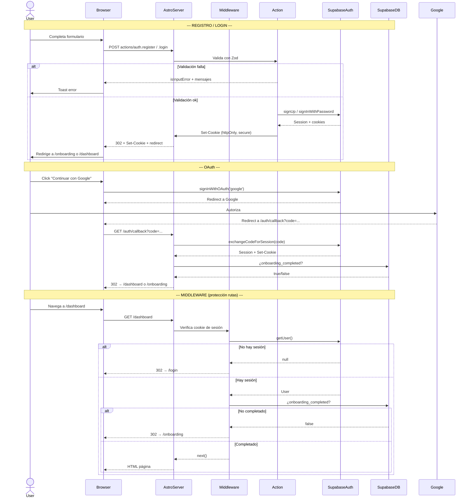

# PLAN-AUTH-001: Plan Técnico — Autenticación

## 1. Stack Tecnológico

| Capa | Tecnología | Versión | Propósito |
|------|-----------|---------|-----------|
| Framework | Astro | ^6.1.6 | SSR, routing, middleware, actions |
| UI Framework | Vue 3 | ^3.4.0 | Componentes interactivos client-side |
| State Management | Pinia | ^2.1.7 | Estado de sesión en cliente |
| Auth Provider | Supabase Auth | — | Registro, login, OAuth, reset password |
| SSR Cookies | @supabase/ssr | ^0.10.2 | Cookies httpOnly server-side |
| Client SDK | @supabase/supabase-js | ^2.39.0 | Cliente OAuth (browser) |
| Validation | Zod (astro:schema) | — | Validación server-side |
| CSS | TailwindCSS v4 | ^4.0.0 | Estilos utilitarios |
| Glass UI | CSS custom properties | — | Glassmorphism design system |
| Toasts | vue-sonner | ^2.0.9 | Feedback al usuario |
| Deployment | Vercel | — | Hosting + Edge Functions |
| Package Manager | pnpm | 9.0.0 | Dependencies |

---

## 2. Arquitectura

### 2.1 Diagrama de Flujo (Mermaid)



### 2.2 Mapa de Rutas

```
/login                  → BaseLayout + LoginForm.vue (client:load)
/register               → BaseLayout + RegisterForm.vue (client:load)
/auth/callback          → Server: exchangeCodeForSession + redirect
/reset-password         → BaseLayout + ResetPasswordForm.vue (client:load)
/dashboard              → AppLayout + DashboardView.vue (PROTECTED)
/onboarding             → BaseLayout + OnboardingForm.vue (PROTECTED)
/library                → PROTECTED
/review                 → PROTECTED
/review/[mode]          → PROTECTED
/results                → PROTECTED
/badges                 → PROTECTED
/profile                → PROTECTED
```

---

## 3. Componentes y Flujo

### 3.1 Árbol de Componentes

```
BaseLayout
├── login.astro
│   └── LoginForm.vue (client:load)
│       ├── GlassCard.vue
│       ├── GlassButton.vue
│       └── OAuthButtons.vue
├── register.astro
│   └── RegisterForm.vue (client:load)
│       ├── GlassCard.vue
│       ├── GlassButton.vue
│       └── OAuthButtons.vue
├── reset-password.astro
│   └── ResetPasswordForm.vue (client:load)
│       ├── GlassCard.vue
│       └── GlassButton.vue
└── auth/callback.astro (server-only)
```

### 3.2 Flujo de Sesión (Cliente)

```
AuthInitializer.vue (mounted en app entrypoint)
  └── useAuthStore.init()
        ├── supabase.auth.getSession() → session, user
        ├── supabase.auth.onAuthStateChange() → listener
        └── loading = false

Logout (useAuthStore.logout())
  ├── actions.auth.logout() → server invalida sesión
  ├── session = null, user = null
  ├── Limpia localStorage (supabase tokens)
  ├── Limpia cookies (sb-*)
  ├── supabase.auth.signOut()
  └── window.location.href = '/login'
```

### 3.3 Flujo de Sesión (Servidor - Middleware)

```
onRequest (middleware/index.ts)
  ├── ¿Ruta de auth (/login, /register)?
  │   ├── createSupabaseClient(request, cookies)
  │   ├── supabase.auth.getUser()
  │   └── if user → redirect('/dashboard')
  ├── ¿Ruta pública? → next()
  ├── ¿Ruta no protegida? → next()
  └── ¿Ruta protegida?
      ├── createSupabaseClient(request, cookies)
      ├── supabase.auth.getUser()
      ├── if error → redirect('/login')
      ├── if !user → redirect('/login')
      ├── if /onboarding → next()
      └── check onboarding_completed
          ├── if false → redirect('/onboarding')
          └── if true → next()
```

---

## 4. Seguridad

### 4.1 Manejo de Sesión

| Medida | Implementación | Archivo |
|--------|---------------|---------|
| Cookies httpOnly | `cookies.set(name, value, { httpOnly: true })` | `src/lib/supabase.ts:110` |
| Secure en producción | `secure: !IS_LOCAL` | `src/lib/supabase.ts:112` |
| SameSite=Lax | `sameSite: 'lax'` | `src/lib/supabase.ts:113` |
| Sesión no expuesta al cliente | Solo PUBLIC_* env vars en cliente | `src/stores/auth.ts:7-9` |
| Token refresh automático | `autoRefreshToken: true` | `src/stores/auth.ts:14` |

### 4.2 RLS (Row Level Security)

Las tablas que dependen de `user_id` deben tener políticas RLS:

```sql
-- user_preferences: cada usuario solo ve/edita sus propias preferencias
CREATE POLICY "users_own_preferences" ON user_preferences
  FOR ALL USING (auth.uid() = user_id);

-- user_stats: cada usuario solo ve/edita sus propias stats
CREATE POLICY "users_own_stats" ON user_stats
  FOR ALL USING (auth.uid() = user_id);

-- user_progress: cada usuario solo ve su progreso
CREATE POLICY "users_own_progress" ON user_progress
  FOR ALL USING (auth.uid() = user_id);

-- user_badges: cada usuario solo ve sus insignias
CREATE POLICY "users_own_badges" ON user_badges
  FOR ALL USING (auth.uid() = user_id);
```

### 4.3 Validación en Doble Capa

| Capa | Validación | Ubicación |
|------|-----------|-----------|
| Cliente (Vue) | Email regex, password length, confirm match | `RegisterForm.vue:19-30` |
| Servidor (Zod) | Email válido, password 8+ chars + mayúscula + número + especial | `actions/index.ts:435-440` |
| Supabase | Unique email, password hash | Server-side |

### 4.4 Security Headers (Middleware After)

```
X-Content-Type-Options: nosniff
X-Frame-Options: DENY
X-XSS-Protection: 1; mode=block
Referrer-Policy: strict-origin-when-cross-origin
Permissions-Policy: camera=(), microphone=(), geolocation=()
```

### 4.5 OWASP Compliance

| OWASP | Medida |
|-------|--------|
| A01 (Broken Access Control) | Middleware protege rutas + RLS en DB |
| A02 (Cryptographic Failures) | httpOnly + Secure cookies |
| A03 (Injection) | Zod validation + Supabase parameterized queries |
| A04 (Insecure Design) | Rate limiting via Supabase |
| A05 (Security Misconfiguration) | Env vars servidor no expuestas |
| A07 (Auth Failures) | Sesión manejada server-side via @supabase/ssr |
| A10 (SSRF) | URL validation en `createSupabaseClient` |

---

## 5. Manejo de Errores

### 5.1 Jerarquía de Error

```
AppError
├── UNAUTHORIZED       → "Tu sesión expiró. Inicia sesión de nuevo."
├── FORBIDDEN          → Mensaje genérico
├── NOT_FOUND          → Mensaje genérico
├── VALIDATION_ERROR   → Mensaje genérico
├── NETWORK_ERROR      → "Sin conexión. Verifica tu internet."
├── INTERNAL_ERROR     → Mensaje genérico
├── SESSION_EXPIRED    → "Tu sesión expiró. Inicia sesión de nuevo."
├── RATE_LIMIT         → "Demasiadas solicitudes. Espera un momento."
└── TIMEOUT            → "La solicitud tardó demasiado. Intenta de nuevo."
```

### 5.2 Mapeo Supabase → AppError

```typescript
function mapSupabaseError(error): AppErrorCode {
  status 401 || code 'PGRST301'           → UNAUTHORIZED
  status 403 || code 'PGRST116'           → FORBIDDEN
  status 404 || code 'PGRST204'           → NOT_FOUND
  status 408                               → TIMEOUT
  status 429                               → RATE_LIMIT
  status 400 + 'invalid login credentials' → UNAUTHORIZED
  status 400 + 'email not confirmed'       → UNAUTHORIZED
  else                                     → INTERNAL_ERROR
}
```

### 5.3 Logging

```typescript
// Server-side logging structure
{
  level: 'ERROR',
  timestamp: ISO string,
  code: AppErrorCode,
  path: '/actions/auth.login',
  detail: 'invalid login credentials'
}
```

### 5.4 Feedback al Usuario

| Situación | Canal | Mensaje |
|-----------|-------|---------|
| Login exitoso | toast.success | "¡Bienvenido de vuelta! Redirigiendo…" |
| Registro exitoso | toast.success | "¡Cuenta creada! Configurando tu perfil…" |
| Login fallido | toast.error | "Email o contraseña incorrectos." |
| Reset enviado | toast.success | "Revisa tu email para restablecer tu contraseña." |
| Password actualizada | toast.success | "Contraseña actualizada." |
| Error de conexión | toast.error | "No se pudo conectar. Verifica tu conexión." |
| Campos incompletos | toast.error | "Completa todos los campos." |

---

## 6. Variables de Entorno

| Variable | Ámbito | Ejemplo |
|----------|--------|---------|
| `PUBLIC_SUPABASE_URL` | Cliente | `https://xxxx.supabase.co` |
| `PUBLIC_SUPABASE_ANON_KEY` | Cliente | `eyJhbGciOi...` |
| `SUPABASE_URL` | Servidor | `https://xxxx.supabase.co` |
| `SUPABASE_ANON_KEY` | Servidor | `eyJhbGciOi...` |

**Nota:** `SUPABASE_URL` y `SUPABASE_ANON_KEY` (sin prefijo PUBLIC_) solo existen en el servidor y se validan al iniciar — rechazan placeholders y URLs no HTTPS/no-local.

---

## 7. Dependencias Externas

| Paquete | Uso |
|---------|-----|
| `@supabase/supabase-js` | Cliente Supabase (browser OAuth + store) |
| `@supabase/ssr` | Cookies SSR server-side |
| `astro:actions` | Server actions con validación Zod |
| `vue-sonner` | Toast notifications |
| `pinia` | Auth store client-side |
