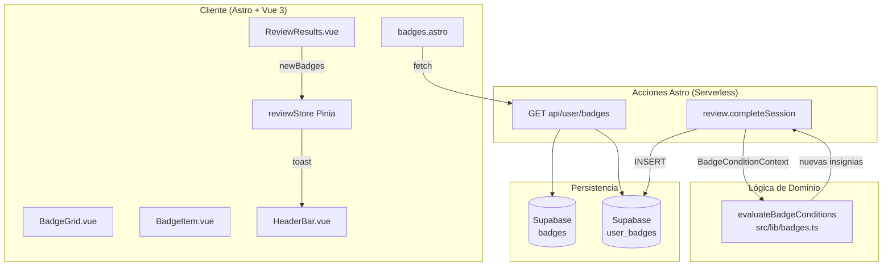
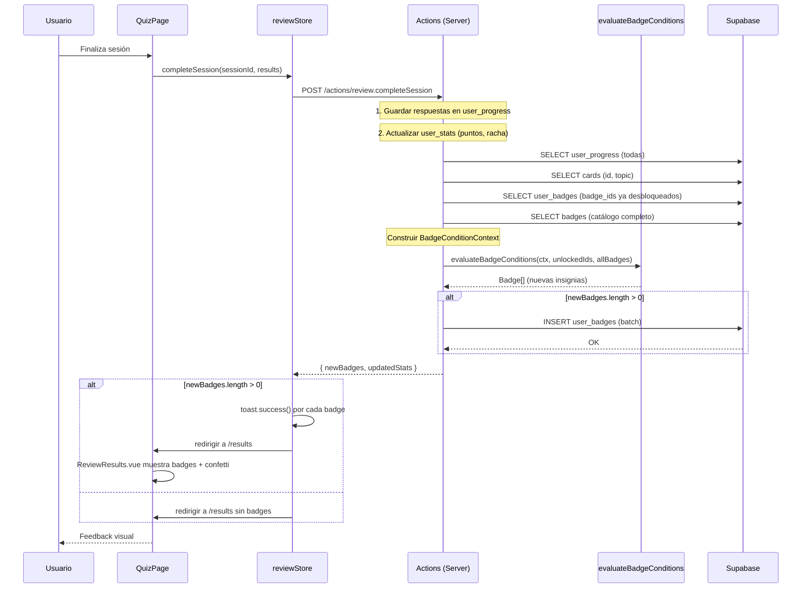
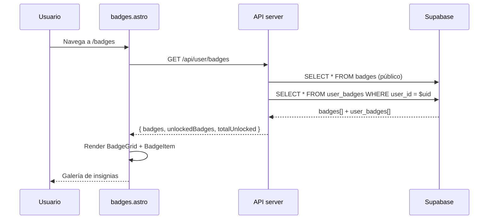

# Plan Técnico: BDG-008 — Sistema de Insignias

## Stack Tecnológico

| Capa | Tecnología | Justificación |
|------|-----------|---------------|
| Frontend | Astro 5 + Vue 3 | Stack existente. Página `/badges` con componente Vue. |
| Estado | Pinia | `reviewStore` ya maneja badge toast y `sessionCompleteResult`. |
| Estilos | TailwindCSS v4 + CSS scoped | Componentes BadgeItem/BadgeGrid ya usan CSS scoped con variables. |
| Backend | Astro Actions + Supabase | `review.completeSession` ya ejecuta `evaluateBadgeConditions`. |
| Base de Datos | Supabase (Postgres 15) | Tablas `badges` y `user_badges` existentes. Único cambio: añadir columna `category` a `badges`. |
| Animación | canvas-confetti 1.9.x | Ya incluido en package.json. Usado en ReviewResults.vue. |
| Toast | vue-sonner | Ya configurado. reviewStore ya usa `toast.success` para insignias. |
| Despliegue | Vercel | Serverless functions para las acciones existentes. |

## Arquitectura



### Flujo de desbloqueo post-sesión



### Flujo de carga de página /badges



## Componentes

### evaluateBadgeConditions (`src/lib/badges.ts`) — YA EXISTE
- **Responsabilidad**: Evaluación pura de condiciones contra contexto del usuario
- **Funciones**: `evaluateBadgeConditions(context, unlockedBadgeIds, allBadges)`
- **Condiciones soportadas**: `first_correct`, `correct_streak`, `total_reviewed`, `daily_streak`, `topic_mastery`, `total_correct`, `perfect_session`, `all_cards_mastery`
- **Dependencias**: `BadgeConditionContext`, `BadgeConditionJson`
- **Notas**: Función pura, sin I/O. Idempotente. Testeable unitariamente.

### reviewStore (Pinia, `src/stores/review.ts`) — YA EXISTE
- **Estado**: `sessionCompleteResult` contiene `newBadges: Badge[]`
- **Acciones**: `completeSession()` ya ejecuta toast por cada badge en `data.data.newBadges`
- **Mejora propuesta**: Almacenar `lastUnlockedBadgeIds` para evitar repetir animación en recarga

### BadgeItem.vue (`src/components/badges/BadgeItem.vue`) — YA EXISTE
- **Props**: `badge: Badge`, `unlockedAt: string | null`
- **Estados**: `locked` (opacidad 0.4 + candado), `unlocked` (borde primario + fecha)
- **Mejora propuesta**: Añadir animación `glow` en el borde cuando es recién desbloqueada (vía prop `justUnlocked`)

### BadgeGrid.vue (`src/components/badges/BadgeGrid.vue`) — YA EXISTE
- **Props**: `badges: Badge[]`, `unlockedBadges: UserBadge[]`
- **Responsabilidad**: Agrupar por nivel (básico/intermedio/avanzado), mostrar contador "X / 9"
- **Estados**: Vacío (EmptyState), con datos (grid 1/2/3 columnas responsive)

### BadgeCelebration.vue — NUEVO
- **Responsabilidad**: Animación de confetti al desbloquear insignias
- **Props**: `badges: Badge[]`, `show: boolean`
- **Comportamiento**: Dispara `canvas-confetti` con 2 tandas (similar a ReviewResults.vue). Se monta en ReviewResults.vue cuando hay newBadges.
- **Accesibilidad**: Respeta `prefers-reduced-motion`. No confetti si está activo.

## Modelo de Datos

### badges (YA EXISTE — añadir columna category)

```mermaid
erDiagram
    BADGES ||--o{ USER_BADGES : desbloquea
    USERS ||--o{ USER_BADGES : posee

    BADGES {
        uuid id PK
        text name UNIQUE
        text description
        text icon "emoji representativo"
        text level "basic | intermediate | advanced"
        jsonb condition "regla de desbloqueo"
        text category "achievement | streak | mastery"
    }

    USER_BADGES {
        uuid id PK
        uuid user_id FK
        uuid badge_id FK
        timestamptz unlocked_at "DEFAULT now()"
    }
```

| Campo | Tipo | Restricciones |
|-------|------|---------------|
| id | UUID | PK, DEFAULT gen_random_uuid() |
| name | TEXT | NOT NULL, UNIQUE |
| description | TEXT | NOT NULL |
| icon | TEXT | NOT NULL |
| level | TEXT | NOT NULL, CHECK IN ('basic', 'intermediate', 'advanced') |
| condition | JSONB | NOT NULL |
| category | TEXT | NULLABLE, CHECK IN ('achievement', 'streak', 'mastery') |

### user_badges (YA EXISTE)

| Campo | Tipo | Restricciones |
|-------|------|---------------|
| id | UUID | PK, DEFAULT gen_random_uuid() |
| user_id | UUID | NOT NULL, FK → auth.users, ON DELETE CASCADE |
| badge_id | UUID | NOT NULL, FK → badges, ON DELETE CASCADE |
| unlocked_at | TIMESTAMPTZ | NOT NULL, DEFAULT now() |

**Unique constraint**: `UNIQUE (user_id, badge_id)` — garantiza idempotencia a nivel BD.

### Índices (YA EXISTEN)
```sql
CREATE INDEX IF NOT EXISTS idx_user_badges_user_id ON user_badges (user_id);
-- PK ya cubre (user_id, badge_id) vía unique constraint
```

### Migración: añadir columna category
```sql
ALTER TABLE badges ADD COLUMN IF NOT EXISTS category TEXT CHECK (category IN ('achievement', 'streak', 'mastery'));

-- Actualizar seed data con categorías
UPDATE badges SET category = 'achievement' WHERE name IN ('Primer paso', 'Estudioso', 'Centurión', 'Perfeccionista');
UPDATE badges SET category = 'streak' WHERE name IN ('En racha', 'Semana de fuego');
UPDATE badges SET category = 'mastery' WHERE name IN ('Experto JS', 'Maestro TS', 'Maestro total');
```

### RLS Policies (YA EXISTEN)
```sql
-- badges: solo SELECT para authenticated
CREATE POLICY "badges_read_authenticated"
  ON badges FOR SELECT TO authenticated USING (true);

-- user_badges: cada usuario solo ve/modifica sus propios registros
CREATE POLICY "user_badges_own"
  ON user_badges FOR ALL TO authenticated
  USING (auth.uid() = user_id)
  WITH CHECK (auth.uid() = user_id);
```

## Evaluación de Condiciones Post-Sesión

La evaluación se ejecuta dentro de `review.completeSession` en el servidor. Flujo detallado:

```
1. Guardar respuestas de la sesión en user_progress
2. Actualizar user_stats (puntos, racha diaria)
3. Consultar datos para BadgeConditionContext:
   a. SELECT user_progress (todas las filas del usuario) → totalReviewed, correctAnswers
   b. SELECT cards → topicProgress (total por topic)
   c. SELECT user_badges → unlockedIds (para idempotencia)
   d. SELECT badges → allBadges (catálogo completo)
4. Construir BadgeConditionContext:
   {
     totalReviewed,
     correctAnswers,
     currentStreak,      // del streakService
     correctStreak,       // racha máxima DENTRO de la sesión actual
     sessionCorrect,      // de la sesión actual
     sessionTotal,        // de la sesión actual
     topicProgress        // { topic: { reviewed, total } }
   }
5. Ejecutar evaluateBadgeConditions(ctx, unlockedIds, allBadges)
6. Si hay nuevas, INSERT batch en user_badges
7. Incluir newBadges en la respuesta a completeSession
```

### Idempotencia
- `evaluateBadgeConditions` filtra badges ya desbloqueados por `unlockedIds`
- Constraint `UNIQUE (user_id, badge_id)` en BD evita duplicados en caso de race condition

## Animación de Celebración

### Confetti (ReviewResults.vue — YA EXISTE para score >= 80%)
- `canvas-confetti` se dispara en `onMounted` si `percentage >= 80`
- Dos tandas: 120 partículas al centro + 60 a cada lado (delay 250ms)
- Respeta `prefers-reduced-motion`

### Glow en badges recién desbloqueadas (NUEVO)
- BadgeItem.vue recibe prop `justUnlocked: boolean`
- Cuando es `true`, se aplica animación CSS `@keyframes glow` en el borde
- Duración: 2 segundos, se autodesactiva después

### Toast (reviewStore — YA EXISTE)
- `toast.success('🏆 ¡Nueva insignia! {icon} {name}')` por cada badge
- Se ejecuta en el store antes de navegar a /results

## Seguridad

- **Autenticación**: Todas las acciones requieren JWT válido (middleware de Astro existente)
- **Autorización**: RLS policies garantizan que cada usuario solo ve/modifica sus propios `user_badges`
- **Catálogo público**: `badges` es SELECT para cualquier authenticated user
- **Validación**: El servidor construye el `BadgeConditionContext` desde datos reales de BD (no se confía en datos del cliente)

## Tests

| Tipo | Archivo | Cobertura |
|------|---------|-----------|
| Unitarios | `tests/unit/badges.test.ts` | YA EXISTE: 8 condiciones, idempotencia, edge cases |
| E2E | `tests/e2e/badges.spec.ts` | YA EXISTE: unlocked count, locked state, date display, level grouping, "Primer paso" flow, toast |
| E2E | Playwright — confetti | Verificar que canvas-confetti se llama con `particleCount >= 80` al desbloquear badge |
| E2E | Playwright — accesibilidad | prefers-reduced-motion: no confetti. Teclado navegable en galería. |
