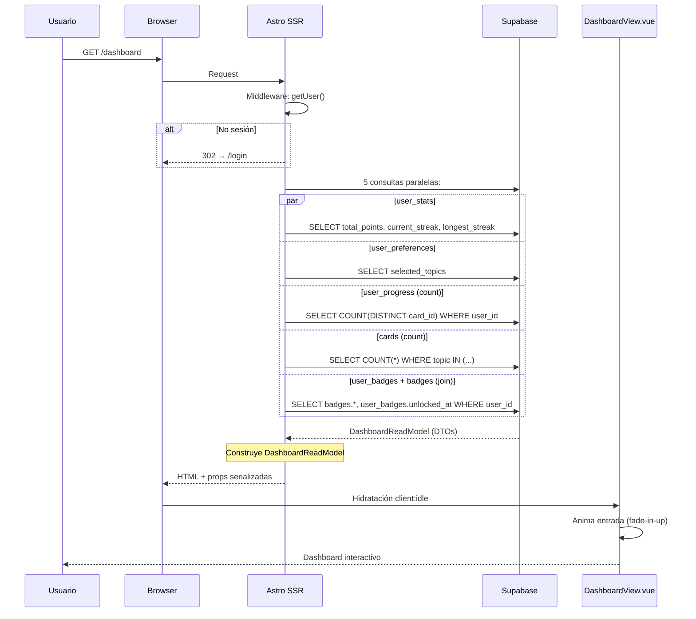
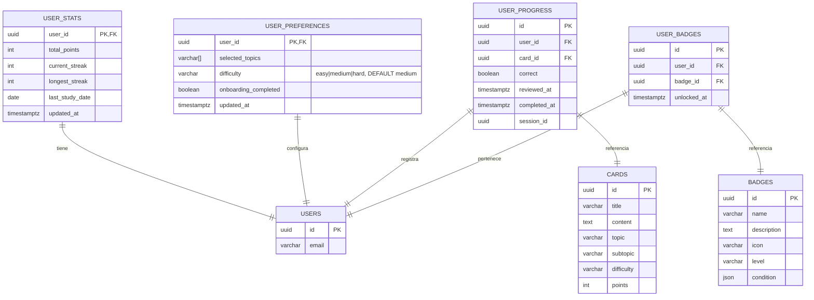

# PLAN-DSH-007: Plan Técnico — Dashboard Principal

## 1. Stack Tecnológico

| Capa | Tecnología | Versión | Propósito |
|------|-----------|---------|-----------|
| Framework | Astro | ^6.1.6 | SSR, routing, middleware |
| UI Framework | Vue 3 | ^3.4.0 | Componente interactivo DashboardView |
| State Management | Pinia | ^2.1.7 | Estado global (no necesario para dashboard, usa props SSR) |
| DB | Supabase (Postgres) | — | Tablas: user_stats, user_progress, user_preferences, user_badges, badges |
| CSS | TailwindCSS v4 + CSS scoped | ^4.0.0 | Estilos utilitarios + variables de tema |
| Glass UI | CSS custom properties | — | Glassmorphism design system |
| Validation | Zod (astro:schema) | — | Validación server-side |
| Deployment | Vercel | — | SSR con `@astrojs/vercel` |
| Testing | Vitest + Playwright | — | Unit + E2E |

## 2. Arquitectura

### 2.1 Diagrama de Arquitectura (C4-style)

```mermaid
graph TD
    subgraph "Browser"
        V1[DashboardView.vue<br/>client:idle]
    end

    subgraph "Astro SSR"
        P1[dashboard.astro]
        M1[Middleware:<br/>verifica sesión]
    end

    subgraph "Read Model Service"
        R1[getDashboardData<br/>consultas paralelas]
    end

    subgraph "Supabase"
        S1[(user_stats)]
        S2[(user_preferences)]
        S3[(user_progress)]
        S4[(user_badges)]
        S5[(badges)]
        S6[(cards)]
    end

    subgraph "Bounded Contexts (origen de datos)"
        BC1[Gamification<br/>puntos, racha]
        BC2[CardCatalog<br/>progreso tarjetas]
        BC3[Badges<br/>insignias]
    end

    U[Usuario] -->|GET /dashboard| M1
    M1 -->|302 si no sesión| U
    M1 -->|next()| P1
    P1 --> R1
    R1 -->|query 1| S1
    R1 -->|query 2| S2
    R1 -->|query 3| S3
    R1 -->|query 4| S6
    R1 -->|query 5| S4
    R1 -->|join| S5
    R1 -->|DashboardReadModel| P1
    P1 -->|props serializadas| V1
    V1 --> U

    BC1 -.->|origen| S1
    BC2 -.->|origen| S3
    BC2 -.->|origen| S6
    BC3 -.->|origen| S4
    BC3 -.->|origen| S5
```

### 2.2 Secuencia SSR → Hidratación



### 2.3 Mapa de Rutas

```
/dashboard              → AppLayout + DashboardView.vue (client:idle, PROTECTED)
/review                 → PROTECTED
/library                → PROTECTED
/badges                 → PROTECTED
```

## 3. Read Model CQRS

### 3.1 DashboardReadModel

```typescript
interface DashboardReadModel {
  userId: string
  greeting: {
    timeGreeting: string  // "Buenos días" | "Buenas tardes" | "Buenas noches"
    userName: string
    full: string          // "Buenos días, Juan 👋"
  }
  points: number
  streak: {
    current: number       // user_stats.current_streak
    longest: number       // user_stats.longest_streak
  }
  progress: {
    reviewed: number      // COUNT(DISTINCT card_id) FROM user_progress
    total: number         // COUNT(*) FROM cards WHERE topic IN user_topics
    percentage: number    // 0-100
  }
  badges: BadgeDTO[]
  quickActions: QuickAction[]
}
```

### 3.2 Consultas del Read Model (SSR en dashboard.astro)

| Query | Tabla | Propósito | Tiempo estimado |
|-------|-------|-----------|-----------------|
| Q1 | user_stats | total_points, current_streak, longest_streak | < 50ms |
| Q2 | user_preferences | selected_topics del usuario | < 50ms |
| Q3 | user_progress | COUNT(DISTINCT card_id) repasadas | < 100ms |
| Q4 | cards | COUNT(*) WHERE topic IN (selected_topics) | < 100ms |
| Q5 | user_badges + badges (join) | Todas las insignias desbloqueadas | < 100ms |

Todas las queries se ejecutan en paralelo con `Promise.all`. Tiempo total estimado: < 300ms.

### 3.3 Integración con Eventos

El Dashboard NO genera eventos. Consume eventos de otros bounded contexts para eventual refresco:

| Evento | Origen | Acción |
|--------|--------|--------|
| `PointsAwarded` | Gamification | Refrescar totalPoints (futuro: revalida SSR) |
| `StreakUpdated` | Gamification | Refrescar streak |
| `BadgeUnlocked` | Badges | Refrescar insignias |
| `SessionCompleted` | ReviewSession | Refrescar progreso |

Actualmente no hay invalidación en cliente — el usuario recarga o vuelve a `/dashboard` para datos frescos.

## 4. Componentes Vue

### 4.1 Árbol de Componentes

```
dashboard.astro (SSR)
  └── DashboardView.vue (client:idle)
        ├── GlassCard.vue          (estadísticas, progreso, acciones)
        ├── GlassButton.vue        (botones CTA)
        ├── BadgeItem.vue          (cada insignia)
        ├── SkeletonLoader.vue     (carga inicial)
        └── EmptyState.vue         (sin insignias)
```

### 4.2 DashboardView.vue (ya existe — refactor parcial)

| Prop | Tipo | Default | Origen |
|------|------|---------|--------|
| `totalPoints` | number | 0 | Q1 → user_stats.total_points |
| `currentStreak` | number | 0 | Q1 → user_stats.current_streak |
| `longestStreak` | number | 0 | Q1 → user_stats.longest_streak |
| `cardsToday` | number | 0 | Q3 → user_progress |
| `uniqueReviewed` | number | 0 | Q3 → DISTINCT count |
| `totalCards` | number | 0 | Q4 → cards count |
| `userEmail` | string | '' | Supabase Auth user.email |
| `allBadges` | BadgeDTO[] | [] | Q5 → user_badges + badges join |
| `loading` | boolean | false | Controla skeleton |

### 4.3 Comportamientos

| Comportamiento | Detalle |
|---------------|---------|
| Saludo | `greeting` computed: franja horaria + nombre desde email |
| Progreso | `progressPercent` computed: `Math.round(reviewed / total * 100)`, 0 si total=0 |
| Streak label | "🔥 [N] días", "1 día" singular, "—" si 0 |
| Skeleton | `loading=true` muestra SkeletonLoader, luego fade-in-up con delay escalonado |
| Badges vacío | `allBadges.length === 0` → EmptyState con CTA a `/review` |
| Animaciones | fade-in-up con `animation-delay` 0ms, 100ms, 150ms, 200ms escalonado |

## 5. Flujo de Datos

```
Servidor (Astro SSR)
  1. Middleware verifica sesión → getUser()
  2. dashboard.astro ejecuta 5 queries en paralelo
  3. Construye DashboardReadModel con DTOs
  4. Pasa props serializadas al template

Cliente (Vue 3 + client:idle)
  5. DashboardView recibe props, loading=false
  6. Computed properties: greeting, progressPercent, streakLabel
  7. Renderiza: saludo → stats grid → progreso → badges → acciones
  8. Animación fade-in-up secuencial en stat-cards

Interacción
  9. Clic "Continuar estudiando" → window.location.href = '/review'
  10. Clic "Ir a biblioteca" → window.location.href = '/library'
```

## 6. Modelo de Datos (ERD)



## 7. Seguridad

| Medida | Implementación |
|--------|---------------|
| Protección de ruta | Middleware `getUser()` → 302 si no hay sesión |
| RLS user_stats | `auth.uid() = user_id` — cada usuario solo ve sus stats |
| RLS user_badges | `auth.uid() = user_id` — cada usuario solo ve sus badges |
| RLS user_progress | `auth.uid() = user_id` — cada usuario solo ve su progreso |
| RLS user_preferences | `auth.uid() = user_id` — cada usuario solo ve sus preferencias |
| Datos no expuestos | Props SSR solo contienen DTOs, nunca tokens ni secrets |

## 8. Rendimiento

| Métrica | Objetivo | Estrategia |
|---------|----------|------------|
| SSR queries | < 300ms total | 5 queries en paralelo con `Promise.all` |
| Hydration | client:idle (no bloquea LCP) | Islands architecture |
| CLS | < 0.1 | min-height fijo en contenedores, skeleton loader |
| LCP | < 2.5s | HTML estático servido primero, Vue hidrata después |
| Bundle | < 30kB (DashboardView) | Sin dependencias pesadas, solo Vue + componentes locales |
| Animaciones | GPU aceleradas | `transform` + `opacity`, no animar `width` directly (solo barra) |

## 9. Manejo de Errores SSR

Cada query SSR captura error individualmente. Si falla una, las demás continúan:

```typescript
const [statsResult, prefsResult, reviewedResult, totalResult, badgesResult] =
  await Promise.all([
    supabase.from('user_stats').select('...').eq('user_id', user.id).maybeSingle(),
    supabase.from('user_preferences').select('selected_topics').eq('user_id', user.id).single(),
    supabase.from('user_progress').select('card_id', { count: 'exact', head: true }).eq('user_id', user.id),
    supabase.from('cards').select('id', { count: 'exact', head: true }).in('topic', topics),
    supabase.from('user_badges').select('*, badges(*)').eq('user_id', user.id),
  ])

// Cada error se loggea individualmente sin bloquear las demás queries
// Los valores fallidos se reemplazan por defaults (0, [])
```

## 10. Variables de Entorno

| Variable | Ámbito | Propósito |
|----------|--------|-----------|
| `PUBLIC_SUPABASE_URL` | Cliente | URL de Supabase |
| `PUBLIC_SUPABASE_ANON_KEY` | Cliente | Anon key pública |
| `SUPABASE_URL` | Servidor | URL de Supabase (validada) |
| `SUPABASE_ANON_KEY` | Servidor | Anon key servidor (validada) |
