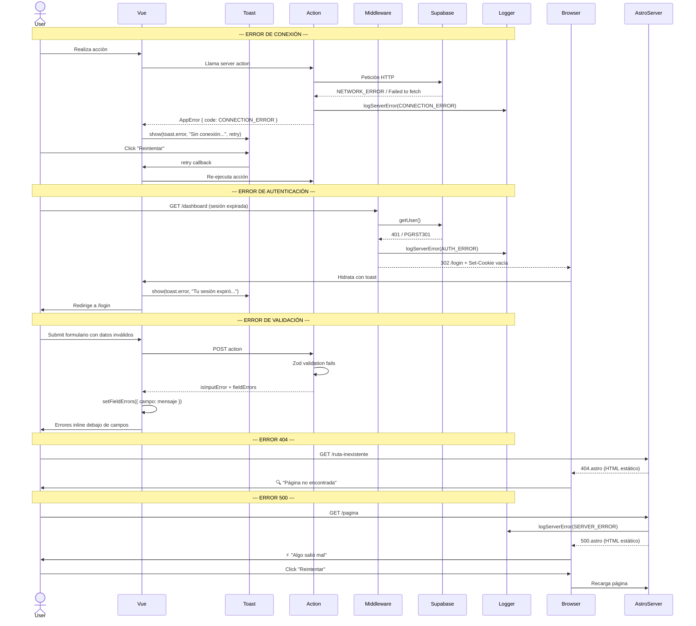
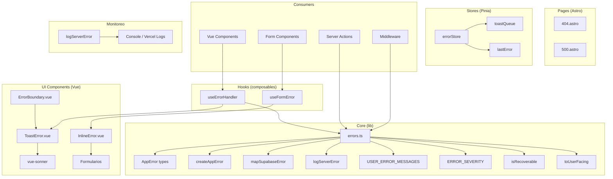

# PLAN-ERRORS-013: Plan Técnico — Manejo de Errores y Estados de Conexión

## 1. Stack Tecnológico

| Capa | Tecnología | Versión | Propósito |
|------|-----------|---------|-----------|
| Framework | Astro | ^6.1.6 | SSR, routing, middleware, server actions |
| UI Framework | Vue 3 | ^3.4.0 | Componentes interactivos client-side |
| State Management | Pinia | ^2.1.7 | Estado global de errores |
| Toast | vue-sonner | ^2.0.9 | Toasts no bloqueantes |
| Client SDK | @supabase/supabase-js | ^2.39.0 | Cliente Supabase |
| Validation | Zod | — | Validación server-side |
| CSS | TailwindCSS v4 | ^4.0.0 | Estilos utilitarios |
| Glass UI | CSS custom properties | — | Glassmorphism design system |
| Deployment | Vercel | — | Hosting + Edge Functions |
| Package Manager | pnpm | 9.0.0 | Dependencies |

---

## 2. Arquitectura

### 2.1 Diagrama de Flujo de Error (Mermaid)



### 2.2 Diagrama de Componentes



### 2.3 Mapa de Rutas

```
/404.astro            → BaseLayout + HTML estático (🔍 + botón)
/500.astro            → BaseLayout + HTML estático (⚡ + botones)
/*                    → Astro redirige a 404.astro si no existe ruta
```

---

## 3. Componentes y Flujo

### 3.1 Árbol de Componentes

```
BaseLayout
├── 404.astro
│   └── (HTML estático: 🔍, título, descripción, botón)
├── 500.astro
│   └── (HTML estático: ⚡, título, descripción, botones)
└── ErrorBoundary.vue (envuelve contenido dinámico Vue)
    └── ToastError.vue (slot, maneja errores del hijo)

AppLayout
├── ErrorBoundary.vue
└── ... (contenido de la app)

Formularios (RegisterForm, LoginForm, etc.)
├── InlineError.vue (por campo)
└── ToastError.vue (errores no-validación)
```

### 3.2 Flujo de Error Global (Pinia Store)

```
errorStore
├── lastError: AppError | null
├── toastQueue: Array<{ id, error, retry? }>
├── showError(error, retry?)
│   ├── Agrega a toastQueue
│   ├── Muestra toast vía vue-sonner
│   └── Si recoverable → botón Reintentar
├── dismissError(id)
│   └── Remueve de toastQueue
└── clearAll()
```

### 3.3 useErrorHandler (Composable)

```typescript
function useErrorHandler() {
  function handleError(error: unknown, retry?: () => void): void
  function handleActionError(result: ActionError, retry?: () => void): void
  function mapAndShow(error: SupabaseError, retry?: () => void): void
  function wrapAsync<T>(fn: () => Promise<T>): Promise<T | undefined>

  return { handleError, handleActionError, mapAndShow, wrapAsync }
}
```

### 3.4 useFormError (Composable)

```typescript
function useFormError() {
  const fieldErrors: Ref<Record<string, string[]>>
  
  function setFieldErrors(errors: Record<string, string[]>): void
  function getFieldError(field: string): string | undefined
  function clearFieldErrors(): void
  function handleValidationError(result: { fieldErrors?: Record<string, string[]> }): void

  return { fieldErrors, setFieldErrors, getFieldError, clearFieldErrors, handleValidationError }
}
```

### 3.5 Flujo de Error en Server Actions

```
1. Action recibe datos → Zod validation
2. Si validation falla → retorna isInputError + fieldErrors
   └── Vue muestra InlineError debajo de cada campo
3. Si Supabase falla → mapSupabaseError() traduce
4. createAppError(code, detail, path)
5. logServerError(appError)
6. Retorna { success: false, error: AppError }
   └── Vue recibe → toast o redirect según code
```

### 3.6 Flujo de Error en Middleware

```
1. Middleware detecta sesión inválida / error de getUser()
2. mapSupabaseError(error)
3. createAppError(code, 'Auth error', path)
4. logServerError(appError)
5. Redirige a /login + Set-Cookie vacía + toast en query param ?toast=session_expired
   └── LoginForm.vue lee query param y muestra toast
```

---

## 4. Seguridad

### 4.1 Protección de Información Sensible

| Medida | Implementación | Archivo |
|--------|---------------|---------|
| Stack traces nunca en UI | `toUserFacing()` filtra detail y path | `src/lib/errors.ts` |
| Errores Supabase mapeados | `mapSupabaseError()` antes de cualquier response | `src/lib/errors.ts` |
| Errores de validación no exponen lógica interna | Mensajes definidos en Zod, no en crudo | `src/actions/index.ts` |
| Logs con detalle técnico solo server-side | `logServerError()` solo se llama en servidor | `src/lib/errors.ts` |
| Código de error no revela infraestructura | Códigos semánticos (AUTH_ERROR, no DB_ERROR) | `src/lib/errors.ts` |

### 4.2 OWASP Compliance

| OWASP | Medida |
|-------|--------|
| A01 (Broken Access Control) | AUTH_ERROR redirige a login |
| A02 (Cryptographic Failures) | No se exponen tokens en errores |
| A05 (Security Misconfiguration) | Stack traces desactivados en producción |
| A07 (Auth Failures) | Sesión expirada detectada y manejada |
| A10 (SSRF) | URL de Supabase validada antes de errores |

---

## 5. Manejo de Errores

### 5.1 Jerarquía de Error

```
AppError
├── CONNECTION_ERROR    → Toast + Reintentar   → "Sin conexión. Verifica tu internet."
├── SERVER_ERROR        → Toast + Reintentar   → "Error del servidor. Intenta de nuevo."
├── AUTH_ERROR          → Toast + Redirect     → "Tu sesión expiró. Inicia sesión de nuevo."
├── VALIDATION_ERROR    → Inline               → Mensaje específico del campo
├── RATE_LIMIT          → Toast + Reintentar   → "Demasiadas solicitudes. Espera un momento."
├── TIMEOUT             → Toast + Reintentar   → "La solicitud tardó demasiado. Intenta de nuevo."
└── NOT_FOUND           → Página 404           → "Página no encontrada"
```

### 5.2 Mapeo Supabase → AppError

```typescript
function mapSupabaseError(error): AppErrorCode {
  null/undefined                           → SERVER_ERROR
  'NETWORK_ERROR' / 'Failed to fetch'      → CONNECTION_ERROR
  status 401 / code 'PGRST301'             → AUTH_ERROR
  status 403 / code 'PGRST116'             → AUTH_ERROR
  status 404 / code 'PGRST204'             → NOT_FOUND
  status 408                               → TIMEOUT
  status 429                               → RATE_LIMIT
  status 422 / 400                         → VALIDATION_ERROR
  rest                                     → SERVER_ERROR
  // 400 con credenciales inválidas o email no confirmado
  status 400 + 'invalid login credentials'  → AUTH_ERROR
  status 400 + 'email not confirmed'        → AUTH_ERROR
}
```

### 5.3 Logging Server-Side

```typescript
function logServerError(error: AppError): void {
  console.error(JSON.stringify({
    level: error.code === 'SERVER_ERROR' ? 'CRITICAL' : 'ERROR',
    timestamp: error.timestamp,
    code: error.code,
    path: error.path,
    detail: error.detail,
  }))
}
```

### 5.4 Feedback al Usuario

| Situación | Canal | Mensaje | Duración |
|-----------|-------|---------|----------|
| Sin conexión | toast.error | "Sin conexión. Verifica tu internet." | 8s + Reintentar |
| Error del servidor | toast.error | "Error del servidor. Intenta de nuevo." | 8s + Reintentar |
| Sesión expirada | toast.error | "Tu sesión expiró. Inicia sesión de nuevo." | 8s + Redirect |
| Datos inválidos | inline | Según campo | Persistente |
| Rate limit | toast.error | "Demasiadas solicitudes. Espera un momento." | 8s + Reintentar |
| Timeout | toast.error | "La solicitud tardó demasiado. Intenta de nuevo." | 8s + Reintentar |
| 404 | Página | "Página no encontrada" | — |
| 500 | Página | "Algo salió mal" | — |
| Operación exitosa | toast.success | Mensaje contextual | 3s |

### 5.5 Componentes UI

#### ToastError.vue

```vue
<script setup lang="ts">
// Props: error (AppError), retry (() => void, opcional)
// Comportamiento:
//   - Muestra toast con vue-sonner
//   - Si isRecoverable → agrega botón "Reintentar"
//   - Si AUTH_ERROR → after toast, redirect a /login
//   - Duración: 8s para error, 3s para success
//   - Sin stack trace, sin detail técnico
</script>
```

#### InlineError.vue

```vue
<script setup lang="ts">
// Props: message (string), field (string, opcional para aria-describedby)
// Comportamiento:
//   - Renderiza <p> con mensaje de error
//   - role="alert" + aria-live="polite"
//   - aria-describedby vinculado al input por field prop
//   - Clase CSS para color rojo/anaranjado del design system
</script>
```

#### ErrorBoundary.vue

```vue
<script setup lang="ts">
// Envuelve contenido Vue
// Captura errores de componentes hijos
// Muestra toast con SERVER_ERROR genérico
// No rompe el layout del resto de la página
</script>
```

---

## 6. Variables de Entorno

No se requieren variables de entorno nuevas. El sistema de errores usa las existentes.

---

## 7. Dependencias Externas

| Paquete | Uso | Ya existe |
|---------|-----|-----------|
| `vue-sonner` | Toast notifications | Sí (en ToasterWrapper.vue) |
| `pinia` | Error store | Sí (en entrypoint.ts) |
| `astro:actions` | Server actions | Sí |
| `@supabase/supabase-js` | Cliente Supabase | Sí |
| `zod` | Validación server-side | Sí |

No se requieren nuevas dependencias externas. Todo se implementa con el stack existente.
