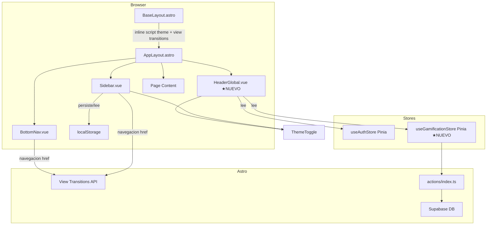

# PLAN-LAYOUT-012: Plan Técnico — Layout y navegación responsiva

## 1. Stack Tecnológico

| Capa | Tecnología | Versión | Propósito |
|------|-----------|---------|-----------|
| Framework | Astro 5 | ^6.1.6 | SSR + View Transitions + layouts anidados |
| UI Framework | Vue 3 | ^3.4.0 | Componentes reactivos (BottomNav, Sidebar, HeaderGlobal) |
| State | Pinia | ^2.1.0 | auth store (sesión) + gamification store (stats) |
| CSS | TailwindCSS v4 | ^4.0.0 | Responsive breakpoints `lg:1024px`, layout grid |
| Persistencia local | localStorage | — | `sidebar-collapsed` key |
| Routing | Astro file-based + View Transitions | — | Navegación SPA con transiciones |

**Nota:** No se requieren nuevas dependencias. Todo el stack ya está en el proyecto.

---

## 2. Arquitectura

### 2.1 Diagrama de Flujo (Mermaid)



### 2.2 Diagrama de Breakpoints Responsivos

```mermaid
flowchart LR
    subgraph Mobile [< 1024px]
        direction TB
        M1[HeaderGlobal<br/>📊 stats + toggle]
        M2[BottomNav<br/>🏠 📚 🔄 🏆 👤]
        M3[Main Content<br/>padding-bottom: 80px]
    end

    subgraph Desktop [>= 1024px]
        direction TB
        D1[HeaderGlobal<br/>📊 stats + toggle]
        D2[Sidebar 220px | 64px collapsable]
        D3[Main Content<br/>flex-1]
    end

    Breakpoint{1024px} -->|width < 1024| Mobile
    Breakpoint -->|width >= 1024| Desktop
```

### 2.3 Mapa de Archivos Afectados

```
src/
├── layouts/
│   └── AppLayout.astro              ← MODIFICAR: cambiar breakpoint md→lg, agregar HeaderGlobal, View Transitions
├── components/
│   ├── layout/
│   │   ├── Sidebar.vue              ← ✅ YA IMPLEMENTADO (persiste estado, toggle, stats faltan)
│   │   ├── BottomNav.vue             ← ✅ YA IMPLEMENTADO (iconos, active state ok)
│   │   ├── HeaderGlobal.vue          ← ★ NUEVO: logo, puntos, racha, toggle tema
│   │   └── Dashboard.vue             ← ✅ YA EXISTE (no tocar, solo consume)
│   └── ui/
│       └── ThemeToggle.vue           ← ✅ YA EXISTE (importado en HeaderGlobal + Sidebar)
├── stores/
│   ├── auth.ts                       ← ✅ YA EXISTE
│   └── gamification.ts               ← ★ NUEVO: totalPoints, currentStreak reactivos
├── types/
│   └── app.ts                        ← MODIFICAR: agregar HeaderStats
├── pages/
│   └── *.astro                       ← ✅ YA EXISTEN (usan AppLayout)
├── composables/
│   ├── useTheme.ts                   ← ✅ YA EXISTE
│   └── useSidebar.ts                 ← ★ NUEVO: lógica de estado colapsable
├── styles/
│   └── global.css                    ← MODIFICAR: padding-bottom para bottom nav
│   └── transitions.css               ← ★ NUEVO: estilos View Transitions
└── actions/
    └── index.ts                      ← MODIFICAR: getUserStats action si no existe
```

---

## 3. Estrategia de Breakpoint

### 3.1 Punto de Corte: 1024px (lg de Tailwind)

| Rango | Componentes visibles | Comportamiento |
|-------|---------------------|----------------|
| < 1024px | HeaderGlobal + BottomNav | Sidebar oculto (display: none) |
| >= 1024px | HeaderGlobal + Sidebar | BottomNav oculto (display: none) |

### 3.2 Actualización necesaria en AppLayout.astro

El layout actual usa `md:flex` / `md:hidden` con breakpoint 768px. Debe cambiarse a `lg:flex` / `lg:hidden` para alinear con el user story (1024px).

```astro
<!-- Antes -->
<div class="hidden md:flex">    <!-- Sidebar visible desde 768px -->
<div class="flex md:hidden">    <!-- BottomNav oculto desde 768px -->

<!-- Después -->
<div class="hidden lg:flex">    <!-- Sidebar visible desde 1024px -->
<div class="flex lg:hidden">    <!-- BottomNav oculto desde 1024px -->
```

---

## 4. HeaderGlobal — Especificación

### 4.1 Layout

```
┌──────────────────────────────────────────────────────┐
│ 🧠 MicroLearn           ⭐ 1,240    🔥 7     [🌙/☀️] │
└──────────────────────────────────────────────────────┘
```

- Fijo en la parte superior, z-index 40
- Altura: 56px (h-14)
- Glassmorphism consistente con el sistema de diseño
- Padding horizontal responsive: px-4 md:px-6 lg:px-8

### 4.2 Datos que consume

| Dato | Fuente | Tipo |
|------|--------|------|
| Logo + nombre | Hardcoded | string |
| totalPoints | useGamificationStore | number |
| currentStreak | useGamificationStore | number |
| ThemeMode | useTheme composable | 'light'\|'dark' |

### 4.3 Comportamiento

- Stats se muestran como "⭐ {puntos}" y "🔥 {racha}"
- Si los stats aún no cargan, mostrar SkeletonLoader de 40px
- Si el usuario no está autenticado, ocultar stats (mostrar solo logo + toggle)
- El toggle de tema es el mismo ThemeToggle.vue existente

---

## 5. Persistencia Sidebar State

### 5.1 Estrategia

| Capa | Mecanismo | Key | Tiempo |
|------|-----------|-----|--------|
| Cliente | localStorage | `sidebar-collapsed` | Persistente entre sesiones |
| Sesión | Memoria (ref de Vue) | — | Mientras dura la página |

### 5.2 Flujo

```
Carga página
  → onMounted: localStorage.getItem('sidebar-collapsed')
    → 'true' → collapsed = true
    → null/'false' → collapsed = false (default expandido)

Toggle click
  → collapsed = !collapsed
  → localStorage.setItem('sidebar-collapsed', collapsed)
  → CSS transition width 220px ↔ 64px
```

### 5.3 Estado actual

Sidebar.vue ya implementa persistencia en localStorage con la key `sidebar-collapsed`. No requiere cambios.

---

## 6. View Transitions

### 6.1 Configuración en Astro

```astro
---
// AppLayout.astro
import { ViewTransitions } from 'astro:transitions'
---
<html>
<head>
  <ViewTransitions />
</head>
```

### 6.2 Estilos de Transición

```css
/* transitions.css */
html {
  view-transition-name: none;
}

@keyframes fade-in {
  from { opacity: 0; transform: translateY(8px); }
  to { opacity: 1; transform: translateY(0); }
}

@keyframes fade-out {
  from { opacity: 1; }
  to { opacity: 0; }
}

::view-transition-old(root) {
  animation: fade-out 150ms ease;
}

::view-transition-new(root) {
  animation: fade-in 200ms ease;
}
```

### 6.3 Comportamiento

- Los enlaces del sidebar y bottom nav usan `<a href="...">` nativos de HTML
- Astro intercepta la navegación y aplica la transición
- Si el navegador no soporta View Transitions, fallback a navegación normal

---

## 7. Store de Gamificación (Nuevo)

```typescript
// src/stores/gamification.ts
import { defineStore } from 'pinia'
import { ref } from 'vue'
import { actions } from 'astro:actions'

export const useGamificationStore = defineStore('gamification', () => {
  const totalPoints = ref(0)
  const currentStreak = ref(0)
  const loading = ref(true)

  async function fetchStats(userId: string) {
    loading.value = true
    try {
      const result = await actions.auth.getUserStats({ userId })
      if (result.data?.success) {
        totalPoints.value = result.data.stats.totalPoints
        currentStreak.value = result.data.stats.currentStreak
      }
    } catch {
      // Silencioso — stats se quedan en 0
    } finally {
      loading.value = false
    }
  }

  return { totalPoints, currentStreak, loading, fetchStats }
})
```

---

## 8. Componentes y Flujo

### 8.1 Árbol de Componentes

```
BaseLayout.astro
└── AppLayout.astro (con ViewTransitions)
    ├── HeaderGlobal.vue (client:idle)
    │   └── ThemeToggle.vue
    ├── Sidebar.vue (lg:flex, client:idle)  [desktop]
    │   └── ThemeToggle.vue
    ├── <slot /> (page content)
    └── BottomNav.vue (lg:hidden, client:idle)  [mobile]
```

### 8.2 Flujo de Navegación

```
User click en enlace (sidebar o bottom nav)
  → <a href="/dashboard"> nativo
  → Astro View Transitions intercepta
  → Transición fade-out → fade-in
  → Nueva página renderizada sin recarga
  → Enlace activo actualizado vía window.location.pathname
```

### 8.3 Flujo de Stats en Header

```
AppLayout monta HeaderGlobal (client:idle)
  → onMounted: useGamificationStore.fetchStats(userId)
  → fetchStats llama actions.auth.getUserStats
  → Respuesta → totalPoints, currentStreak reactivos
  → HeaderGlobal renderiza ⭐ 1,240 🔥 7
```

---

## 9. Variables de Entorno

No se requieren nuevas variables de entorno.
