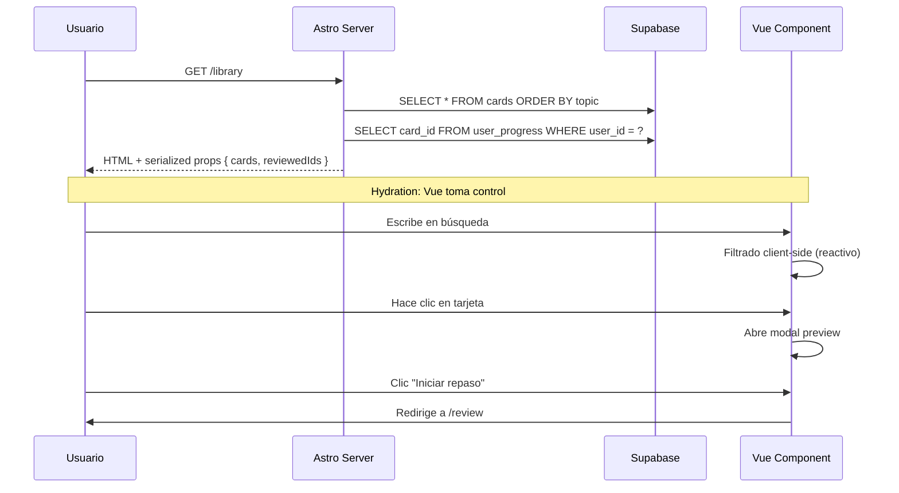
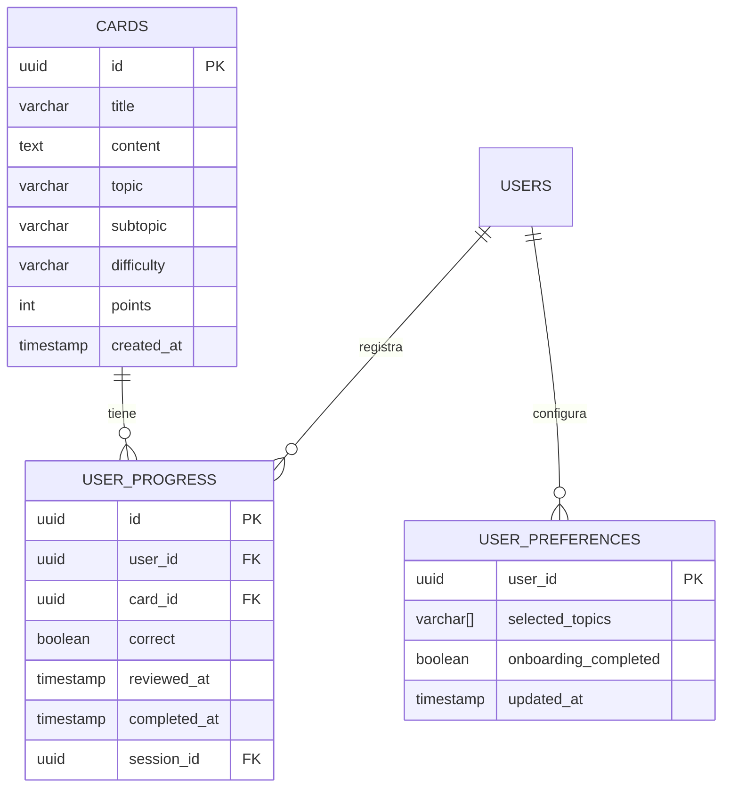

# Plan Técnico: LIB-003 — Biblioteca de Tarjetas de Estudio

## Stack Tecnológico

| Capa | Tecnología | Justificación |
|------|-----------|---------------|
| Framework | Astro 5 | SSR, islands architecture. Página `/library` con `client:idle` para CardLibrary |
| UI | Vue 3 + Composition API | Componentes interactivos del lado cliente (filtros, búsqueda, modal) |
| Estado | Pinia (store existente `review.ts`) | Sesiones de repaso. Biblioteca usa props desde Astro SSR |
| Estilos | Tailwind CSS v4 + CSS scoped | Componentes existentes usan CSS scoped con variables de tema |
| Backend | Astro Actions | `defineAction` para consultas de tarjetas y estado de repaso |
| DB | Supabase (Postgres) | Tablas: `cards`, `user_progress`, `user_preferences` |
| Deploy | Vercel | SSR con adapter `@astrojs/vercel` |
| Testing | Vitest + Playwright | Unit (Vitest), E2E (Playwright) |

## Arquitectura

```mermaid
graph TD
    subgraph "Server (Astro SSR)"
        A1[library.astro] -->|SSR fetch| B1
        A1 --> A2
        A2[CardLibrary.vue client:idle]
    end

    subgraph "Supabase"
        B1[(cards table)]
        B2[(user_progress table)]
        B3[(user_preferences table)]
    end

    subgraph "Vue Client Components"
        A2 --> C1[GlassCard / GlassButton / EmptyState / SkeletonLoader]
        A2 --> C2[CardItem.vue]
        A2 --> C3[CardPreview Modal]
        A2 --> C4[Filter Bar]
        A2 --> C5[Search Input]
    end

    subgraph "Astro Actions (cuando se necesite)"
        D1[actions.library.*] --> B1
        D1 --> B2
    end

    A1 -.->|props: cards, reviewedIds| A2
    C2 -->|@click| C3
    C4 -->|v-model| A2
    C5 -->|v-model| A2
```

## Flujo de Datos (SSR)



## Componentes

### CardLibrary.vue (YA EXISTE)
- **Responsabilidad**: Orquestar toda la vista de biblioteca: filtros, búsqueda, grilla, modal
- **Props**: `cards: DbCard[]`, `reviewedIds: string[]`, `loading?: boolean`
- **Estado interno**: `searchQuery`, `topicFilter`, `subtopicFilter`, `difficultyFilter`, `sortBy`, `selectedCard`
- **Dependencias**: CardItem, GlassCard, GlassButton, SkeletonLoader, EmptyState

### CardItem.vue (YA EXISTE)
- **Responsabilidad**: Renderizar una tarjeta individual en la grilla
- **Props**: `card: DbCard`, `reviewed: boolean`
- **Emits**: `click`

### CardPreviewModal (INLINE — ya existe en CardLibrary.vue)
- **Responsabilidad**: Mostrar detalle completo de tarjeta en overlay
- **Estado**: Controlado por `selectedCard` reactivo
- **UX**: Cerrar con ✕, click en overlay, Escape

### FilterBar (INLINE — ya existe en CardLibrary.vue)
- **Responsabilidad**: Selectores de tema, subtema, dificultad y ordenamiento
- **Estado**: Vinculado a refs de CardLibrary via `v-model`

### SearchInput (INLINE — ya existe en CardLibrary.vue)
- **Responsabilidad**: Input de búsqueda con icono
- **Comportamiento**: Filtrado reactivo en tiempo real, case-insensitive

## Modelo de Datos



### Entidades Principales

#### cards
| Campo | Tipo | Restricciones |
|-------|------|---------------|
| id | uuid | PK, DEFAULT gen_random_uuid() |
| title | text | NOT NULL |
| content | text | NOT NULL |
| topic | varchar(50) | NOT NULL |
| subtopic | varchar(100) | NOT NULL, DEFAULT '' |
| difficulty | varchar(10) | NOT NULL, CHECK IN ('easy','medium','hard') |
| points | int2 | NOT NULL, DEFAULT 0 |
| created_at | timestamptz | NOT NULL, DEFAULT now() |

#### user_progress
| Campo | Tipo | Restricciones |
|-------|------|---------------|
| id | uuid | PK, DEFAULT gen_random_uuid() |
| user_id | uuid | FK, NOT NULL |
| card_id | uuid | FK, NOT NULL |
| correct | boolean | NOT NULL |
| reviewed_at | timestamptz | NOT NULL, DEFAULT now() |
| completed_at | timestamptz | NULL |
| session_id | uuid | NULL |

## Caché y Estrategia de Datos

- **SSR directo**: La página `/library` hace 2 queries a Supabase en el servidor y pasa datos serializados al componente Vue
- **Sin caché adicional**: Dataset pequeño (< 200 tarjetas), filtrado client-side es suficiente
- **Optimización**: Las queries SSR usan `order()` para evitar ordenamiento adicional en cliente
- **Reviewed status**: Se calcula en servidor con `SELECT DISTINCT card_id FROM user_progress WHERE user_id = ?` y se pasa como `string[]` de IDs

## Seguridad

- **Autenticación**: `library.astro` verifica sesión con `supabase.auth.getUser()`. Redirige a `/login` si no hay sesión.
- **Autorización**: Las tarjetas no se filtran por usuario (son globales), pero el estado de repaso sí es por usuario
- **Validación server-side**: No hay writes desde la biblioteca, solo lecturas SSR + filtrado client-side

## Rendimiento

- **SSR**: 2 queries paralelizables (cards + progress) en < 200ms p99
- **Client-side**: Filtrado de < 200 items en < 10ms (JS nativo, sin librerías)
- **Hydration**: Solo `CardLibrary.vue` se hidrata (islands architecture), el resto es HTML estático
- **Skeleton**: Loader visible durante SSR + hydration para evitar layout shift
