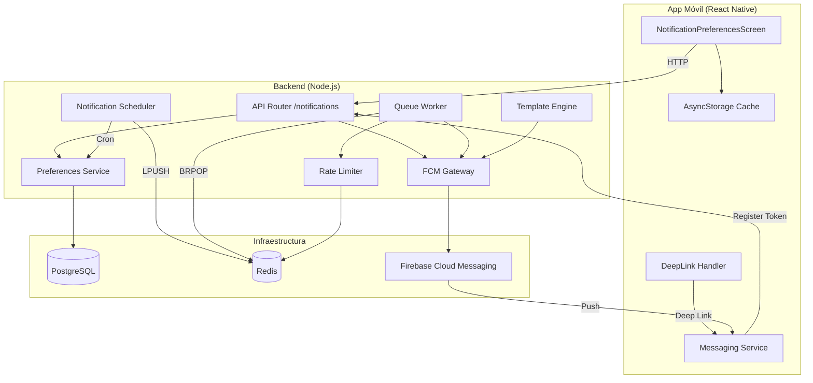
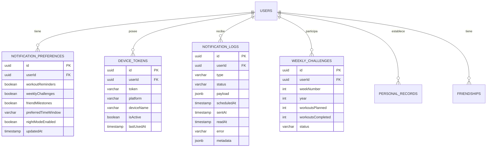

# Plan Técnico: Sistema de Notificaciones Push Inteligentes

## Stack Tecnológico

| Capa | Tecnología | Justificación |
|------|-----------|---------------|
| Frontend (App) | React Native 0.76+ | Ya es el framework de la app. Librería: `@react-native-firebase/messaging` |
| Backend API | Node.js + Express | Ya es el stack del backend. Nuevo router: `/notifications` |
| Base de Datos | PostgreSQL 16 | Datos relacionales. Ya en uso en el proyecto. |
| Caché / Colas | Redis 7+ | Rate limiting (contadores atómicos), cola de notificaciones (BRPOP/LPUSH) |
| Push Infrastructure | Firebase Cloud Messaging | SDK único para iOS y Android. Ya integrado. |
| Scheduler | node-cron + Bull/Queue | Para batch diario de recordatorios y retos semanales |
| ORM | Prisma | Ya en uso. Migraciones y consultas tipadas. |

## Arquitectura

## Componentes

### NotificationPreferencesScreen (Móvil)
- **Responsabilidad**: UI de configuración con toggles, selector de franja horaria, preview en vivo
- **Interfaces**: GET/PUT /notifications/preferences, AsyncStorage
- **Dependencias**: @react-native-firebase/messaging, AsyncStorage

### DeepLink Handler (Móvil)
- **Responsabilidad**: Interpretar payload de notificación y navegar a pantalla correcta
- **Interfaces**: Firebase onNotificationOpenedApp, getInitialNotification
- **Dependencias**: React Navigation linking config

### API Router (Backend)
- **Responsabilidad**: Endpoints REST para preferencias, tokens, logs
- **Rutas**: GET/PUT /preferences, POST/DELETE /tokens, GET /logs, PATCH /logs/:id/read
- **Dependencias**: Express, JWT middleware

### Notification Scheduler (Backend)
- **Responsabilidad**: Jobs cron para batch diario de recordatorios y retos semanales
- **Schedule**: Diario 6:30 AM UTC, Lunes 9 AM UTC, Miércoles 2 PM UTC
- **Dependencias**: node-cron, Redis Bull/Queue, Prisma

### Queue Worker (Backend)
- **Responsabilidad**: Consumir cola Redis, aplicar rate limiting, verificar DND, enviar via FCM
- **Dependencias**: Redis, firebase-admin SDK

### FCM Gateway (Backend)
- **Responsabilidad**: Abstracción sobre Firebase Admin SDK
- **Interfaces**: sendNotification(token, payload) → success/failure
- **Dependencias**: firebase-admin SDK

## Modelo de Datos

### Entidades Principales

#### notification_preferences
| Campo | Tipo | Restricciones |
|-------|------|---------------|
| id | UUID | PK |
| user_id | UUID | FK, UNIQUE |
| workout_reminders | boolean | NOT NULL, DEFAULT true |
| weekly_challenges | boolean | NOT NULL, DEFAULT true |
| friend_milestones | boolean | NOT NULL, DEFAULT true |
| preferred_time_window | varchar(10) | CHECK IN ('morning','afternoon','evening'), DEFAULT 'morning' |
| night_mode_enabled | boolean | NOT NULL, DEFAULT true |
| updated_at | timestamptz | NOT NULL, DEFAULT NOW() |

#### device_tokens
| Campo | Tipo | Restricciones |
|-------|------|---------------|
| id | UUID | PK |
| user_id | UUID | FK, NOT NULL |
| token | varchar(512) | NOT NULL, UNIQUE |
| platform | varchar(10) | CHECK IN ('ios','android') |
| device_name | varchar(100) | NULL |
| is_active | boolean | DEFAULT true |
| last_used_at | timestamptz | NOT NULL |

#### notification_logs
| Campo | Tipo | Restricciones |
|-------|------|---------------|
| id | UUID | PK |
| user_id | UUID | FK, NOT NULL |
| type | varchar(30) | CHECK IN ('workout_reminder','weekly_challenge','friend_milestone') |
| status | varchar(20) | CHECK IN ('pending','sent','delivered','failed','skipped','read') |
| payload | jsonb | NOT NULL |
| scheduled_at | timestamptz | NOT NULL |
| sent_at | timestamptz | NULL |
| read_at | timestamptz | NULL |
| error | text | NULL |

## Seguridad

- **Autenticación**: Todos los endpoints requieren JWT válido (middleware existente)
- **Autorización**: El usuario solo accede a sus propios recursos
- **Cifrado**: Tokens de dispositivo cifrados en reposo (AES-256-GCM)
- **Rate limiting**: Máximo 10 registros de token/hora por usuario
- **Privacidad**: Derecho al olvido (GDPR) — borrado de preferencias, anonimización de logs, borrado de tokens

## Rendimiento

- **Caché**: Preferencias en Redis (TTL 5 min), templates en Redis (TTL 1 hora)
- **Colas**: Redis BRPOP/LPUSH para desacoplar generación de eventos del envío
- **Rate limiting**: Redis INCR + EXPIRE (atómico, sin race conditions)
- **Límites**: 100 conexiones FCM concurrentes, timeout 10s por envío
- **Monitoreo**: Alarma si tasa de fallo > 5% en 15 min. Dashboard Grafana.
