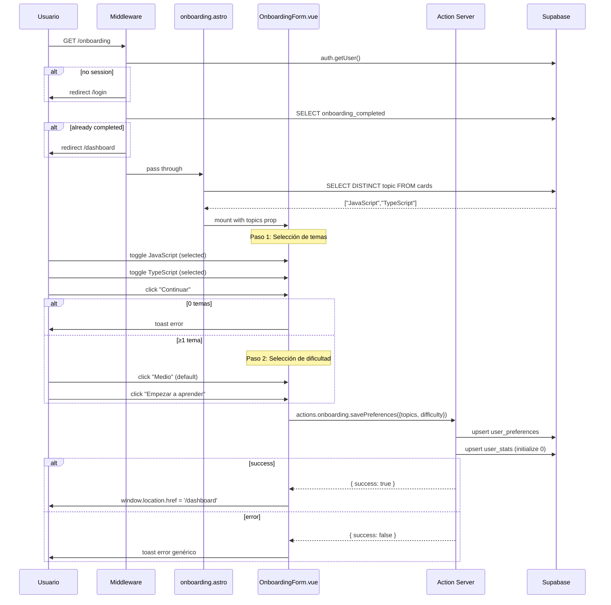
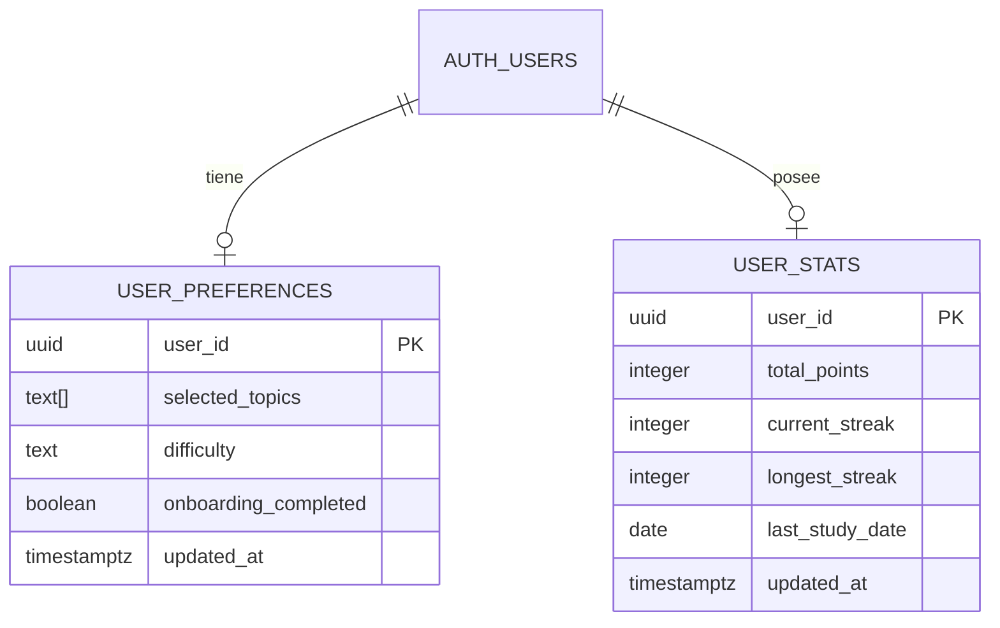

# Plan Técnico: ONB-002 Onboarding de temas y dificultad

## Stack Tecnológico

| Capa | Tecnología | Justificación |
|------|-----------|---------------|
| Framework | Astro 5 | SSR + middleware de protección de rutas. Islands architecture para Vue. |
| UI Componente | Vue 3 + Composition API | OnboardingForm.vue existente. `client:idle` para hidratación diferida. |
| Estado | Pinia (store auth) | Store existente para sesión. Onboarding usa estado local en componente. |
| Estilos | TailwindCSS v4 + CSS scoped | Patrón existente: GlassCard, GlassButton, CSS variables del tema. |
| Server Actions | `astro:actions` + Zod | `actions/onboarding.savePreferences` existente con validación. |
| Base de Datos | Supabase (Postgres) | Tablas `user_preferences` y `user_stats`. |
| Middleware | Astro middleware | `middleware/index.ts` existente con redirect lógica de onboarding. |
| Despliegue | Vercel | Serverless functions para SSR y actions. |

## Arquitectura

```mermaid
graph TD
    subgraph "Cliente (Browser)"
        A1[onboarding.astro - SSR]
        A2[OnboardingForm.vue - client:idle]
        A3[Pinia AuthStore]
    end

    subgraph "Servidor (Astro SSR)"
        B1[Middleware - auth + onboarding guard]
        B2[onboarding.astro - page handler]
        B3[actions/onboarding.savePreferences]
        B4[ServerAction Validation - Zod]
    end

    subgraph "Infraestructura"
        C1[(Supabase - user_preferences)]
        C2[(Supabase - user_stats)]
        C3[(Supabase - auth.users)]
    end

    subgraph "Rutas involucradas"
        D1[/register] -->|redirect| B2
        D2[/dashboard] -->|middleware check| B1
        D3[/library] -->|middleware check| B1
        D4[/review] -->|middleware check| B1
    end

    Usuario -->|GET /onboarding| B1
    B1 -->|sin sesión| /login
    B1 -->|onboarding_completed=true| /dashboard
    B1 -->|ok| B2
    B2 -->|query topics| C1
    B2 --> A2

    A2 -->|POST savePreferences| B3
    B3 -->|Zod validate| B4
    B4 -->|upsert| C1
    B4 -->|upsert| C2
    B3 -->|{ success: true }| A2
    A2 -->|window.location| /dashboard
```

## Flujo de Datos



## Componentes

### onboarding.astro (SSR Page)
- **Responsabilidad**: Verificar sesión, redirigir si ya onboardeado, extraer topics desde DB, renderizar y pasar props al componente Vue
- **Input**: `Astro.request`, `Astro.cookies`
- **Output**: HTML con slot para `OnboardingForm` + props `topics`
- **Hidratación**: `client:idle`
- **Archivo**: `src/pages/onboarding.astro` (ya existe)

### OnboardingForm.vue
- **Responsabilidad**: UI del wizard de 2 pasos, validaciones locales, llamada a la action, manejo de errores y navegación post-éxito
- **Props**: `topics: string[]` (dinámicos desde DB)
- **Estado local**: `step` (1|2), `selected` (string[]), `difficulty` (string), `loading` (boolean)
- **Métodos**: `toggleTopic`, `goToStep2`, `goToStep1`, `handleSubmit`
- **Validaciones**: `selected.length >= 1` en frontend (duplicada en servidor vía Zod)
- **Dependencias**: `astro:actions`, `vue-sonner` (toast), `GlassButton`, `GlassCard`
- **Archivo**: `src/components/onboarding/OnboardingForm.vue` (ya existe)

### Middleware
- **Responsabilidad**: Proteger rutas, verificar onboarding completado, redirigir según corresponda
- **Flujo**: `isProtectedRoute` → `auth.getUser()` → `user_preferences.onboarding_completed` → redirect
- **Archivo**: `src/middleware/index.ts` (ya existe)

### Action: `onboarding.savePreferences`
- **Responsabilidad**: Validar input con Zod, upsert en `user_preferences`, inicializar `user_stats`, retornar éxito/error
- **Input Zod**: `topics: z.array(z.string().min(1)).min(1)`, `difficulty: z.enum(['easy','medium','hard']).default('medium')`
- **Transaccionalidad**: Dos operaciones (prefs + stats). Si falla stats, las prefs ya quedaron guardadas (tolerancia parcial).
- **Archivo**: `src/actions/index.ts` (ya existe, líneas 318-367)

## Modelo de Datos



## Consistencia de Tipos

### Gap detectado: `difficulty` ausente en `UserPreferences` del frontend

**Archivo**: `src/types/app.ts:38-42`

```typescript
// Actual (incompleto):
export interface UserPreferences {
  selectedTopics: string[]
  onboardingCompleted: boolean
}

// Debe ser:
export interface UserPreferences {
  selectedTopics: string[]
  difficulty: Difficulty    // ← agregar
  onboardingCompleted: boolean
}
```

**Archivo**: `src/types/database.ts:106-126` — la fila `user_preferences` en types DB no incluye `difficulty`. Se debe agregar:

```typescript
// Row, Insert, Update de user_preferences deben incluir:
difficulty: string       // en Row
difficulty?: string      // en Insert y Update
```

## Seguridad

- **Autenticación**: Middleware verifica sesión antes de servir la página
- **Server-only**: La action `savePreferences` usa `requireUser()`, no expone lógica al cliente
- **Validación Zod**: `z.array(z.string().min(1)).min(1)` previene topics vacíos
- **No exponer DB**: El query de topics usa `DISTINCT` desde el servidor, no se expone la tabla completa
- **OWASP A02**: Cookies de sesión httpOnly + secure

## Rendimiento

- **Hidratación**: `client:idle` evita hidratar hasta que el navegador esté inactivo
- **Bundle**: El formulario de onboarding es pequeño (~2KB gzipped), no requiere lazy loading
- **DB query**: `SELECT DISTINCT topic` es ligero (columna indexada)
- **Rate limiting**: No aplica (1 llamada por onboarding completado)
- **Tiempo objetivo SSR**: < 200ms (middleware + 2 queries simples)

## Monitoreo

- **Eventos sugeridos**: `onboarding_started`, `onboarding_step1_completed`, `onboarding_step2_completed`, `onboarding_completed`, `onboarding_error`
- **Log de errores**: Usar `logServerError` (existente en `src/lib/errors.ts`)
- **Alertas**: Si tasa de error en `savePreferences` > 5% en 1 hora
