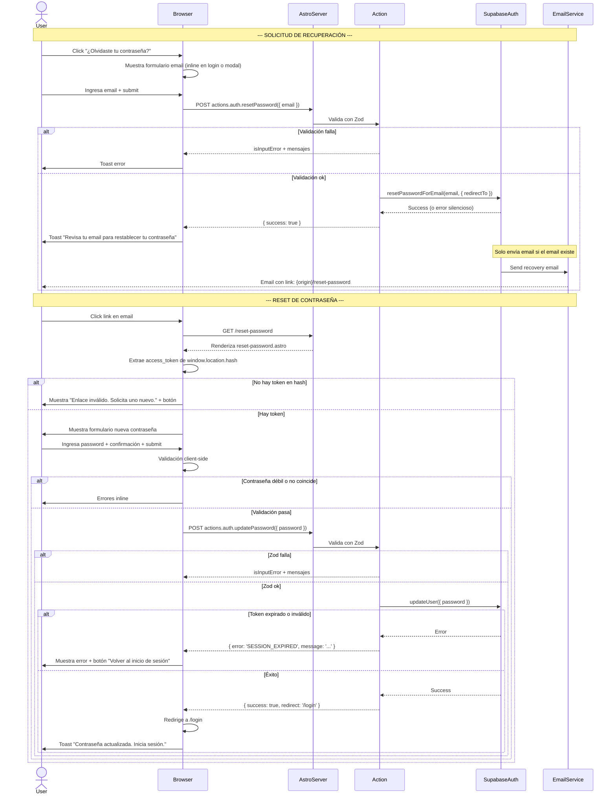

# PLAN-PWR-014: Plan Técnico — Recuperación de Contraseña

## 1. Stack Tecnológico

| Capa | Tecnología | Versión | Propósito |
|------|-----------|---------|-----------|
| Framework | Astro | ^6.1.6 | SSR, routing, middleware, actions |
| UI Framework | Vue 3 | ^3.4.0 | Componentes interactivos client-side |
| State Management | Pinia | ^2.1.7 | Estado de sesión en cliente |
| Auth Provider | Supabase Auth | — | Reset password email + token management |
| SSR Cookies | @supabase/ssr | ^0.10.2 | Cookies httpOnly server-side |
| Client SDK | @supabase/supabase-js | ^2.39.0 | Cliente Supabase (browser) |
| Validation | Zod (astro:schema) | — | Validación server-side |
| CSS | TailwindCSS v4 | ^4.0.0 | Estilos utilitarios |
| Toasts | vue-sonner | ^2.0.9 | Feedback al usuario |
| Icons | Lucide / SVG inline | — | Icono de ojo para mostrar/ocultar password |
| Deployment | Vercel | — | Hosting + Edge Functions |
| Package Manager | pnpm | 9.0.0 | Dependencies |

---

## 2. Arquitectura

### 2.1 Diagrama de Flujo (Mermaid)



### 2.2 Mapa de Rutas

```
/login                  → BaseLayout + LoginForm.vue (client:load)
/login + forgot         → LoginForm muestra inline forgot flow
/reset-password         → BaseLayout + ResetPasswordForm.vue (client:load) [PÚBLICA]
```

### 2.3 Integración con Supabase Auth Recovery

```
Configuración en Supabase Dashboard:
  Authentication → Settings → Email Templates → Reset Password
  - Template: personalizado con marca MicroLearn
  - redirect_to: https://{origin}/reset-password

Server Action:
  supabase.auth.resetPasswordForEmail(email, {
    redirectTo: `${PUBLIC_SITE_URL}/reset-password`
  })

  Nota: Supabase maneja automáticamente:
  - Generación del token JWT
  - Expiración del token (default: 3600s = 1h)
  - Envío del email
  - Validación del token en updateUser
```

---

## 3. Componentes y Flujo

### 3.1 Árbol de Componentes

```
BaseLayout
├── login.astro
│   └── LoginForm.vue (client:load)
│       ├── GlassCard.vue
│       ├── InputField.vue (email)
│       ├── InputField.vue (password)
│       ├── OAuthButtons.vue
│       └── "¿Olvidaste tu contraseña?" link → toggle forgot mode
│
└── reset-password.astro
    └── ResetPasswordForm.vue (client:load)
        ├── GlassCard.vue
        ├── Estado: LOADING | INVALID_TOKEN | FORM | SUCCESS
        ├── InputField.vue (nueva contraseña + toggle visibility)
        ├── InputField.vue (confirmar contraseña + toggle visibility)
        ├── PasswordStrengthIndicator.vue (requisitos checklist)
        └── GlassButton.vue (submit)
```

### 3.2 Estados del Componente ResetPasswordForm.vue

```
LOADING        → Verificando token en URL hash
INVALID_TOKEN  → No hay token o expirado → mensaje + botón "Volver al login"
FORM           → Mostrar campos de password
SUBMITTING     → Enviando a actions.auth.updatePassword
SUCCESS        → Redirigiendo a /login
```

### 3.3 Lógica de Extracción de Token

```typescript
// En ResetPasswordForm.vue setup
onMounted(() => {
  const hash = window.location.hash
  if (!hash || !hash.includes('access_token=')) {
    state.value = 'INVALID_TOKEN'
    return
  }
  const params = new URLSearchParams(hash.slice(1))
  const token = params.get('access_token')
  if (!token) {
    state.value = 'INVALID_TOKEN'
    return
  }
  // Limpiar hash de URL por seguridad
  window.history.replaceState(null, '', window.location.pathname)
  state.value = 'FORM'
})
```

### 3.4 Validación Client-Side en Tiempo Real

```typescript
const password = ref('')
const confirmPassword = ref('')
const errors = computed(() => {
  const e: string[] = []
  if (!password.value) return e
  if (password.value.length < 8)
    e.push('Al menos 8 caracteres')
  if (!/[A-Z]/.test(password.value))
    e.push('Al menos una mayúscula')
  if (!/[a-z]/.test(password.value))
    e.push('Al menos una minúscula')
  if (!/[0-9]/.test(password.value))
    e.push('Al menos un número')
  return e
})
const matchError = computed(() =>
  confirmPassword.value && password.value !== confirmPassword.value
    ? 'Las contraseñas no coinciden'
    : null
)
```

---

## 4. Seguridad

### 4.1 Token Recovery

| Medida | Implementación | Responsable |
|--------|---------------|-------------|
| Token JWT generado por Supabase | `supabase.auth.resetPasswordForEmail()` | Supabase |
| Expiración del token | Configurable en Supabase Auth (default: 3600s) | Supabase Dashboard |
| Token en hash de URL | `#access_token=...` (no en query params) | Estándar OAuth |
| Hash limpiado post-extracción | `window.history.replaceState(null, '', path)` | Client-side |

### 4.2 Rate Limiting

| Capa | Medida | Comportamiento |
|------|--------|----------------|
| Supabase Auth | Rate limit por IP en resetPasswordForEmail | 429 tras exceder límite |
| Cliente | Debounce en botón submit (2s) | Previene doble envío |
| UX | Mensaje genérico siempre | No revela si email existe |

### 4.3 Prevención de Enumeración de Usuarios

```
Solicitud A (email registrado):   response { success: true }  → email ENVIADO
Solicitud B (email no registrado): response { success: true }  → email NO enviado
                                                                    ↓
                                                  El CLIENTE ve el MISMO mensaje:
                                                  "Si el email existe, recibirás
                                                   instrucciones para restablecer
                                                   tu contraseña."
```

### 4.4 Validación en Doble Capa

| Capa | Validación | Ubicación |
|------|-----------|-----------|
| Cliente (Vue) | Password length, mayúscula, minúscula, número, match confirmación | `ResetPasswordForm.vue` |
| Servidor (Zod) | Email válido, password 8+ chars + mayúscula + minúscula + número | `actions/index.ts` |
| Supabase | Token JWT válido, no expirado, asociado al usuario | Server-side |

### 4.5 Security Headers (reutiliza middleware de AUTH-001)

```
X-Content-Type-Options: nosniff
X-Frame-Options: DENY
X-XSS-Protection: 1; mode=block
Content-Security-Policy: bloquea scripts inline no autorizados
```

### 4.6 OWASP Compliance

| OWASP | Medida |
|-------|--------|
| A01 (Broken Access Control) | Ruta `/reset-password` pública, pero solo permite cambio con token válido |
| A02 (Cryptographic Failures) | Token JWT manejado por Supabase, hash URL no logged |
| A03 (Injection) | Zod validation + Supabase parameterized queries |
| A05 (Security Misconfiguration) | Mensaje genérico anti-enumeración |
| A07 (Auth Failures) | Token temporal + rate limiting |
| A10 (SSRF) | URL validation en redirectTo |

---

## 5. Manejo de Errores

### 5.1 Mapeo Supabase → AppError (recovery-specific)

```typescript
function mapRecoveryError(error): AppErrorCode {
  status 400 + 'Invalid JWT' / 'Token expired' → SESSION_EXPIRED
  status 429                                    → RATE_LIMIT
  status 400 + 'Password should be'             → VALIDATION_ERROR
  else                                          → INTERNAL_ERROR
}
```

### 5.2 Feedback al Usuario

| Situación | Canal | Mensaje |
|-----------|-------|---------|
| Email de reset enviado | toast.success | "Revisa tu email para restablecer tu contraseña." |
| Password actualizada | toast.success | "Contraseña actualizada. Inicia sesión." |
| Link expirado/inválido | Error UI inline | "El enlace ha expirado o no es válido. Solicita uno nuevo." |
| Token faltante en URL | Error UI inline | "Enlace inválido. Solicita uno nuevo." |
| Error de red | toast.error | "No se pudo conectar. Verifica tu conexión." |
| Rate limit | toast.error | "Demasiadas solicitudes. Espera un momento." |
| Campos inválidos | Errores inline | Según regla incumplida |

---

## 6. Variables de Entorno

| Variable | Ámbito | Propósito |
|----------|--------|-----------|
| `PUBLIC_SITE_URL` | Cliente | URL base para redirectTo en reset password |
| `PUBLIC_SUPABASE_URL` | Cliente | URL del proyecto Supabase |
| `PUBLIC_SUPABASE_ANON_KEY` | Cliente | Anon key para cliente Supabase |

---

## 7. Dependencias Externas

| Paquete | Uso |
|---------|-----|
| `@supabase/supabase-js` | Cliente Supabase (resetPasswordForEmail, updateUser) |
| `@supabase/ssr` | Cookies SSR server-side |
| `astro:actions` | Server actions con validación Zod |
| `vue-sonner` | Toast notifications |
| `pinia` | Auth store client-side |
