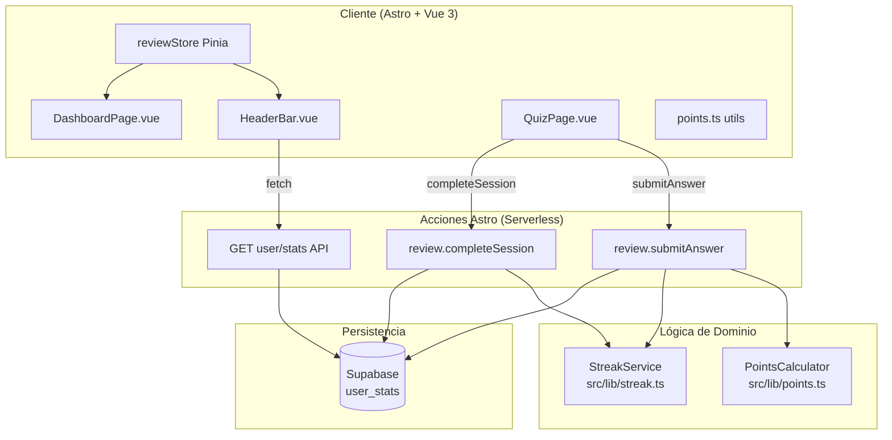
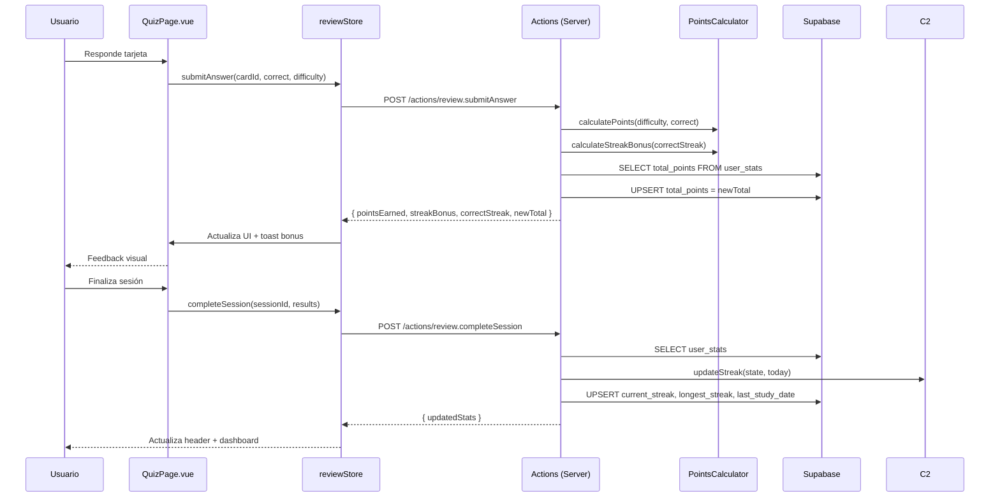
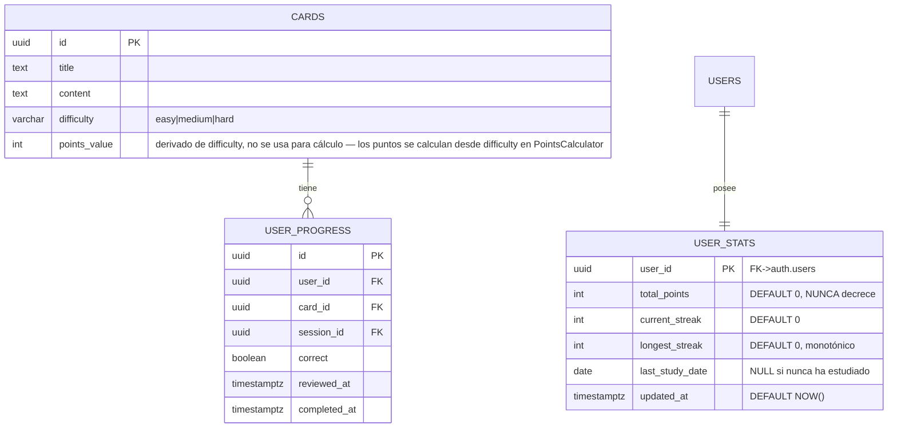

# Plan Técnico: PTS-005 — Sistema de Puntos y Racha Diaria

## Stack Tecnológico

| Capa | Tecnología | Justificación |
|------|-----------|---------------|
| Frontend | Astro 5 + Vue 3 | Ya es el stack. Componentes existentes para header y dashboard. |
| Estado | Pinia | Store `reviewStore` ya maneja puntos y racha en sesión. |
| Estilos | TailwindCSS v4 | Ya en uso. Clases utilitarias para badges y displays de puntos. |
| Backend | Astro Actions + Supabase | Acciones existentes `review.submitAnswer` y `review.completeSession`. |
| Base de Datos | Supabase (Postgres 15) | Tabla `user_stats` existente. Sin cambios de schema. |
| Cache Cliente | TanStack Query (opcional) | Para polling de `user_stats` en header si se requiere refresco. |
| Despliegue | Vercel | Serverless functions para las acciones. |

## Arquitectura



### Flujo de respuesta en quiz



## Componentes

### PointsCalculator (`src/lib/points.ts`)
- **Responsabilidad**: Cálculo puro de puntos base y bonos de racha en sesión
- **Funciones**: `calculatePoints(difficulty, correct)`, `calculateStreakBonus(correctStreak)`, `applyPoints(current, difficulty, correct, streak)`
- **Dependencias**: `Difficulty` type
- **Notas**: Sin I/O. Función pura. Testable unitariamente.

### StreakService (`src/lib/streak.ts`)
- **Responsabilidad**: Evaluación y actualización de racha diaria
- **Funciones**: `updateStreak(state, today)`, `isStreakBroken(lastDate, today)`
- **Interfaces**: `StreakState { current_streak, longest_streak, last_study_date }`
- **Dependencias**: Ninguna. Función pura.

### reviewStore (Pinia, `src/stores/review.ts`)
- **Responsabilidad**: Estado de sesión actual, correctStreak, puntos acumulados en sesión
- **Estado**: `correctStreak`, `sessionPoints`, `lastResult`
- **Acciones**: `submitAnswer`, `completeSession` — delegan en Astro Actions

### HeaderBar.vue
- **Responsabilidad**: Mostrar puntos totales y racha actual con iconos
- **Datos vía**: Store reactivo o fetch inicial de `user_stats`
- **Props/Store**: `totalPoints`, `currentStreak`
- **UX**: Ícono 🏆 + puntos, 🔥 + racha. Actualización reactiva al completar sesión.

### DashboardPage.vue
- **Responsabilidad**: Vista detallada con puntos, racha actual, racha máxima, última fecha de estudio
- **Datos vía**: Fetch de `user_stats` al montar + store compartido

## Modelo de Datos



### user_stats
| Campo | Tipo | Restricciones |
|-------|------|---------------|
| user_id | UUID | PK, FK → auth.users |
| total_points | integer | NOT NULL, DEFAULT 0, CHECK (>= 0) |
| current_streak | integer | NOT NULL, DEFAULT 0, CHECK (>= 0) |
| longest_streak | integer | NOT NULL, DEFAULT 0, CHECK (>= 0) |
| last_study_date | date | NULLABLE |

### Índices
```sql
-- PK ya existe por user_id (única fila por usuario)
-- No se requieren índices adicionales para este volumen
```

### RLS Policies (ya existentes)
```sql
-- Las policies ya existen en schema.sql:
-- SELECT: auth.uid() = user_id
-- INSERT: auth.uid() = user_id
-- UPDATE: auth.uid() = user_id
```

## Servicios

### PointsCalculator
```
Entrada:  (difficulty: 'easy'|'medium'|'hard', correct: boolean, correctStreak: number)
Salida:   { base: number, bonus: number, total: number }

Lógica:
  if !correct → { base: 0, bonus: 0, total: 0 }
  base = MAP(difficulty → points)  // easy=5, medium=10, hard=15
  bonus = 0
  if correctStreak == 3  → bonus = 5
  if correctStreak == 5  → bonus = 15
  if correctStreak > 5 && (correctStreak % 3 == 0) → bonus = 5
  total = base + bonus
```

### StreakService
```
Entrada:  (state: StreakState, today: string "YYYY-MM-DD")
Salida:   StreakState

Lógica:
  if state.last_study_date == today → return state (sin cambios)
  if state.last_study_date == null → newStreak = 1
  if diffDays(last_study_date, today) == 1 → newStreak = current_streak + 1
  if diffDays(last_study_date, today) > 1  → newStreak = 1
  longest = max(longest_streak, newStreak)
  return { current_streak: newStreak, longest_streak: longest, last_study_date: today }
```

## Concurrencia y Atomicidad

### Escenario: respuestas rápidas en paralelo
- **Problema**: Si el usuario responde muy rápido, dos `submitAnswer` pueden leer el mismo `total_points` antes de que el primero escriba, causando pérdida de puntos.
- **Solución actual**: El servidor (Astro Action) hace `SELECT` + cálculo + `UPSERT` en secuencia. Como las Actions corren en Vercel Serverless, el riesgo de race condition es bajo (un solo hilo por sesión).
- **Mitigación futura**: Usar `UPDATE user_stats SET total_points = total_points + $1 WHERE user_id = $2` con incremento atómico en vez de read-modify-write.

### Escenario: completar sesión mientras se responde
- No es posible porque `completeSession` se llama después de que el usuario explícitamente finaliza. No hay concurrencia.

### Transaccionalidad
- Cada `submitAnswer` es una operación individual. No hay transacciones cross-table.
- `completeSession` actualiza `user_stats` en un solo `UPSERT`.

## Seguridad

- **Autenticación**: Todas las acciones requieren JWT válido (middleware de Astro existente)
- **Autorización**: RLS policies garantizan que cada usuario solo ve/modifica su propia fila en `user_stats`
- **Validación**: `correct` y `difficulty` se validan en servidor. No se confía en datos del cliente.
- **Integridad**: `total_points` y `longest_streak` se validan en servidor para cumplir invariantes (no negativos, monotónicos)

## Offline y Resiliencia

- El cliente mantiene el estado de la sesión en Pinia. Si la conexión falla:
  - `submitAnswer` falla → se marca como pendiente
  - `completeSession` falla → se reintenta al reconectar
  - Los puntos locales se actualizan optimistamente
- La racha diaria se calcula al completar sesión en servidor, no en cliente

## Tests

| Tipo | Archivo | Cobertura |
|------|---------|-----------|
| Unitarios | `src/lib/points.ts` | 100% casos: todas dificultades, bonos 0/3/5/6/9, incorrecta |
| Unitarios | `src/lib/streak.ts` | 100% casos: mismo día, día siguiente, gap 2+, gap >30, null |
| Integración | `/tests/submit-points.test.ts` | Pipeline submitAnswer + DB assertion |
| Integración | `/tests/streak-persistence.test.ts` | completeSession + verificar DB |
| E2E | Playwright | Flujo completo: quiz → puntos → header → dashboard |
