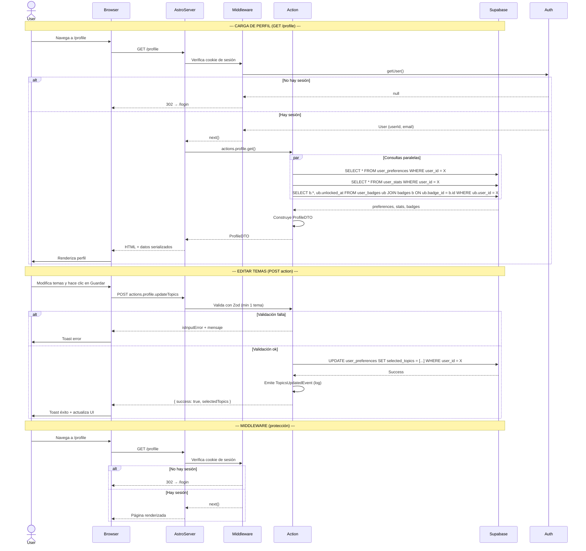

# PLAN-PRF-009: Plan Técnico — Perfil de Usuario

## 1. Stack Tecnológico

| Capa | Tecnología | Versión | Propósito |
|------|-----------|---------|-----------|
| Framework | Astro | ^6.1.6 | SSR, routing, middleware, actions |
| UI Framework | Vue 3 | ^3.4.0 | Componentes interactivos client-side |
| State Management | Pinia | ^2.1.7 | Estado de sesión en cliente |
| Auth Provider | Supabase Auth | — | Sesión y email del usuario |
| Database | Supabase (Postgres) | — | user_preferences, user_stats, user_badges |
| SSR Cookies | @supabase/ssr | ^0.10.2 | Cookies httpOnly server-side |
| Validation | Zod (astro:schema) | — | Validación server-side de topics |
| CSS | TailwindCSS v4 | ^4.0.0 | Estilos utilitarios |
| Glass UI | CSS custom properties | — | Glassmorphism design system |
| Toasts | vue-sonner | ^2.0.9 | Feedback al usuario |
| Icons | SVG inline | — | Íconos de stats e insignias |
| Deployment | Vercel | — | Hosting + Edge Functions |

---

## 2. Arquitectura

### 2.1 Diagrama de Flujo (Mermaid)



### 2.2 Mapa de Rutas

```
/profile        → AppLayout + ProfileView.vue (PROTECTED, client:load)
/profile/edit   → (modal inline, no ruta separada)
```

---

## 3. Componentes y Flujo

### 3.1 Árbol de Componentes

```
AppLayout
└── profile.astro
    └── ProfileView.vue (client:load, min-height fijo)
        ├── ProfileHeader.vue
        │   ├── AvatarCircle.vue
        │   │   └── (InitialsAvatar | UploadedAvatar según estado)
        │   └── EmailDisplay.vue
        ├── StatsGrid.vue
        │   ├── StatCard.vue (Puntos totales)
        │   ├── StatCard.vue (Racha actual)
        │   └── StatCard.vue (Racha máxima)
        ├── BadgesSection.vue
        │   ├── BadgeCard.vue (por cada insignia)
        │   └── EmptyBadges.vue (si no hay insignias)
        └── TopicsEditor.vue
            ├── TopicCheckbox.vue (JavaScript)
            ├── TopicCheckbox.vue (TypeScript)
            └── SaveButton.vue
```

### 3.2 Read Model (CQRS)

```
ProfileReadModel
└── getProfile(userId: string): Promise<ProfileDTO>
      ├── Promise.all([
      │     supabase.from('user_preferences').select('*').eq('user_id', userId).single(),
      │     supabase.from('user_stats').select('*').eq('user_id', userId).single(),
      │     supabase.from('user_badges')
      │       .select('badge_id, unlocked_at, badges(*)')
      │       .eq('user_id', userId),
      │   ])
      └── → ProfileDTO
```

### 3.3 Flujo de Edición de Temas

```
TopicsEditor.vue
  │
  ├── Estado inicial: selectedTopics desde ProfileDTO
  ├── Usuario check/uncheck topics
  ├── Estado local: dirtyTopics (solo cambia si hay modificaciones)
  │
  ├── onClick Guardar
  │   ├── Validar client-side: dirtyTopics.length >= 1
  │   ├── set saving = true, disable button
  │   ├── await actions.profile.updateTopics({ topics: dirtyTopics })
  │   ├── Éxito:
  │   │   ├── toast.success("Temas actualizados")
  │   │   ├── selectedTopics = dirtyTopics
  │   │   ├── saving = false
  │   │   └── Emitir evento para que otros componentes (header, library) reaccionen
  │   └── Error:
  │       ├── toast.error("No se pudieron guardar los cambios")
  │       └── saving = false
  │
  └── Cancelar: revertir dirtyTopics a selectedTopics original
```

### 3.4 Integración con Bounded Contexts

| Bounded Context | Datos consumidos | Propósito |
|----------------|-----------------|-----------|
| **Auth** (AUTH-001) | `userId`, `email` | Identidad del usuario para el perfil |
| **UserPreferences** (ONB-002) | `selectedTopics` | Temas seleccionados para mostrar y editar |
| **UserStats** (PTS-005) | `totalPoints`, `currentStreak`, `longestStreak` | Estadísticas de progreso |
| **Badges** (BDG-008) | `badge_id`, `unlockedAt`, `badges.*` | Insignias desbloqueadas |
| **Library** (LIB-003) | `selectedTopics` (escucha cambios) | Filtrado de contenido cuando cambian temas |

**Eventos entre contexts:**
```
Profile (PRF-009)
  └── TopicsUpdated { userId, previousTopics, newTopics }
        ├── Library (LIB-003): refiltra tarjetas mostradas
        └── Dashboard (DSH-007): actualiza contenido recomendado
```

---

## 4. Esquemas de Base de Datos

### Tablas existentes (no se modifican)

```sql
-- user_preferences (ya existe de ONB-002)
-- user_stats (ya existe de PTS-005)
-- user_badges + badges (ya existen de BDG-008)
```

### user_preferences (existente)

| Campo | Tipo | Uso en PRF-009 |
|-------|------|----------------|
| user_id | UUID | PK, FK → auth.users |
| selected_topics | text[] | Lectura y edición desde el perfil |
| onboarding_completed | boolean | No usado directamente |
| updated_at | timestamptz | Última modificación |

### user_stats (existente)

| Campo | Tipo | Uso en PRF-009 |
|-------|------|----------------|
| user_id | UUID | PK, FK → auth.users |
| total_points | integer | Mostrar en StatsCard |
| current_streak | integer | Mostrar en StatsCard |
| longest_streak | integer | Mostrar en StatsCard |
| last_study_date | timestamptz | No mostrado directamente |

### user_badges + badges (existentes)

| Tabla | Campo | Uso en PRF-009 |
|-------|-------|----------------|
| user_badges | badge_id | JOIN con badges |
| user_badges | unlocked_at | Fecha de desbloqueo |
| badges | name | Nombre de insignia |
| badges | icon | Ícono de insignia |
| badges | level | Nivel (basic/intermediate/advanced) |
| badges | category | Categoría (achievement/streak/mastery) |

---

## 5. Seguridad

### 5.1 RLS Policies (existentes, verificar cobertura)

```sql
-- user_preferences: usuario solo ve/edita sus propias preferencias
CREATE POLICY "users_own_preferences" ON user_preferences
  FOR ALL USING (auth.uid() = user_id);

-- user_stats: usuario solo ve sus estadísticas
CREATE POLICY "users_own_stats" ON user_stats
  FOR ALL USING (auth.uid() = user_id);

-- user_badges: usuario solo ve sus insignias
CREATE POLICY "users_own_badges" ON user_badges
  FOR ALL USING (auth.uid() = user_id);
```

### 5.2 Validación en Doble Capa (Editar Temas)

| Capa | Validación | Ubicación |
|------|-----------|-----------|
| Cliente (Vue) | `topics.length >= 1` antes de habilitar botón Guardar | `TopicsEditor.vue` |
| Servidor (Zod) | `z.array(z.enum(['JavaScript','TypeScript'])).min(1)` | `actions/index.ts` |
| Supabase (RLS) | `auth.uid() = user_id` | Política RLS en tabla |

### 5.3 Security Headers

Heredados del middleware global de AUTH-001:
```
X-Content-Type-Options: nosniff
X-Frame-Options: DENY
X-XSS-Protection: 1; mode=block
Referrer-Policy: strict-origin-when-cross-origin
```

---

## 6. Manejo de Errores

### 6.1 Códigos de Error Específicos del Perfil

```
PROFILE_LOAD_ERROR    → "No se pudo cargar el perfil. Intenta de nuevo."
TOPICS_UPDATE_ERROR   → "No se pudieron guardar los temas."
TOPICS_VALIDATION     → "Selecciona al menos un tema."
BADGES_LOAD_ERROR     → "No se pudieron cargar las insignias."
STATS_LOAD_ERROR      → "No se pudieron cargar las estadísticas."
```

### 6.2 Mapeo de Errores en ProfileReadModel

```typescript
async function getProfile(userId: string): Promise<ProfileDTO> {
  try {
    const [prefs, stats, badges] = await Promise.all([
      prefsRepo.findByUserId(userId),
      statsRepo.findByUserId(userId),
      badgesRepo.findByUserId(userId),
    ])

    return ProfileMapper.toDTO({
      email: session.user.email,
      avatar: Avatar.default(session.user.email),
      selectedTopics: prefs?.selectedTopics ?? [],
      stats: stats ?? { totalPoints: 0, currentStreak: 0, longestStreak: 0 },
      badges: badges ?? [],
    })
  } catch (error) {
    logServerError({ code: 'PROFILE_LOAD_ERROR', error })
    throw createAppError('INTERNAL_ERROR', 'No se pudo cargar el perfil.')
  }
}
```

### 6.3 Feedback al Usuario

| Situación | Canal | Mensaje |
|-----------|-------|---------|
| Perfil cargado | — | Renderizado directo |
| Temas actualizados | toast.success | "Temas de estudio actualizados" |
| Error al cargar perfil | toast.error | "No se pudo cargar el perfil. Intenta de nuevo." |
| Error al guardar temas | toast.error | "No se pudieron guardar los cambios." |
| Validación client-side | toast.error | "Selecciona al menos un tema." |

---

## 7. Variables de Entorno

| Variable | Ámbito | Propósito |
|----------|--------|-----------|
| `PUBLIC_SUPABASE_URL` | Cliente | URL de Supabase |
| `PUBLIC_SUPABASE_ANON_KEY` | Cliente | Anon key de Supabase |
| `SUPABASE_URL` | Servidor | URL de Supabase (validada SSRF) |
| `SUPABASE_ANON_KEY` | Servidor | Anon key de Supabase (validada) |

---

## 8. Dependencias Externas

| Paquete | Uso |
|---------|-----|
| `@supabase/supabase-js` | Cliente Supabase para consultas DB |
| `@supabase/ssr` | Cookies SSR server-side |
| `astro:actions` | Server actions con validación Zod |
| `vue-sonner` | Toast notifications |
| `pinia` | Auth store (sesión en cliente) |
