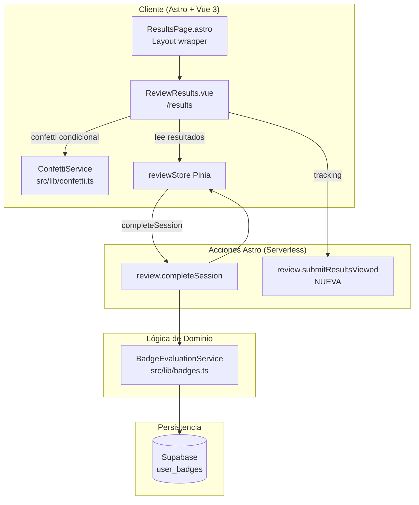
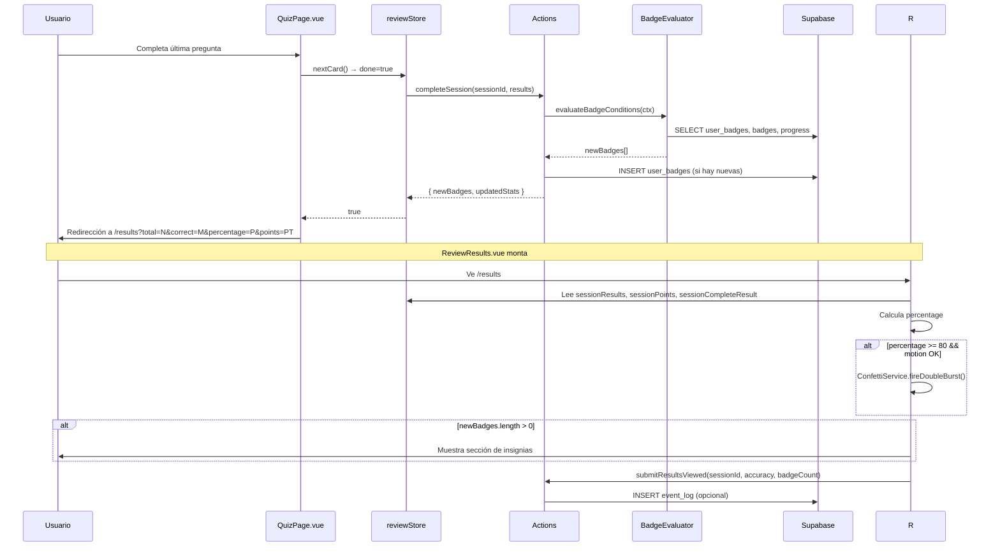
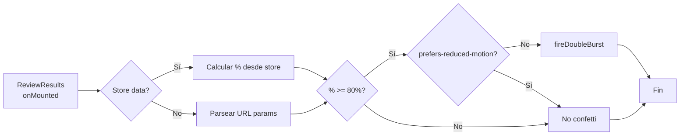

# Plan Técnico: RES-006 — Resultados de sesión de repaso

## Stack Tecnológico

| Capa | Tecnología | Justificación |
|------|-----------|---------------|
| Frontend | Astro 5 + Vue 3 | Stack existente. `ReviewResults.vue` ya implementado. |
| Estado | Pinia (`useReviewStore`) | Store ya maneja `sessionResults`, `sessionPoints`, `sessionCompleteResult`. |
| Estilos | TailwindCSS v4 + CSS custom props | Variables `--glass-*`, `--color-*` ya definidas en el theme. |
| Animación | `canvas-confetti` (CDN/lazy import) | Dependencia existente. Carga diferida para no bloquear. |
| Backend | Astro Actions + Supabase | Acción `review.completeSession` ya devuelve `newBadges` + `updatedStats`. |
| Tracking | Astro Action `review.submitResultsViewed` (nueva) | Para evento `ResultsViewed`. |
| Despliegue | Vercel | Serverless functions existentes. |

## Arquitectura



### Flujo de navegación a resultados



### Flujo del ConfettiService



## Componentes

### ConfettiService (`src/lib/confetti.ts`) — NUEVO
- **Responsabilidad**: Abstracción sobre `canvas-confetti` con métodos nombrados
- **Funciones**:
  - `shouldCelebrate(accuracy, threshold = 80): boolean` — decide si aplicar confetti
  - `fireBasic(particleCount, spread, origin): void` — burst simple
  - `fireDoubleBurst(): void` — burst central + lateral (usado en resultados)
  - `isMotionOk(): boolean` — check `prefers-reduced-motion`
- **Dependencias**: `canvas-confetti` (lazy `await import()`)
- **Notas**: Sin I/O de red. Función pura excepto `fire*` que muta el DOM canvas.

### ReviewResults.vue (`src/components/cards/ReviewResults.vue`) — REFACTOR
- **Responsabilidad**: Renderizar estadísticas, confetti, insignias, acciones
- **Estado actual**: Ya implementado. Refactor para extraer confetti a servicio.
- **Mejoras**:
  - Usar `ConfettiService.shouldCelebrate()` en vez de inline `>= 80`
  - Agregar link a `/badges` en sección de insignias
  - Agregar tracking `submitResultsViewed`
  - Usar `ConfettiService.fireDoubleBurst()` en vez de inline `canvas-confetti`
- **Props/Store**: `store.sessionResults`, `store.sessionPoints`, `store.sessionCompleteResult`
- **Fallback**: URL params: `total`, `correct`, `percentage`, `points`

### ResultsPage.astro (nueva ruta)
- **Responsabilidad**: Layout wrapper para `/results`
- **Implementación**: SPA style — renderiza `<ReviewResults />` client:only="vue"

### reviewStore (Pinia, `src/stores/review.ts`) — SIN CAMBIOS
- Ya expone todo lo necesario. No requiere modificaciones.

### submitResultsViewed Action (`src/actions/index.ts`) — NUEVA
- **Responsabilidad**: Persistir evento `ResultsViewed` para analytics
- **Input**: `{ sessionId, accuracy, newBadgeCount }`
- **Output**: `{ success: true }`
- **Implementación**: Insert en tabla `event_log` o supabase function
- **Resiliencia**: Falla silenciosamente (no crítica para UX)

## Modelo de Datos

Sin cambios de schema. Se reutilizan tablas existentes:

- `user_progress` — para contar total/correctas de la sesión
- `user_badges` — para insignias desbloqueadas
- `user_stats` — para puntos y racha

### Tabla opcional: `event_log` (para tracking)

| Campo | Tipo | Restricciones |
|-------|------|---------------|
| id | UUID | PK, DEFAULT gen_random_uuid() |
| user_id | UUID | NOT NULL, FK → auth.users |
| event_type | varchar | NOT NULL, 'ResultsViewed' |
| payload | jsonb | NULLABLE |
| created_at | timestamptz | DEFAULT now() |

### RLS Policies
```sql
-- event_log: usuario solo ve sus propios eventos
CREATE POLICY "event_log_select" ON event_log FOR SELECT USING (auth.uid() = user_id);
CREATE POLICY "event_log_insert" ON event_log FOR INSERT WITH CHECK (auth.uid() = user_id);
```

## Servicios

### ConfettiService
```
shouldCelebrate(accuracy, threshold=80):
  if accuracy >= threshold AND isMotionOk() → true
  else → false

fireDoubleBurst():
  import('canvas-confetti')
  confetti({ particleCount: 120, spread: 70, origin: { y: 0.6 } })
  setTimeout(250ms):
    confetti({ particleCount: 60, angle: 60, spread: 55, origin: { x: 0, y: 0.65 } })
    confetti({ particleCount: 60, angle: 120, spread: 55, origin: { x: 1, y: 0.65 } })

isMotionOk():
  !window.matchMedia('(prefers-reduced-motion: reduce)').matches
```

### BadgeEvaluationService (existente en `src/lib/badges.ts`)
Sin cambios. Ya implementado y llamado desde `completeSession`.

## Seguridad

- **Autenticación**: Todas las acciones requieren JWT válido (middleware Astro)
- **Autorización**: RLS en `event_log` garantiza aislamiento por usuario
- **Validación**: Datos de resultados se leen del store (no de input externo)
- **Fallback URL params**: Solo numéricos, validados con `Number()` y fallback a 0

## Offline y Resiliencia

- El confetti es puramente cliente: no requiere red
- El tracking `submitResultsViewed` falla silenciosamente
- El fallback por URL params permite recovery ante refresh
- Si `canvas-confetti` falla al cargar, catch silencioso sin impacto en UI

## Tests

| Tipo | Archivo | Cobertura |
|------|---------|-----------|
| Unitarios | `src/lib/confetti.test.ts` | DeberíaCelebrar, shouldCelebrate umbral, isMotionOk simulado |
| Unitarios | `src/lib/badges.test.ts` | (existente) Evaluación de condiciones |
| Integración | `/tests/results-tracking.test.ts` | submitResultsViewed + verificar event_log |
| E2E | Playwright `results.spec.ts` | Flujo completo: quiz → resultados → confetti → insignias → acciones |
| E2E | Playwright `results-url-params.spec.ts` | Fallback URL params, refresh recovery |
