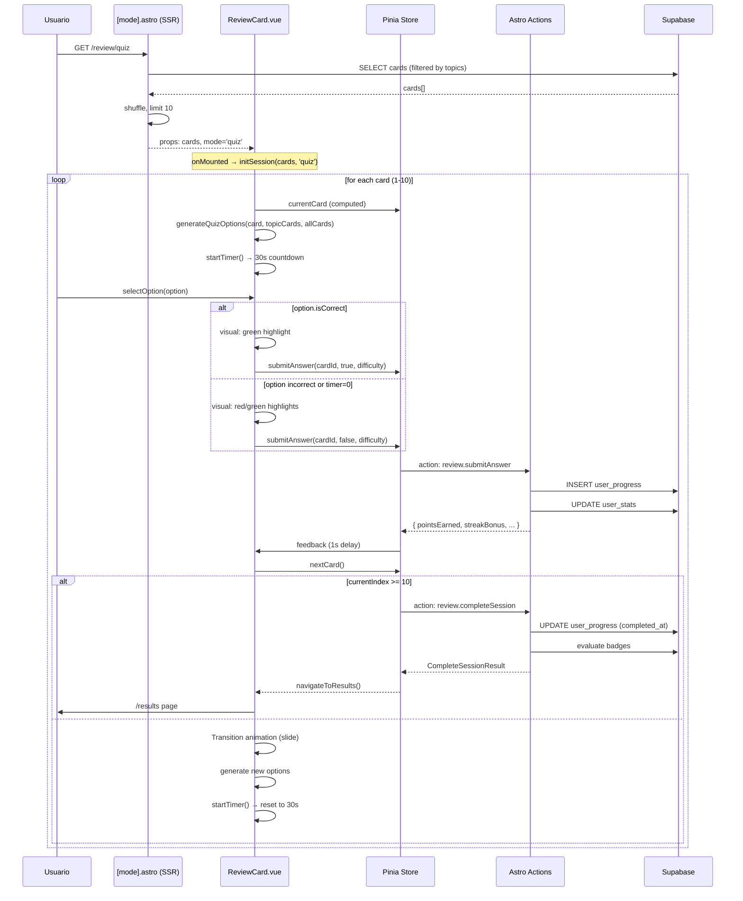
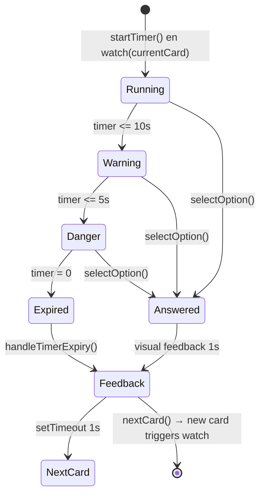

# Plan Técnico: REV-004 — Modo Quiz

## Stack Tecnológico

| Capa | Tecnología | Justificación |
|------|-----------|---------------|
| Meta-framework | Astro 5 | SSR inicial, carga del layout y datos de tarjetas |
| Frontend interactivo | Vue 3 + Composition API | Componente ReviewCard.vue con reactividad del quiz |
| Estado | Pinia | useReviewStore — sesión, respuestas, progreso |
| Estilos | TailwindCSS v4 + CSS custom properties | Glassmorphism, transiciones, timer states |
| Base de datos | Supabase (Postgres) | user_progress, cards, user_stats |
| API | Astro Actions (server) | submitAnswer, completeSession |
| Iconos | Sistema existente (emoji/texto) | Sin dependencia adicional |

## Arquitectura

```mermaid
graph TD
    subgraph "Cliente (Astro + Vue 3)"
        A1["review/index.astro<br/>Selector de modo"]
        A2["review/[mode].astro<br/>SSR: carga tarjetas"]
        A3["ReviewCard.vue<br/>Componente quiz"]
        A4["useReviewStore (Pinia)<br/>Estado de sesión"]
        A5["useReviewSession.ts<br/>Composable"]
        A6["lib/quiz.ts<br/>generateQuizOptions()"]
    end

    subgraph "Servidor (Astro Actions)"
        B1["actions/index.ts<br/>review.submitAnswer"]
        B2["actions/index.ts<br/>review.completeSession"]
        B3["lib/points.ts<br/>calculatePoints()"]
        B4["lib/badges.ts<br/>evaluateBadgeConditions()"]
    end

    subgraph "Base de Datos (Supabase)"
        C1[("cards")]
        C2[("user_progress")]
        C3[("user_stats")]
        C4[("user_preferences")]
    end

    A2 -->|SQL query| C1
    A2 -->|SQL query| C4
    A3 --> A4
    A3 --> A5
    A3 --> A6
    A4 -->|Astro Action| B1
    A4 -->|Astro Action| B2
    B1 --> C2
    B1 --> C3
    B1 --> B3
    B2 --> C2
    B2 --> C3
    B2 --> B4

    subgraph "Navegación"
        D1["/review → /review/quiz<br/>→ /results"]
    end

    A3 -->|navigateToResults()| D1
```

## Data Flow: Ciclo de vida del Quiz



## Componentes

### review/[mode].astro (SSR)
- **Responsabilidad**: Cargar tarjetas desde Supabase filtradas por temas del usuario, barajar, limitar a 10, pasar props al componente Vue
- **Estado**: Stateless (renderizado SSR)
- **Dependencias**: `createSupabaseClient()`, tipos `Card`, `ReviewMode`
- **Archivo**: `src/pages/review/[mode].astro` (existente)

### ReviewCard.vue (Cliente)
- **Responsabilidad**: UI completa del quiz — timer, opciones, feedback, progreso, navegación a resultados
- **Props**: `cards: Card[]`, `mode: ReviewMode`
- **Estado local**: `quizOptions`, `selectedOptionId`, `answered`, `currentCardContent`, `timer`
- **Dependencias**: `useReviewStore`, `useReviewSession`, `generateQuizOptions`
- **Archivo**: `src/components/cards/ReviewCard.vue` (existente)

### useReviewStore (Pinia)
- **Responsabilidad**: Estado global de la sesión — deck, índice, respuestas, puntos, streak
- **Acciones**: `initSession`, `submitAnswer`, `nextCard`, `completeSession`
- **Archivo**: `src/stores/review.ts` (existente)

### useReviewSession (Composable)
- **Responsabilidad**: Wrapper sobre store para estado de flip card (usado en self-assessment, compartido)
- **Archivo**: `src/composables/useReviewSession.ts` (existente)

### quiz.ts (Utility)
- **Responsabilidad**: `generateQuizOptions()` — genera 4 opciones (1 correcta + 3 distractores) con shuffle
- **Archivo**: `src/lib/quiz.ts` (existente)

## Timer Management



| Estado | Condición | UI | Acción |
|--------|-----------|-----|--------|
| Running | 30s > t > 10s | Normal (gris) | — |
| Warning | 10s ≥ t > 5s | Naranja + background warning | — |
| Danger | 5s ≥ t > 0 | Rojo + animación pulse | — |
| Expired | t = 0 | Opción correcta resaltada | `handleTimerExpiry()` → marcar incorrecta |
| Answered | click en opción | Verde/rojo según acierto | `selectOption()`, feedback 1s, auto-advance |

## Modelo de Datos (tablas existentes)

### cards
| Campo | Tipo | Uso en quiz |
|-------|------|-------------|
| id | UUID | Identificar tarjeta y opciones |
| title | string | Título de la pregunta |
| content | string | Explicación post-respuesta |
| topic | string | Filtrar por tema del usuario |
| difficulty | enum('easy','medium','hard') | Calcular puntos |

### user_progress
| Campo | Tipo | Uso en quiz |
|-------|------|-------------|
| id | UUID | PK |
| user_id | UUID | FK a usuarios |
| card_id | UUID | FK a cards |
| correct | boolean | Resultado de la respuesta |
| session_id | UUID | Agrupar respuestas de una sesión |
| reviewed_at | timestamp | Orden de respuestas |
| completed_at | timestamp | Null hasta completeSession |

### user_stats
| Campo | Tipo | Uso en quiz |
|-------|------|-------------|
| user_id | UUID | FK |
| total_points | int | Suma acumulada |
| current_streak | int | Racha actual (se resetea en incorrecta) |
| longest_streak | int | Máxima histórica |

## Cambios Requeridos

### 1. `src/lib/points.ts` — Actualizar BASE_POINTS
```
Actual:  { easy: 5, medium: 10, hard: 15 }
Nuevo:   { easy: 10, medium: 20, hard: 30 }
```

### 2. `src/components/cards/ReviewCard.vue` — Sin cambios mayores (quiz ya funcional)
- Verificar que `handleTimerExpiry` para quiz mode muestra explicación antes de auto-avance
- Aumentar delay de auto-avance de 1s a 2s cuando el timer expira para lectura de explicación

### 3. `src/pages/review/[mode].astro` — Sin cambios (ya filtra por topics, selecciona 10)

## Pruebas de Rendimiento

| Escenario | Objetivo |
|-----------|----------|
| 10 respuestas rápidas (< 5s c/u) | submitAnswer < 200ms c/u |
| Timer expiry en todas | handleTimerExpiry < 50ms |
| Carga inicial con 50k cards en DB | SSR < 500ms |

## Seguridad

- **Autenticación**: Middleware existente redirige a /login si no hay sesión
- **Autorización**: submitAnswer verifica userId vs JWT
- **Validación servidor**: Puntos calculados en servidor con dificultad real de la tarjeta (no confiar en cliente)
- **Validación servidor**:completeSession verifica que los sessionResults enviados coinciden con user_progress en DB
- **Anti-tampering**: El cliente envía solo cardId y correct; el servidor calcula puntos
