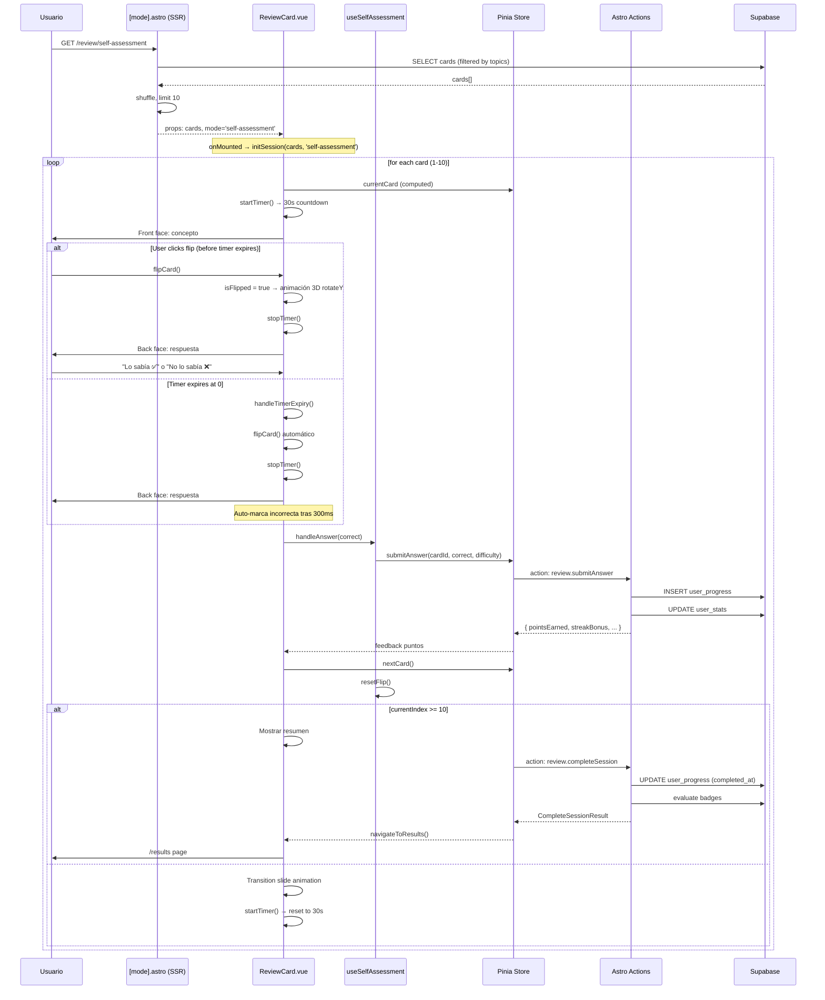
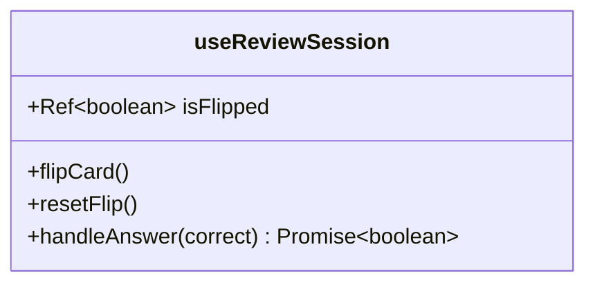
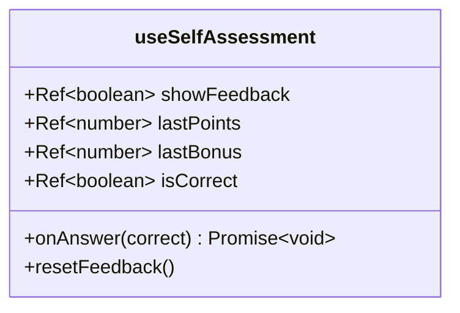
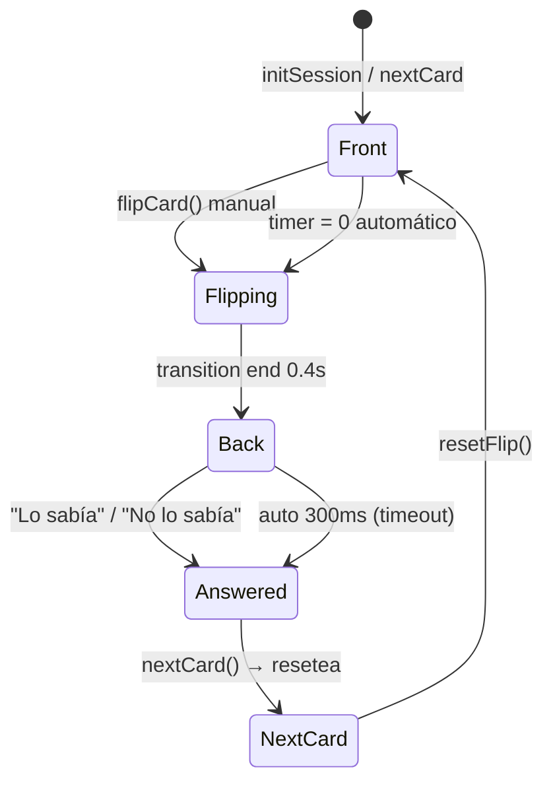
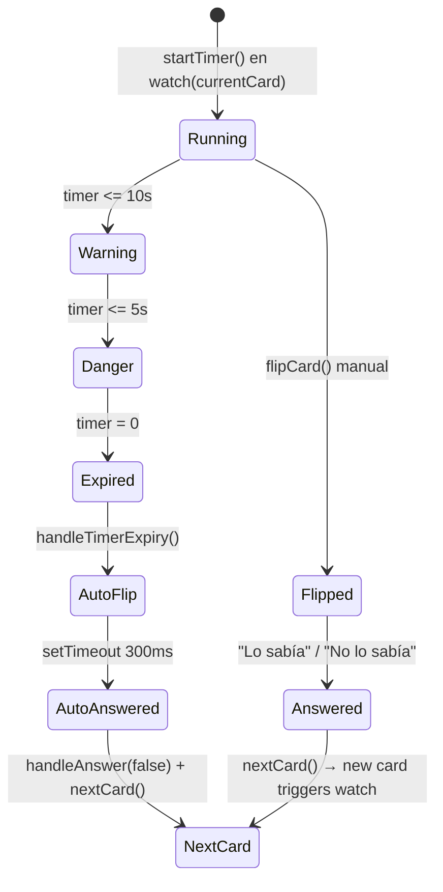

# Plan Técnico: REV-011 — Modo Autoevaluación (Flip Card)

## Stack Tecnológico

| Capa | Tecnología | Justificación |
|------|-----------|---------------|
| Meta-framework | Astro 5 | SSR inicial, carga del layout y datos de tarjetas |
| Frontend interactivo | Vue 3 + Composition API | Componente ReviewCard.vue con reactividad del flip y timer |
| Estado | Pinia | useReviewStore — sesión, respuestas, progreso (reutilizada) |
| Estilos | TailwindCSS v4 + CSS scoped | 3D flip (perspective, preserve-3d, backface-visibility), timer states |
| Base de datos | Supabase (Postgres) | user_progress, cards, user_stats (sin cambios de schema) |
| API | Astro Actions (server) | submitAnswer, completeSession (reutilizadas, agnósticas al modo) |
| Animación 3D | CSS transform (rotateY) | GPU compositing, 60fps, sin dependencias JS extra |
| Iconos | Sistema existente (emoji/texto) | Sin dependencia adicional |

## Arquitectura

```mermaid
graph TD
    subgraph "Cliente (Astro + Vue 3)"
        A1["review/index.astro<br/>Selector de modo"]
        A2["review/[mode].astro<br/>SSR: carga tarjetas"]
        A3["ReviewCard.vue<br/>Componente flip card + timer"]
        A4["useReviewStore (Pinia)<br/>Estado de sesión"]
        A5["useReviewSession.ts<br/>Composable flip state"]
        A6["useSelfAssessment.ts<br/>Composable autoevaluación<br/>NUEVO"]
    end

    subgraph "Servidor (Astro Actions)"
        B1["actions/index.ts<br/>review.submitAnswer"]
        B2["actions/index.ts<br/>review.completeSession"]
        B3["lib/points.ts<br/>PointsCalculator<br/>REUTILIZADO"]
        B4["lib/streak.ts<br/>StreakService<br/>REUTILIZADO"]
        B5["lib/badges.ts<br/>evaluateBadgeConditions"]
    end

    subgraph "Base de Datos (Supabase)"
        C1[("cards")]
        C2[("user_progress")]
        C3[("user_stats")]
        C4[("user_preferences")]
    end

    A2 -->|SQL query| C1
    A2 -->|SQL query| C4
    A3 --> A4
    A3 --> A5
    A3 --> A6
    A4 -->|Astro Action| B1
    A4 -->|Astro Action| B2
    B1 --> C2
    B1 --> C3
    B1 --> B3
    B2 --> C2
    B2 --> C3
    B2 --> B5

    subgraph "Navegación"
        D1["/review → /review/self-assessment<br/>→ /results"]
    end

    A3 -->|navigateToResults()| D1
    A6 -->|useReviewStore| A4
    A5 -->|useReviewStore| A4
```

### Reutilización de servicios Gamification

| Servicio | Archivo | Uso en autoevaluación | Cambios necesarios |
|----------|---------|-----------------------|-------------------|
| PointsCalculator | `src/lib/points.ts` | `calculatePoints(difficulty, correct)` para puntos base + `calculateStreakBonus(correctStreak)` para bonos | Sin cambios — los valores actuales (easy=5, medium=10, hard=15) ya coinciden con RN-007 |
| StreakService | `src/lib/streak.ts` | `updateStreak(state, today)` al completar sesión | Sin cambios |
| review.submitAnswer | `src/actions/index.ts` | Persistir respuesta en user_progress | Sin cambios — agnóstico al modo (solo usa cardId + correct) |
| review.completeSession | `src/actions/index.ts` | Finalizar sesión, evaluar badges | Sin cambios |
| evaluateBadgeConditions | `src/lib/badges.ts` | Evaluar insignias al completar sesión | Sin cambios |

## Data Flow: Ciclo de vida de la Autoevaluación



## Componentes

### review/[mode].astro (SSR)
- **Responsabilidad**: Cargar tarjetas desde Supabase filtradas por temas del usuario, barajar, limitar a 10, pasar props al componente Vue
- **Estado**: Stateless (renderizado SSR)
- **Dependencias**: `createSupabaseClient()`, tipos `Card`, `ReviewMode`
- **Archivo**: `src/pages/review/[mode].astro` (existente)
- **Cambios**: Si `mode === 'self-assessment'`, usar `BASE_POINTS` actual (5/10/15)

### ReviewCard.vue (Cliente) — con template self-assessment existente (líneas 182–240)
- **Responsabilidad**: UI completa de autoevaluación — flip card 3D, timer, botones auto-evaluación, progreso, navegación a resultados
- **Props**: `cards: Card[]`, `mode: ReviewMode`
- **Estado local**: `isFlipped` (desde useReviewSession), `timer`, `selectedAnswer`, `showFeedback`
- **Dependencias**: `useReviewStore`, `useReviewSession`, `useSelfAssessment`
- **Archivo**: `src/components/cards/ReviewCard.vue` (existente, refactor)

### useReviewSession (Composable — existente)

- **Responsabilidad**: Estado del flip card (isFlipped), con reset para nueva tarjeta
- **Mejora propuesta**: Agregar método `resetFlip()` para reiniciar isFlipped en nextCard
- **Archivo**: `src/composables/useReviewSession.ts` (existente)

### useSelfAssessment (Composable — NUEVO)

- **Responsabilidad**: Lógica específica de autoevaluación: feedback de puntos, manejo de estado post-respuesta
- **Dependencias**: `useReviewStore`
- **Archivo**: `src/composables/useSelfAssessment.ts` (nuevo)

### useReviewStore (Pinia — existente, sin cambios)
- **Responsabilidad**: Estado global de la sesión — deck, índice, respuestas, puntos, streak
- **Acciones**: `initSession`, `submitAnswer`, `nextCard`, `completeSession` (reutilizadas)
- **Archivo**: `src/stores/review.ts`

## Animación 3D Flip



### CSS Architecture

```css
/* ── Contenedor 3D ─────────────────────────────────────── */
.card-scene {
  perspective: 1000px;              /* Profundidad 3D */
  width: 100%;
}

.card-3d {
  position: relative;
  width: 100%;
  min-height: 55vh;
  transform-style: preserve-3d;      /* Hijos en espacio 3D */
  transition: transform 0.5s ease;   /* Duración flip */
}

.card-3d.is-flipped {
  transform: rotateY(180deg);       /* Giro completo */
}

/* ── Caras ──────────────────────────────────────────────── */
.card-face {
  position: absolute;
  inset: 0;
  backface-visibility: hidden;       /* Oculta reverso al girar */
  -webkit-backface-visibility: hidden;
}

.card-back {
  transform: rotateY(180deg);        /* Pre-rotada */
}

/* ── Reduced motion ─────────────────────────────────────── */
@media (prefers-reduced-motion: reduce) {
  .card-3d {
    transition: none;
  }
  .card-3d.is-flipped .card-front { display: none; }
  .card-3d.is-flipped .card-back { display: flex; }
}
```

| Propiedad | Valor | Propósito |
|-----------|-------|-----------|
| `perspective` | 1000px | Profundidad 3D realista |
| `transform-style` | preserve-3d | Hijos heredan espacio 3D |
| `transition` | transform 0.5s ease | Animación suave del giro |
| `backface-visibility` | hidden | Oculta la cara trasera durante el giro |
| `rotateY(180deg)` | card-back | Pre-posiciona el reverso |

## Timer Management



| Estado | Condición | UI | Acción |
|--------|-----------|-----|--------|
| Running | 30s > t > 10s | Normal (gris) | Esperando flip manual |
| Warning | 10s ≥ t > 5s | Naranja + background warning | — |
| Danger | 5s ≥ t > 0 | Rojo + animación pulse | — |
| Expired | t = 0 | Flip automático | `handleTimerExpiry()` → flipCard + marcar incorrecta |
| AutoFlip | transition end | Respuesta visible, "No lo sabía" automático | `handleAnswer(false)` tras 300ms |
| Answered | click en botón | Feedback puntos, nextCard tras 1s | `selectAnswer(correct)`, feedback 1s, auto-advance |

## Modelo de Datos (tablas existentes — sin cambios)

### cards
| Campo | Tipo | Uso en autoevaluación |
|-------|------|-----------------------|
| id | UUID | Identificar tarjeta |
| title | string | Concepto/pregunta (frente) |
| content | string | Respuesta/explicación (reverso) |
| topic | string | Filtrar por tema del usuario |
| difficulty | enum('easy','medium','hard') | Calcular puntos (5/10/15) |

### user_progress
| Campo | Tipo | Uso en autoevaluación |
|-------|------|-----------------------|
| id | UUID | PK |
| user_id | UUID | FK a usuarios |
| card_id | UUID | FK a cards |
| correct | boolean | Resultado auto-evaluación |
| session_id | UUID | Agrupar respuestas de una sesión |
| reviewed_at | timestamp | Orden de respuestas |
| completed_at | timestamp | Null hasta completeSession |

### user_stats
| Campo | Tipo | Uso en autoevaluación |
|-------|------|-----------------------|
| user_id | UUID | FK |
| total_points | int | Suma acumulada (5/10/15 + bonos) |
| current_streak | int | Racha actual |
| longest_streak | int | Máxima histórica |

## Cambios Requeridos

### 1. `src/composables/useSelfAssessment.ts` — NUEVO
- Extraer lógica de autoevaluación: `showFeedback`, `lastPoints`, `lastBonus`, `isCorrect`
- Método `onAnswer(correct)` para manejar feedback + nextCard
- Método `resetFeedback()` para limpiar entre tarjetas

### 2. `src/composables/useReviewSession.ts` — Mejora
- Agregar `resetFlip()` para reiniciar isFlipped en nextCard
- Agregar getter `currentFace: ComputedRef<CardFace>`

### 3. `src/components/cards/ReviewCard.vue` — Refactor
- Extraer lógica de autoevaluación (template self-assessment líneas 182–240) a `useSelfAssessment`
- Verificar que `handleTimerExpiry` para self-assessment mode:
  1. Hace flip automático si `!isFlipped`
  2. Llama `handleAnswer(false)` tras 300ms (tiempo para leer respuesta)
  3. No permite auto-evaluación manual después de timeout

### 4. `src/types/app.ts` — Nuevos tipos
- Agregar `CardFace` type
- Agregar `FlipAnimationConfig` interface
- Agregar `SelfAssessmentResult` interface

### 5. `src/pages/review/[mode].astro` — Sin cambios (ya filtra por topics, selecciona 10)

## Pruebas de Rendimiento

| Escenario | Objetivo |
|-----------|----------|
| 10 flips rápidos (< 3s c/u) | submitAnswer < 200ms c/u, animación 60fps |
| Timer expiry en todas | handleTimerExpiry < 50ms |
| Carga inicial con 50k cards en DB | SSR < 500ms |

## Seguridad

- **Autenticación**: Middleware existente redirige a /login si no hay sesión
- **Autorización**: submitAnswer verifica userId vs JWT
- **Validación servidor**: Puntos calculados en servidor con dificultad real de la tarjeta (no confiar en cliente)
- **Validación servidor**: Los mismos mecanismos de `review.submitAnswer` y `review.completeSession` se aplican — el servidor no distingue el modo, solo procesa cardId + correct
- **Anti-tampering**: El cliente envía solo cardId y correct; el servidor calcula puntos. El flag `selfEvaluated` es informativo, no se usa para cálculos de puntos
