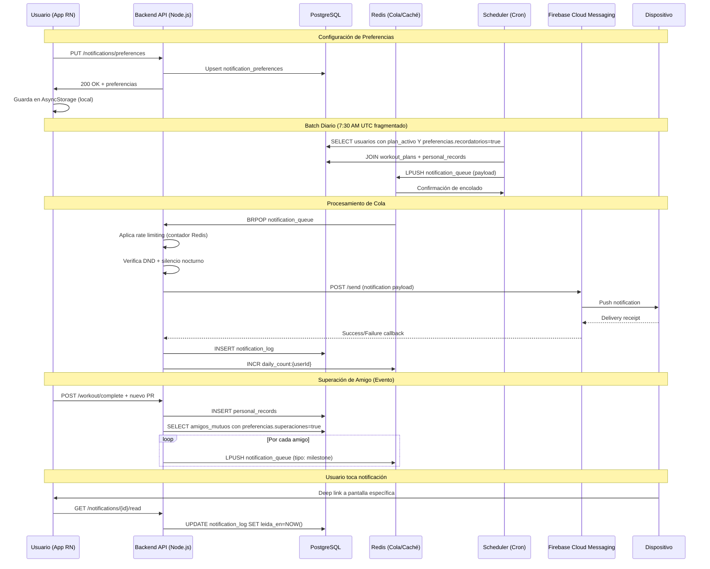
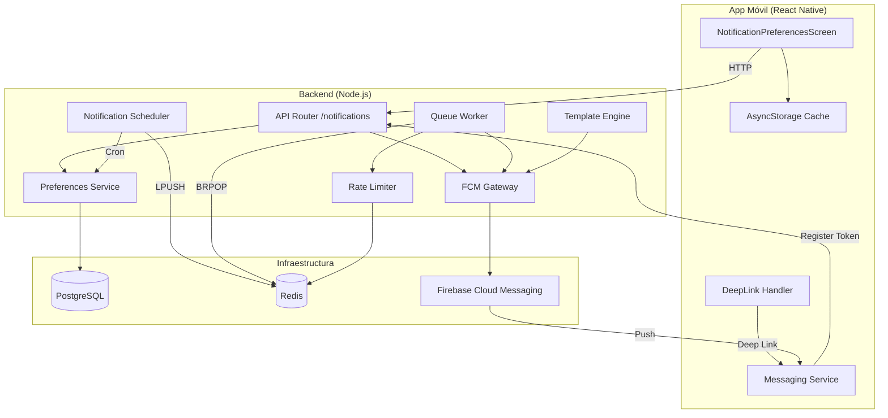
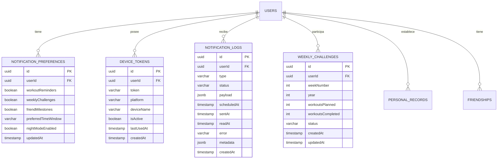

# Evaluación: User Story Spec Skill
## Proyecto: Sistema de Notificaciones Push — App de Fitness
## Fecha: 2026-05-13

---

# FASE 1: Entrevista Exhaustiva (Simulada)

## Bloque A: Visión y Problema

**P1 — ¿Cuál es el problema principal que resuelve esta funcionalidad?**

> Los usuarios olvidan sus entrenamientos, pierden motivación durante la semana, y no se enteran de logros de amigos. La app actual solo notifica cuando hay un cambio en el plan, pero no es personalizada ni oportuna. Queremos que el usuario sienta que la app lo acompaña, no que lo interrumpe.

**P2 — ¿Quiénes son los usuarios finales?**

> Dos perfiles principales:
> - **Perfil A — Entusiasta del fitness (70%)**: Entrena 3-4 veces/semana, usa la app para planes de entrenamiento, sigue amigos. Edad 22-40. Nivel técnico medio-alto.
> - **Perfil B — Usuario casual (30%)**: Entrena 1-2 veces/semana, usa la app esporádicamente. Edad 30-50. Nivel técnico medio-bajo. Propenso a abandonar.
>
> La funcionalidad está diseñada principalmente para el Perfil A, pero debe ser útil también para el Perfil B (para fidelizarlo).

**P3 — ¿Qué valor de negocio aporta?**

> - Aumentar retención D30 en un 15% (usuario que recibe notificaciones personalizadas vs. no las recibe)
> - Incrementar sesiones semanales por usuario de 2.8 a 3.5 (objetivo: 25% más de engagement)
> - Reducir churn en usuarios inactivos (>7 días sin abrir la app) en un 20%
> - Aumentar la viralidad: usuarios que comparten logros generan 2x más invitaciones

---

## Bloque B: Comportamiento y Flujo Principal

**P4 — Describe el flujo feliz paso a paso**

> 1. El usuario abre la app y configura sus preferencias de notificación en Settings > Notificaciones
> 2. Activa/desactiva tipos: recordatorios de entrenamiento, retos semanales, superaciones de amigos
> 3. Selecciona franjas horarias preferidas (mañana/tarde/noche)
> 4. El backend evalúa diariamente qué notificaciones enviar según las reglas de negocio
> 5. A las 7:30 AM (o franja elegida), llega un reminder push: "¡Hoy toca pecho! Tu mejor marca en press banca es 65kg 💪"
> 6. El lunes a las 10 AM llega: "🔥 Reto semanal: 3 entrenamientos esta semana. ¡Llevas 1!"
> 7. Cuando un amigo supera su marca: "🏆 ¡María acaba de romper su récord en sentadilla! 80kg — dale like"
> 8. Al tocar la notificación, abre la sección correspondiente de la app

**P5 — ¿Qué desencadena esta acción?**

> Tres triggers:
> - **Recordatorio entrenamiento**: Programado según el plan semanal del usuario (7:30 AM el día del entrenamiento)
> - **Reto semanal**: Trigger semanal (lunes 10 AM) + seguimiento diario si el usuario no ha completado sus entrenamientos
> - **Superación de amigo**: Evento en tiempo real cuando un amigo registra un nuevo PR (personal record)

**P6 — ¿Qué información necesita el usuario para completar la acción?**

> - Para recordatorios: el nombre del entrenamiento del día, mejor marca personal en ese ejercicio
> - Para retos: progreso semanal (X de Y entrenamientos completados), días restantes
> - Para superaciones: nombre del amigo, ejercicio, nuevo récord, diferencia vs anterior

**P7 — ¿Qué feedback recibe el usuario en cada paso?**

> - Al configurar notificaciones: preview en vivo de cómo se verá la notificación
> - Al activar/desactivar: toggle animado + confirmación táctil (haptic en móvil)
> - Al recibir push: badge count actualizado, sonido configurable
> - Al tocar la notificación: deep link a la pantalla exacta (plan de entrenamiento, retos, o feed social)

---

## Bloque C: Bordes y Errores

**P8 — ¿Qué pasa cuando algo sale mal?**

> - **Sin conexión**: Las notificaciones se encolan en el servidor. Al reconectar, se envían las pendientes (máximo 3 acumuladas para no saturar)
> - **Error al enviar push**: Reintento 3 veces con backoff exponencial (30s, 2min, 5min). Si falla, se descarta y se registra en logs
> - **Token de dispositivo expirado**: El backend detecta respuesta "InvalidToken" de FCM/APNs y marca el token como inactivo. Se pide refresco en próximo inicio de app
> - **Zona horaria del usuario cambia**: Se recalcula la próxima ventana de notificación

**P9 — ¿Qué edge cases existen?**

> - Usuario con múltiples dispositivos (tablet + phone): solo notificar en el último usado (o en todos, configurable)
> - Usuario en DND (Do Not Disturb): respetar configuración del SO
> - Usuario sin amigos: no enviar notificaciones de superación
> - Usuario que ya completó el entrenamiento antes del reminder: no enviar recordatorio o enviar versión de "felicitación"
> - Zona horaria del usuario cruza medianoche: recalcular correctamente
> - Amigo borra su PR: no enviar la notificación si el récord fue eliminado antes de ser procesada

**P10 — ¿Qué pasa si el usuario interrumpe el flujo?**

> - **Cierra la app durante configuración**: los cambios se guardan localmente hasta que se sincronicen. Próxima apertura persiste la config pendiente
> - **Toca la notificación pero la app tarda en abrir**: mostrar estado de carga con skeleton. Si falla, mensaje: "No pudimos cargar esta sección. ¿Quieres intentar de nuevo?"
> - **Desinstala la app**: el backend detecta tokens inválidos y limpia el registro. Si reinstala, se genera un nuevo token

**P11 — ¿Hay restricciones de negocio?**

> - Máximo 3 notificaciones push por día por usuario (para evitar fatiga y respetar directrices de App Store/Play Store)
> - No enviar notificaciones entre 10 PM y 7 AM (hora local del usuario), excepto superaciones de amigos solo si el usuario tiene "modo noche" desactivado
> - Los retos semanales solo aplican a usuarios con plan de entrenamiento activo
> - Superaciones de amigos: solo amigos mutuos (bidireccionales)
> - Las notificaciones deben ser aprobadas por el equipo de contenido antes de enviar (templates revisados)

---

## Bloque D: Datos y Persistencia

**P12 — ¿Qué datos se crean/modifican/eliminan?**

> Entidades principales:
> - `notification_preferences`: userId, tipos activados, franjas horarias, DND config
> - `notification_queue`: id, userId, tipo, payload, estado (pending/sent/failed), programada_para, enviada_en, leída_en
> - `notification_tokens`: userId, token, plataforma, device_name, activo, última_vez_usado
> - `notification_log`: id, userId, tipo, estado, error (si falló), timestamp, metadata
> - `personal_records`: userId, ejercicio, marca, fecha, superado_por (array de amigos que dieron like)
> - `weekly_challenges`: userId, semana, entrenamientos_completados, objetivo, estado

**P13 — ¿Hay historial o auditoría requerida?**

> Sí:
> - Log de todas las notificaciones enviadas (quién, cuándo, qué tipo, si se leyó)
> - Historial de cambios en preferencias de notificación (para auditoría y revertir cambios accidentales)
> - Métricas de entrega: enviadas, entregadas, abiertas, taux de conversión por tipo
> - Retención de logs: 90 días para datos operativos, 12 meses para métricas anonimizadas

**P14 — ¿Qué datos deben persistir localmente vs en servidor?**

> - **Local**: preferencias de notificación (para respuesta instantánea en UI), cache de templates de notificación, cola de eventos pendientes (offline-first)
> - **Servidor**: todos los registros históricos, tokens de dispositivo, configuración de usuario, métricas
> - **Sincronización**: Al conectar, sync bidireccional. Prioridad al servidor en conflictos. Estrategia: última escritura gana (LWW) con timestamp del servidor

---

## Bloque E: No-Funcionales

**P15 — ¿Hay requisitos de rendimiento?**

> - Entrega de notificaciones: < 30 segundos desde que se genera el evento hasta que llega al dispositivo (excluyendo latencia de red de FCM/APNs)
> - Consultas de configuración de notificaciones: < 200ms p99
> - Usuarios concurrentes estimados: 50,000 DAU, 300,000 MAU
> - Volumen de notificaciones: ~150,000 push/día (50% recordatorios, 30% retos, 20% superaciones)
> - Procesamiento batch diario de recordatorios en < 5 minutos para toda la base de usuarios

**P16 — ¿Qué medidas de seguridad se requieren?**

> - Autenticación: JWT con refresh tokens, integración con auth existente (Firebase Auth o Supabase Auth)
> - Autorización: el endpoint de registro de tokens requiere sesión activa
> - Cifrado: tokens de dispositivo cifrados en reposo (AES-256)
> - Privacidad: el usuario puede opt-out totalmente. Datos de notificaciones no compartidos con terceros
> - Cumplimiento: GDPR (derecho al olvido incluye borrar historial de notificaciones), CCPA, ePrivacy Directive (consentimiento para notificaciones push)
> - Rate limiting: máximo 10 registros de token por hora por usuario

**P17 — ¿Hay restricciones técnicas conocidas?**

> - App multiplataforma: iOS y Android (React Native actualmente)
> - Backend existente en Node.js + Express
> - Base de datos: PostgreSQL (principal) + Redis (caché/colas)
> - Push infrastructure: Firebase Cloud Messaging (FCM) para Android, APNs para iOS via Firebase
> - La app ya tiene un sistema de autenticación y un módulo social (amigos, feed)
> - Debe integrarse con el módulo de planes de entrenamiento existente para saber qué ejercicios tiene el usuario cada día

---

## Preguntas de Seguimiento

**P18 — ¿Hay integración con sistemas externos?**

> Sí: Firebase Cloud Messaging (FCM) para el envío de push en ambas plataformas. También se evaluará Expo Push Notifications como alternativa para simplificar.

**P19 — ¿Quién aprueba/revisa el resultado final?**

> - PM de producto (aprueba funcionalidad) — Carolina M.
> - Tech Lead (aprueba arquitectura) — Diego F.
> - Content team (aprueba templates de copy) — equipo de contenido
> - QA (aprueba criterios de aceptación) — equipo QA

**P20 — ¿Hay métricas de éxito definidas?**

> - **Tasa de apertura de notificaciones**: > 25% (benchmark industria fitness: 18-22%)
> - **Tasa de conversión**: > 10% de usuarios que al tocar notificación completan una acción (registrar entrenamiento, unirse a reto, dar like)
> - **Reducción de inactividad**: usuarios que reciben notificaciones abren la app 3x más que los que no reciben
> - **Satisfacción**: NPS específico de notificaciones > 40 (medido en encuesta in-app trimestral)

---

## Resumen de la Entrevista (Validación con Usuario)

> **Confirmación del agente**: He capturado 3 flujos principales (recordatorios de entrenamiento, retos semanales, superaciones de amigos), con configuraciones personalizables por el usuario, límite de 3 push/día, integración con FCM/APNs, y métricas de negocio definidas. ¿Es correcto?

> **Respuesta simulada**: Sí, correcto. Adelante con las user stories.

---

# FASE 2: User Stories con Behavioral Design

---

### US-001: Recordatorio de entrenamiento personalizado

- **Resumen**: Recibir un push matutino con el entrenamiento del día y la mejor marca personal para motivar al usuario a entrenar

#### Perfil:
- **Persona**: Entusiasta del fitness (Perfil A)
- **Frecuencia**: Alta (cada día de entrenamiento, 3-4 veces/semana)
- **Contexto emocional**: Apurado por la mañana, necesita un empujón motivacional

#### Use Case:
- **Como** entusiasta del fitness con plan de entrenamiento activo
- **Quiero** recibir un recordatorio push cada mañana de entrenamiento con mi mejor marca personal
- **Para** sentirme motivado y preparado antes de ir al gimnasio, aprovechando mi mejor rendimiento como referencia

#### Criterios de Aceptación (Gherkin):
- **Escenario**: Recordatorio enviado en la franja horaria del usuario
- **Dado** que tengo un plan de entrenamiento activo
- **Y dado** que tengo notificaciones de recordatorio activadas
- **Y dado** que hoy tengo entrenamiento programado
- **Y dado** que tengo una mejor marca personal registrada para el ejercicio principal de hoy
- **Cuando** sean las 7:30 AM (o mi franja horaria configurada)
- **Entonces** recibo un push con el texto: "¡Hoy toca [grupo muscular]! Tu mejor marca en [ejercicio] es [marca]kg 💪"
- **Y dado** que al tocar la notificación se abre el plan de entrenamiento del día

- **Principios conductuales**: Reducción de fricción (no requiere abrir la app para saber qué toca hoy), Loss aversion (muestra la marca personal para que el usuario quiera superarla), Contexto emocional (tono motivacional, emoji de músculo)

---

### US-002: Control de preferencias de notificación

- **Resumen**: Configurar desde la app qué notificaciones recibir y en qué horarios

#### Perfil:
- **Persona**: Entusiasta del fitness (Perfil A) / Usuario casual (Perfil B)
- **Frecuencia**: Baja (configuración única o esporádica)
- **Contexto emocional**: Quiere personalizar su experiencia sin sentirse abrumado

#### Use Case:
- **Como** usuario de la app de fitness
- **Quiero** activar/desactivar tipos de notificación y elegir franjas horarias
- **Para** controlar cuándo y cómo me llegan los avisos sin que interrumpan mi día

#### Criterios de Aceptación (Gherkin):
- **Escenario**: Usuario configura notificaciones desde Settings
- **Dado** que estoy logueado en la app
- **Y dado** que accedo a Settings > Notificaciones
- **Cuando** veo los tres tipos de notificación (recordatorios, retos, superaciones)
- **Y** activo/desactivo cada uno mediante toggle
- **Y** selecciono una franja horaria (mañana/tarde/noche)
- **Entonces** veo un preview en vivo de cómo se verá la notificación según mi selección
- **Y** mis preferencias se guardan localmente (respuesta instantánea)
- **Y** se sincronizan con el servidor

- **Principios conductuales**: Defaults (todas activadas por defecto guían al éxito), Reducción de fricción (preview en vivo evita confusión), Loss aversion (el preview muestra lo que "perdería" si desactiva)

---

### US-003: Reto semanal personalizado

- **Resumen**: Recibir y dar seguimiento a un reto semanal adaptado al historial del usuario

#### Perfil:
- **Persona**: Entusiasta del fitness (Perfil A)
- **Frecuencia**: Media (semanal)
- **Contexto emocional**: Motivado los lunes, necesita consistencia el resto de la semana

#### Use Case:
- **Como** usuario activo con plan de entrenamiento
- **Quiero** recibir un reto semanal que me desafíe a completar mis entrenamientos
- **Para** mantener la constancia y sentir progreso medible semana a semana

#### Criterios de Aceptación (Gherkin):
- **Escenario**: Reto semanal creado y notificado el lunes
- **Dado** que tengo un plan de entrenamiento activo
- **Y dado** que son las 10:00 AM del lunes
- **Cuando** el sistema calcula mi objetivo semanal (cantidad de entrenamientos en mi plan)
- **Entonces** recibo un push: "🔥 Reto semanal: [X] entrenamientos esta semana. ¡Llevas [completados]!"
- **Y** al tocar la notificación se abre la vista de progreso semanal

- **Escenario**: Seguimiento de reto a mitad de semana (sin progreso)
- **Dado** que es miércoles
- **Y dado** que no he completado ningún entrenamiento de mi reto semanal
- **Cuando** el sistema detecta inactividad
- **Entonces** recibo un push de recuperación: "⏰ ¡Aún estás a tiempo! Te quedan [días] días para completar tu reto semanal"

- **Principios conductuales**: Loss aversion (perder la racha semanal duele), Fijación de metas (objetivo concreto), Defaults (el reto se asigna automáticamente), Scarcity ("te quedan X días" activa urgencia)

---

### US-004: Notificación de superación de amigo

- **Resumen**: Recibir alerta cuando un amigo supera su marca personal en un ejercicio

#### Perfil:
- **Persona**: Entusiasta del fitness (Perfil A)
- **Frecuencia**: Media-alta (variable según actividad de amigos)
- **Contexto emocional**: Social, competitivo, motivado por el logro ajeno

#### Use Case:
- **Como** usuario con amigos en la app
- **Quiero** recibir una notificación cuando un amigo supera su marca personal
- **Para** celebrar sus logros, sentirme parte de una comunidad y motivarme a superar mis propias marcas

#### Criterios de Aceptación (Gherkin):
- **Escenario**: Amigo supera marca personal y se notifica
- **Dado** que tengo al menos un amigo mutuo en la app
- **Y dado** que tengo notificaciones de superación activadas
- **Y dado** que mi amigo ha registrado un nuevo PR en un ejercicio
- **Cuando** el sistema procesa el nuevo PR
- **Entonces** recibo un push: "🏆 [Nombre] acaba de romper su récord en [ejercicio]! [Nuevo]kg — dale like"
- **Y** al tocar la notificación se abre el perfil del amigo con el nuevo récord destacado

- **Escenario**: Sin amigos en la app
- **Dado** que no tengo amigos en la app
- **Y dado** que intento activar notificaciones de superación
- **Cuando** veo la configuración
- **Entonces** veo la opción deshabilitada con un mensaje: "Conecta con amigos para recibir notificaciones de sus logros"
- **Y** un CTA: "Invitar amigos"

- **Principios conductuales**: Prueba social (ver logros ajenos motiva), Loss aversion (no quiero quedarme atrás), Micro-interacción de celebración (like rápido), FOMO (miedo a perderme los logros de mi red)

---

### US-005: Rate limiting y silencio nocturno

- **Resumen**: Proteger al usuario de sobrecarga de notificaciones con límites inteligentes

#### Perfil:
- **Persona**: Ambos perfiles
- **Frecuencia**: Constante (background)
- **Contexto emocional**: Quiere estar informado sin ser interrumpido

#### Use Case:
- **Como** usuario que valora su tranquilidad
- **Quiero** que la app limite las notificaciones a un máximo diario y respete mi horario de sueño
- **Para** no sentirme abrumado por avisos y mantener una relación saludable con la app

#### Criterios de Aceptación (Gherkin):
- **Escenario**: Límite diario alcanzado
- **Dado** que ya he recibido 3 notificaciones push hoy
- **Cuando** se genera un nuevo evento notificable
- **Entonces** el evento se descarta o se pospone para el día siguiente
- **Y** se registra en el log como "skipped (daily limit reached)"

- **Escenario**: Horario nocturno
- **Dado** que son las 11:00 PM (hora local del usuario)
- **Y dado** que el usuario tiene activado el modo silencio nocturno
- **Cuando** se genera una notificación de superación de amigo
- **Entonces** la notificación se pospone hasta las 7:00 AM
- **Y** se entrega dentro del primer lote matutino

- **Principios conductuales**: Loss aversion (evita que el usuario desactive todo por fatiga), Defaults (silencio nocturno activo por defecto), Respeto contextual (muestra que la app entiende las necesidades del usuario)

---

### US-006: Offline resiliencia y cola de notificaciones

- **Resumen**: Asegurar que las notificaciones no se pierdan cuando el dispositivo está offline

#### Perfil:
- **Persona**: Ambos perfiles
- **Frecuencia**: Baja (situaciones de pérdida de conexión)
- **Contexto emocional**: Frustrado por la falta de conexión, quiere que la app "recuerde" lo que se perdió

#### Use Case:
- **Como** usuario con conectividad intermitente
- **Quiero** que las notificaciones no se pierdan cuando mi dispositivo está offline
- **Para** recibir la información importante aunque se entregue con retraso

#### Criterios de Aceptación (Gherkin):
- **Escenario**: Notificación generada mientras el usuario está offline
- **Dado** que el dispositivo del usuario está sin conexión
- **Cuando** se genera una notificación en el servidor
- **Entonces** la notificación se encola en el servidor con estado "pending"
- **Y** se reintenta máximo 3 veces con backoff exponencial (30s, 2min, 5min)
- **Y** si el dispositivo se reconecta dentro de la ventana, se entrega
- **Y** si fallan los 3 intentos, se descarta y se registra como "failed"

- **Principios conductuales**: Loss aversion (evita que el usuario pierda información importante), Consistencia (la app se siente confiable aunque falle la red)

---

# FASE 3: Especificación Técnica (OpenSpec)

```yaml
---
title: Sistema de Notificaciones Push Inteligentes — App Fitness
version: 1.0
date_created: 2026-05-13
owner: Equipo de Producto — Carolina M.
tags: especificación, user-stories, notificaciones, push, fitness, behavioral-design
---
```

---

## 1. Propósito y Alcance

Sistema de notificaciones push contextuales y personalizadas para una app de fitness multiplataforma (iOS/Android). El sistema gestiona tres tipos de notificaciones: recordatorios de entrenamiento con marcas personales, retos semanales con seguimiento de progreso, y alertas sociales cuando un amigo supera su marca personal.

La solución se integra con el stack existente (React Native, Node.js, PostgreSQL, Redis) y utiliza Firebase Cloud Messaging (FCM) como infraestructura de push unificada para ambas plataformas. Incluye configuración de preferencias de usuario, rate limiting (máximo 3 push/día), silencio nocturno, resiliencia offline y colas de reintentos.

El alcance incluye el backend de procesamiento y envío, el módulo de configuración en la app móvil, y la integración con los módulos existentes de planes de entrenamiento y red social. Queda fuera del alcance: diseño visual detallado de la pantalla de configuración, implementación de A/B testing de copies, y el sistema de analytics externo.

---

## 2. Definiciones

| Término | Definición |
|---------|-----------|
| **FCM** | Firebase Cloud Messaging — infraestructura de Google para envío de notificaciones push a iOS y Android |
| **APNs** | Apple Push Notification service — servicio nativo de Apple para notificaciones push |
| **PR** | Personal Record — mejor marca personal del usuario en un ejercicio específico |
| **Token de dispositivo** | Identificador único que FCM/APNs asigna a cada instalación de la app para envío de push |
| **DND** | Do Not Disturb — modo silencio del sistema operativo que bloquea notificaciones |
| **Reto semanal** | Desafío automático que establece como objetivo completar todos los entrenamientos planificados para la semana |
| **Badge count** | Número con la cuenta de notificaciones no leídas que aparece en el ícono de la app |
| **Deep link** | Enlace que abre la app en una sección específica en lugar de la pantalla de inicio |
| **LWW** | Last Writer Wins — estrategia de resolución de conflictos donde el último cambio prevalece |
| **Batch diario** | Proceso que ejecuta el servidor cada día para calcular y encolar notificaciones programadas |

---

## 3. User Stories

### US-001: Recordatorio de entrenamiento personalizado
*(Ver detalle completo en FASE 2)*

- **Resumen**: Recibir push matutino con entrenamiento del día y mejor marca personal
- **Persona**: Entusiasta del fitness
- **Como** entusiasta del fitness **quiero** un recordatorio push con mi mejor marca **para** sentirme motivado antes del gimnasio

### US-002: Control de preferencias de notificación
*(Ver detalle completo en FASE 2)*

- **Resumen**: Configurar tipos y horarios de notificaciones
- **Persona**: Ambos perfiles
- **Como** usuario **quiero** activar/desactivar tipos de notificación **para** controlar cuándo me llegan avisos

### US-003: Reto semanal personalizado
*(Ver detalle completo en FASE 2)*

- **Resumen**: Recibir reto semanal con seguimiento de progreso
- **Persona**: Entusiasta del fitness
- **Como** usuario activo **quiero** un reto semanal **para** mantener constancia y medir progreso

### US-004: Notificación de superación de amigo
*(Ver detalle completo en FASE 2)*

- **Resumen**: Alerta cuando un amigo supera su marca personal
- **Persona**: Entusiasta del fitness
- **Como** usuario con amigos **quiero** saber cuando superan marcas **para** celebrar y motivarme

### US-005: Rate limiting y silencio nocturno
*(Ver detalle completo en FASE 2)*

- **Resumen**: Límite de 3 push/día y respeto del horario de sueño
- **Persona**: Ambos perfiles
- **Como** usuario **quiero** límites inteligentes **para** no sentirme abrumado

### US-006: Offline resiliencia y cola de notificaciones
*(Ver detalle completo en FASE 2)*

- **Resumen**: Notificaciones no se pierden cuando el dispositivo está offline
- **Persona**: Ambos perfiles
- **Como** usuario con conectividad intermitente **quiero** que las notificaciones se encolen **para** recibirlas cuando reconecte

---

## 4. Requerimientos Funcionales

- **RF-001**: El sistema debe permitir al usuario activar/desactivar individualmente cada tipo de notificación (recordatorios, retos, superaciones)
- **RF-002**: El sistema debe permitir al usuario configurar su franja horaria preferida (mañana/tarde/noche)
- **RF-003**: El sistema debe enviar recordatorios de entrenamiento según el plan semanal del usuario y su mejor marca personal
- **RF-004**: El sistema debe crear un reto semanal automático cada lunes basado en los entrenamientos planificados del usuario
- **RF-005**: El sistema debe enviar una notificación de seguimiento si el usuario no ha completado entrenamientos a mitad de semana
- **RF-006**: El sistema debe notificar cuando un amigo mutuo registra un nuevo PR
- **RF-007**: El sistema debe limitar el envío a máximo 3 notificaciones push por día por usuario
- **RF-008**: El sistema debe respetar silencio nocturno (10 PM - 7 AM hora local) para notificaciones no críticas
- **RF-009**: El sistema debe encolar notificaciones cuando el dispositivo está offline y reintentar con backoff exponencial
- **RF-010**: El sistema debe invalidar tokens de dispositivo expirados y solicitar refresco
- **RF-011**: El sistema debe soportar deep links desde cada tipo de notificación a la sección correspondiente
- **RF-012**: El sistema debe mostrar un preview en vivo de la notificación durante la configuración
- **RF-013**: El sistema debe registrar en log todas las notificaciones enviadas, entregadas y abiertas
- **RF-014**: El sistema debe detectar zona horaria del usuario y recalcular ventanas de envío si cambia
- **RF-015**: El sistema debe persistir preferencias localmente con respuesta instantánea y sincronizar con servidor

---

## 5. Requerimientos No Funcionales

- **RNF-001 — Rendimiento**: Entrega de notificaciones en < 30s desde generación del evento (excluyendo latencia FCM/APNs)
- **RNF-002 — Rendimiento**: Procesamiento del batch diario de recordatorios en < 5 min para toda la base
- **RNF-003 — Rendimiento**: Consultas de configuración en < 200ms p99
- **RNF-004 — Escalabilidad**: Soportar 50,000 DAU, 300,000 MAU, 150,000 push/día
- **RNF-005 — Seguridad**: Tokens de dispositivo cifrados en reposo (AES-256)
- **RNF-006 — Seguridad**: Rate limiting de registro de tokens: máximo 10/hora por usuario
- **RNF-007 — Privacidad**: Cumplimiento GDPR, CCPA, ePrivacy Directive. Derecho al olvido incluye borrado de historial de notificaciones
- **RNF-008 — Disponibilidad**: Sistema de colas debe tener disponibilidad 99.9% para no perder eventos
- **RNF-009 — Portabilidad**: Compatible con iOS 15+ y Android 12+
- **RNF-010 — Consistencia**: Estrategia LWW con timestamp del servidor para sincronización de preferencias

---

## 6. Restricciones y Reglas de Negocio

- **RN-001**: Máximo 3 notificaciones push por día por usuario (incluye los 3 tipos). No negociable para evitar fatiga de usuario.
- **RN-002**: No enviar notificaciones entre 10 PM y 7 AM (hora local del usuario). Las superaciones de amigos pueden saltarse esta regla si el usuario tiene modo noche desactivado.
- **RN-003**: Los retos semanales solo aplican a usuarios con plan de entrenamiento activo.
- **RN-004**: Las superaciones de amigos solo aplican a amigos mutuos (relación bidireccional).
- **RN-005**: Los templates de notificaciones deben ser aprobados por el equipo de contenido antes de su activación.
- **RN-006**: El usuario puede opt-out totalmente de notificaciones push desde la configuración del SO.
- **RN-007**: Si un usuario elimina su cuenta, todo el historial de notificaciones debe ser anonimizado/eliminado en 30 días (GDPR).
- **CON-001**: La app está construida en React Native. No se puede cambiar de framework para esta feature.
- **CON-002**: Backend en Node.js + Express. La cola de procesamiento debe integrarse con la infraestructura existente.
- **CON-003**: La infraestructura de push es FCM para ambas plataformas (ya configurado en el proyecto).
- **CON-004**: El módulo de amigos y el módulo de planes de entrenamiento ya existen. No se rediseñan.

---

## 7. Flujo de Datos



---

## 8. Contratos de Interfaz (API)

```typescript
// ============================================
// Preferencias de Notificación
// ============================================

interface NotificationPreferences {
  userId: string;
  workoutReminders: boolean;        // default: true
  weeklyChallenges: boolean;        // default: true
  friendMilestones: boolean;        // default: true
  preferredTimeWindow: 'morning' | 'afternoon' | 'evening'; // default: 'morning'
  nightModeEnabled: boolean;        // default: true
  updatedAt: string;                // ISO 8601
}

// GET /notifications/preferences
// Response 200:
interface GetPreferencesResponse {
  data: NotificationPreferences;
}

// PUT /notifications/preferences
// Request Body:
interface UpdatePreferencesRequest {
  workoutReminders?: boolean;
  weeklyChallenges?: boolean;
  friendMilestones?: boolean;
  preferredTimeWindow?: 'morning' | 'afternoon' | 'evening';
  nightModeEnabled?: boolean;
}
// Response 200:
interface UpdatePreferencesResponse {
  data: NotificationPreferences;
  message: string;
}


// ============================================
// Registro de Token de Dispositivo
// ============================================

interface DeviceToken {
  userId: string;
  token: string;
  platform: 'ios' | 'android';
  deviceName?: string;
  isActive: boolean;
  lastUsedAt: string;
}

// POST /notifications/tokens
// Request Body:
interface RegisterTokenRequest {
  token: string;
  platform: 'ios' | 'android';
  deviceName?: string;
}
// Response 201:
interface RegisterTokenResponse {
  data: DeviceToken;
}

// DELETE /notifications/tokens/:tokenId
// Response 204

// GET /notifications/tokens
// Response 200:
interface ListTokensResponse {
  data: DeviceToken[];
}


// ============================================
// Logs de Notificaciones
// ============================================

interface NotificationLog {
  id: string;
  userId: string;
  type: 'workout_reminder' | 'weekly_challenge' | 'friend_milestone';
  status: 'pending' | 'sent' | 'delivered' | 'failed' | 'skipped' | 'read';
  payload: {
    title: string;
    body: string;
    data?: Record<string, string>;   // deep link metadata
  };
  scheduledAt: string;
  sentAt?: string;
  readAt?: string;
  error?: string;
}

// GET /notifications/logs?limit=20&offset=0&type=workout_reminder
// Response 200:
interface GetLogsResponse {
  data: NotificationLog[];
  pagination: {
    limit: number;
    offset: number;
    total: number;
  };
}


// ============================================
// Marcadores de Lectura
// ============================================

// PATCH /notifications/logs/:id/read
// Response 200:
interface MarkAsReadResponse {
  data: NotificationLog;
}


// ============================================
// Templates de Notificación (Interno, Content Team)
// ============================================

interface NotificationTemplate {
  type: 'workout_reminder' | 'weekly_challenge' | 'friend_milestone';
  variant: string;                   // e.g., 'morning', 'midweek_recovery'
  title: string;                     // with {{placeholders}}
  body: string;                      // with {{placeholders}}
  icon: string;                      // emoji or icon name
  isActive: boolean;
  approvedBy: string;                // content team reviewer
}

// GET /notifications/templates
// Response 200:
interface GetTemplatesResponse {
  data: NotificationTemplate[];
}
```

---

## 9. Escenarios de Error y Manejo

| ID | Escenario | Respuesta del Sistema | Código HTTP |
|----|-----------|----------------------|-------------|
| ERR-001 | Token de dispositivo inválido/expirado | Marcar token como inactivo. Log "invalid_token". No reintentar. | 200 (callback FCM) |
| ERR-002 | Falla de red al enviar push | Reintentar 3 veces: 30s, 2min, 5min. Si persiste: log "failed", descartar. | — |
| ERR-003 | Rate limit diario alcanzado | Log "skipped (daily limit)". Descartar evento. No notificar al usuario. | — |
| ERR-004 | Usuario sin plan de entrenamiento activo | No generar recordatorios ni retos semanales. Log "skipped (no active plan)". | — |
| ERR-005 | Usuario sin amigos | Opción de superaciones deshabilitada en UI con mensaje informativo. | 200 |
| ERR-006 | Zona horaria inválida/no detectable | Usar UTC como fallback y pedir confirmación al usuario. | 400 |
| ERR-007 | Payload de notificación excede límite (4096 bytes FCM) | Truncar mensaje preservando emoji y datos de deep link. Log "truncated". | — |
| ERR-008 | Intento de registrar token sin sesión activa | 401 Unauthorized. No registrar. | 401 |
| ERR-009 | Preferencias con formato inválido | 400 Bad Request con detalle del campo inválido. | 400 |
| ERR-010 | Concurrencia: dos dispositivos intentan registrar mismo token | LWW: última escritura gana. Log "token_reassigned". | 200 |

---

## 10. Criterios de Aceptación Globales

- **AC-001**: Dado que el usuario configura sus preferencias, Cuando guarda, Entonces las preferencias persisten localmente y se sincronizan con el servidor en < 1s
- **AC-002**: Dado que es día de entrenamiento del usuario, Cuando son las 7:30 AM (o su franja), Entonces recibe un push con el nombre del entrenamiento y su mejor marca personal
- **AC-003**: Dado que es lunes 10 AM y el usuario tiene plan activo, Cuando se genera el reto semanal, Entonces recibe un push con el objetivo semanal
- **AC-004**: Dado que el usuario está a miércoles sin entrenamientos completados, Cuando el sistema detecta inactividad, Entonces recibe un push de recuperación con días restantes
- **AC-005**: Dado que un amigo mutuo registra un nuevo PR, Cuando se procesa el evento, Entonces los amigos con preferencia activa reciben notificación en < 30s
- **AC-006**: Dado que el usuario ya recibió 3 push hoy, Cuando se genera un cuarto evento, Entonces se descarta y se registra en log
- **AC-007**: Dado que el dispositivo está offline, Cuando se genera una notificación, Entonces se encola y se reintenta máximo 3 veces
- **AC-008**: Dado que el usuario toca una notificación de recordatorio, Cuando la app se abre, Entonces navega al plan de entrenamiento del día
- **AC-009**: Dado que el usuario está en configuración de notificaciones, Cuando activa/desactiva un tipo, Entonces ve un preview en vivo del cambio
- **AC-010**: Dado que el usuario elimina su cuenta, Cuando se procesa la solicitud, Entonces todo el historial de notificaciones se anonimiza

---

## 11. Métricas de Éxito

| KPI | Definición | Target | Cómo se mide |
|-----|-----------|--------|-------------|
| **Tasa de apertura** | % de notificaciones push que el usuario toca | > 25% | Firebase Analytics + evento `notification_opened` |
| **Tasa de conversión** | % de usuarios que completan acción objetivo tras tocar push | > 10% | Evento `notification_conversion` por tipo |
| **Reducción de inactividad** | % de reducción de usuarios con >7d sin abrir app | > 20% | Cohorte semanal de DAU |
| **Retención D30** | % de usuarios activos a 30 días | +15% vs control | A/B test: con notificaciones vs sin notificaciones |
| **NPS Notificaciones** | Satisfacción del usuario con las notificaciones | > 40 | Encuesta in-app trimestral |
| **Tasa de opt-out** | % de usuarios que desactivan TODAS las notificaciones | < 5% | Comparación de preferencias día 1 vs día 30 |
| **Sesiones semanales** | Promedio de sesiones por usuario por semana | 3.5 (↑25%) | Analytics de sesiones |

---

## 12. Dependencias y Supuestos

| ID | Tipo | Descripción |
|----|------|------------|
| DEP-001 | Dependencia | Firebase Cloud Messaging configurado y operativo en el proyecto |
| DEP-002 | Dependencia | Módulo de amigos existente y funcional (relaciones bidireccionales) |
| DEP-003 | Dependencia | Módulo de planes de entrenamiento existente (CRUD de workouts semanales) |
| DEP-004 | Dependencia | Módulo de personal records existente (registro de marcas por ejercicio) |
| DEP-005 | Dependencia | Redis disponible para colas de notificaciones y rate limiting |
| DEP-006 | Dependencia | PostgreSQL con conexión estable (latencia < 50ms p99) |
| SUP-001 | Supuesto | Los usuarios tienen al menos una franja horaria preferida definida |
| SUP-002 | Supuesto | El 70% de los usuarios tendrán al menos 1 amigo en la app |
| SUP-003 | Supuesto | La tasa de refresco de tokens de dispositivo es < 1% semanal |
| SUP-004 | Supuesto | El 80% de los usuarios mantendrán las notificaciones activadas por defecto |
| SUP-005 | Supuesto | El batch diario puede ejecutarse en una ventana de 15 min sin impacto en rendimiento |

---

## 13. Casos de Prueba

### CP-001: Configuración de preferencias con sincronización local y remota
- **Relación**: US-002, RF-001, RF-002, RF-015
- **Precondiciones**: Usuario logueado. App con conexión a internet.
- **Pasos**:
  1. Navegar a Settings > Notificaciones
  2. Desactivar toggle "Recordatorios de entrenamiento"
  3. Verificar que el preview cambia instantáneamente
  4. Cerrar app y forzar modo avión
  5. Abrir app y verificar que la preferencia persiste localmente
  6. Reactivar conexión y verificar sync con servidor
- **Resultado esperado**: Preferencia persiste localmente sin conexión. Al reconectar, se sincroniza con servidor. Preview refleja cambio en < 100ms.
- **Datos de prueba**: userId = "test-user-001", preferencias iniciales = { workoutReminders: true, weeklyChallenges: true, friendMilestones: true }

### CP-002: Rate limit diario cruzado
- **Relación**: US-005, RF-007, ERR-003
- **Precondiciones**: Usuario logueado. Preferencias todas activadas. Contador diario = 3.
- **Pasos**:
  1. Simular un cuarto evento notificable (ej: superación de amigo)
  2. Verificar que no se envía push
  3. Consultar notification_log y verificar estado = "skipped (daily limit)"
  4. Avanzar reloj del servidor al día siguiente (00:01)
  5. Verificar que el contador se resetea y el próximo evento se envía
- **Resultado esperado**: Cuarto push descartado. Log registra skip. Contador se resetea cada día.
- **Datos de prueba**: userId = "test-user-002", Redis key = `daily_count:test-user-002` = 3

### CP-003: Offline queue con backoff exponencial
- **Relación**: US-006, RF-009, ERR-002
- **Precondiciones**: Dispositivo sin conexión. Evento de reto semanal generado en servidor.
- **Pasos**:
  1. Verificar que la notificación se encola con estado "pending"
  2. Intentar entrega después de 30s → falla (sigue offline) → log "retry_1"
  3. Intentar entrega después de 2min → falla → log "retry_2"
  4. Intentar entrega después de 5min → falla → log "failed"
  5. Reconectar dispositivo
  6. Verificar que no se reenvía la notificación fallida (descartada)
- **Resultado esperado**: 3 reintentos con backoff exponencial. Al fallar todos, se descarta. No hay reintentos infinitos.
- **Datos de prueba**: userId = "test-user-003", token = "mock-invalid-token"

### CP-004: Deep link por tipo de notificación
- **Relación**: US-001, US-003, US-004, RF-011
- **Precondiciones**: Usuario logueado. Notificaciones activadas. Tiene plan activo, reto semanal activo, y al menos un amigo con PR.
- **Pasos**:
  1. Tocar notificación de recordatorio → verificar que abre pantalla "Plan de Entrenamiento > Día de hoy"
  2. Tocar notificación de reto semanal → verificar que abre pantalla "Retos > Semana actual"
  3. Tocar notificación de superación → verificar que abre pantalla "Perfil de amigo > PR destacado"
- **Resultado esperado**: Cada tipo de notificación hace deep link a la pantalla correcta con los datos correctos.
- **Datos de prueba**: notification payload con `data: { screen: 'workout_plan', params: { date: '2026-05-13' } }`

### CP-005: Silencio nocturno con excepción
- **Relación**: US-005, RF-008, RN-002
- **Precondiciones**: Usuario con nightModeEnabled = true. Son las 11:30 PM hora local.
- **Pasos**:
  1. Generar notificación de superación de amigo
  2. Verificar que se pospone (scheduledAt > 7:00 AM del día siguiente)
  3. Cambiar nightModeEnabled = false en preferencias
  4. Generar otra superación de amigo a las 11:30 PM
  5. Verificar que esta SÍ se envía inmediatamente
- **Resultado esperado**: Con modo noche activo, las notificaciones se posponen. Con modo noche inactivo, las superaciones pasan el filtro nocturno.
- **Datos de prueba**: userId = "test-user-004", timezone = "America/Santiago"

---

## 14. Preguntas Abiertas

- [ ] ¿Se requiere soporte para notificaciones rich media (imagen, video) en el futuro?
- [x] ¿Firebase Cloud Messaging o Expo Push Notifications? → Se usará FCM (ya integrado en el proyecto)
- [ ] ¿El usuario debe poder configurar un límite personalizado (menos de 3/día)?
- [x] ¿Los retos semanales son automáticos o el usuario debe aceptarlos? → Automáticos con opción de silenciar
- [ ] ¿Se necesita soporte para notificaciones in-app (no push) para usuarios que no den permiso push?
- [ ] ¿Las notificaciones de superación deben agregar sonido personalizable por amigo?
- [x] ¿La zona horaria se obtiene del dispositivo o el usuario la configura? → Se obtiene del dispositivo con fallback a UTC
- [ ] ¿Se requiere integración con smartwatches (Wear OS, watchOS)?

---

# FASE 4: Plan Técnico

## Stack Tecnológico

| Capa | Tecnología | Justificación |
|------|-----------|---------------|
| Frontend (App) | React Native 0.76+ | Ya es el framework de la app. No se cambia. Librería: `@react-native-firebase/messaging` |
| Backend API | Node.js + Express | Ya es el stack del backend. Nuevo router: `/notifications` |
| Base de Datos | PostgreSQL 16 | Datos relacionales (preferencias, logs, tokens). Ya en uso. |
| Caché / Colas | Redis 7+ | Rate limiting (contadores atómicos), cola de notificaciones (BRPOP/LPUSH), TTL de tokens |
| Push Infrastructure | Firebase Cloud Messaging | Único SDK para iOS y Android. Ya integrado en el proyecto. |
| Scheduler | node-cron + Redis Bull/Queue | Para batch diario de recordatorios y retos semanales |
| ORM | Prisma (ya en uso) | Para migraciones y consultas tipadas a PostgreSQL |
| Monitoreo | Sentry + Firebase Analytics | Errores (Sentry), métricas de entrega (Firebase) |

---

## Arquitectura



---

## Componentes

### Módulo Móvil: NotificationPreferencesScreen
- **Responsabilidad**: UI de configuración de notificaciones con toggles interactivos, selector de franja horaria, y preview en vivo
- **Interfaces**: 
  - `GET /notifications/preferences` → carga preferencias actuales
  - `PUT /notifications/preferences` → guarda cambios
  - AsyncStorage → cache local para respuesta instantánea
- **Dependencias**: `@react-native-firebase/messaging`, `AsyncStorage`, React Navigation

### Módulo Móvil: DeepLink Handler
- **Responsabilidad**: Interpretar payload de notificación y navegar a la pantalla correcta
- **Interfaces**: Escucha `onNotificationOpenedApp` y `getInitialNotification` de Firebase
- **Dependencias**: `@react-native-firebase/messaging`, React Navigation (linking config)

### Backend: API Router
- **Responsabilidad**: Endpoints REST para CRUD de preferencias, registro de tokens, consulta de logs
- **Rutas**:
  - `GET/PUT /notifications/preferences`
  - `POST/DELETE /notifications/tokens`
  - `GET /notifications/logs`
  - `PATCH /notifications/logs/:id/read`
- **Dependencias**: Express router, middleware de auth (JWT)

### Backend: Preferences Service
- **Responsabilidad**: Validación, persistencia y sincronización de preferencias de usuario
- **Interfaces**: Prisma models `notification_preferences`
- **Dependencias**: Prisma, PostgreSQL

### Backend: Notification Scheduler (Cron)
- **Responsabilidad**: Ejecución diaria del batch de recordatorios y retos semanales
- **Schedule**: 
  - Diario 6:30 AM UTC (fragmentado por zona horaria)
  - Lunes 9:00 AM UTC (creación de retos semanales)
  - Miércoles/Jueves 2:00 PM UTC (seguimiento de inactividad)
- **Dependencias**: node-cron, Redis (Bull/Queue), Prisma

### Backend: Queue Worker
- **Responsabilidad**: Consumir cola de Redis, aplicar rate limiting, verificar DND, enviar via FCM
- **Interfaces**: BRPOP de Redis queue, FCM Admin SDK
- **Dependencias**: Redis, `firebase-admin` SDK

### Backend: Rate Limiter
- **Responsabilidad**: Contador atómico de notificaciones/día por usuario en Redis
- **Implementación**: Redis INCR + EXPIRE (TTL = 86400s, resetea a medianoche UTC)
- **Dependencias**: Redis

### Backend: FCM Gateway
- **Responsabilidad**: Abstracción sobre Firebase Admin SDK. Envío y manejo de callbacks de entrega.
- **Interfaces**: `sendNotification(token, payload)` → success/failure callback
- **Dependencias**: `firebase-admin` SDK

### Backend: Template Engine
- **Responsabilidad**: Renderizar templates de notificación con placeholders reemplazados
- **Placeholders**: `{{nombre_ejercicio}}`, `{{marca_personal}}`, `{{nombre_amigo}}`, `{{entrenamientos_completados}}`, `{{objetivo_semanal}}`
- **Dependencias**: Template strings con replace, approval flags desde DB

---

## Modelo de Datos



### Entidades

#### notification_preferences
| Campo | Tipo | Restricciones | Descripción |
|-------|------|---------------|-------------|
| id | UUID | PK, default gen_random_uuid() | ID único |
| user_id | UUID | FK → users.id, UNIQUE | Relación 1:1 con usuario |
| workout_reminders | boolean | NOT NULL, DEFAULT true | Recordatorios de entrenamiento |
| weekly_challenges | boolean | NOT NULL, DEFAULT true | Retos semanales |
| friend_milestones | boolean | NOT NULL, DEFAULT true | Superaciones de amigos |
| preferred_time_window | varchar(10) | NOT NULL, CHECK IN ('morning','afternoon','evening'), DEFAULT 'morning' | Franja horaria |
| night_mode_enabled | boolean | NOT NULL, DEFAULT true | Modo silencio nocturno |
| updated_at | timestamptz | NOT NULL, DEFAULT NOW() | Última actualización |

#### device_tokens
| Campo | Tipo | Restricciones | Descripción |
|-------|------|---------------|-------------|
| id | UUID | PK | ID único |
| user_id | UUID | FK → users.id, NOT NULL | Usuario propietario |
| token | varchar(512) | NOT NULL, UNIQUE | Token FCM/APNs |
| platform | varchar(10) | NOT NULL, CHECK IN ('ios','android') | Plataforma |
| device_name | varchar(100) | NULL | Nombre del dispositivo |
| is_active | boolean | NOT NULL, DEFAULT true | Token vigente |
| last_used_at | timestamptz | NOT NULL, DEFAULT NOW() | Último uso |
| created_at | timestamptz | NOT NULL, DEFAULT NOW() | Creación |

#### notification_logs
| Campo | Tipo | Restricciones | Descripción |
|-------|------|---------------|-------------|
| id | UUID | PK | ID único |
| user_id | UUID | FK → users.id, NOT NULL | Usuario destino |
| type | varchar(30) | NOT NULL, CHECK IN ('workout_reminder','weekly_challenge','friend_milestone') | Tipo |
| status | varchar(20) | NOT NULL, CHECK IN ('pending','sent','delivered','failed','skipped','read') | Estado |
| payload | jsonb | NOT NULL | Contenido completo |
| scheduled_at | timestamptz | NOT NULL | Programado para |
| sent_at | timestamptz | NULL | Enviado en |
| read_at | timestamptz | NULL | Leído en |
| error | text | NULL | Mensaje de error |
| metadata | jsonb | NULL | Datos adicionales (retry count, etc.) |
| created_at | timestamptz | NOT NULL, DEFAULT NOW() | Creación |

**Índices sugeridos**:
- `notification_logs(user_id, created_at DESC)` — consultas de historial por usuario
- `notification_logs(status, scheduled_at)` — consultas de cola de pendientes
- `notification_logs(created_at)` — purge de datos antiguos (>90 días)
- `device_tokens(token)` — lookup por token (único)
- `device_tokens(user_id, is_active)` — tokens activos por usuario

---

## Consideraciones de Seguridad

- **Autenticación**: Todos los endpoints de `/notifications/*` requieren JWT válido (middleware existente). El registro de tokens verifica sesión activa.
- **Autorización**: El usuario solo puede modificar sus propias preferencias y ver sus propios logs. Validación por `userId` del JWT vs `userId` del recurso.
- **Cifrado**: Tokens de dispositivo cifrados en reposo (columna cifrada a nivel de aplicación con AES-256-GCM antes de insertar en PostgreSQL).
- **Rate limiting de registro**: Máximo 10 registros de token por hora por usuario (protección contra abuso). Implementado con Redis sliding window.
- **Privacidad**: El derecho al olvido (GDPR Art. 17) incluye:
  - Borrado de `notification_preferences`
  - Anonimización de `notification_logs` (reemplazar userId por hash irreversible)
  - Borrado de `device_tokens`
- **Validación de entrada**: Sanitización de todos los campos en requests. JSON Schema validation con AJV.

---

## Estrategia de Rendimiento

- **Caché**: 
  - Preferencias de usuario cacheadas en Redis (TTL: 5 min). Invalidate on write.
  - Templates de notificación cacheados en Redis (TTL: 1 hora, se recargan al aprobar nueva versión).
  - Contadores de rate limiting en Redis (INCR + EXPIRE, atómico).
- **Optimización de queries**:
  - Batch de recordatorios: query paginada (OFFSET/LIMIT con cursor) para no bloquear PostgreSQL.
  - Indexación: cubrimos los access patterns principales (ver índices en modelo de datos).
- **Colas**: Redis BRPOP/LPUSH para desacoplar generación de eventos del envío. Permite escalar workers horizontalmente.
- **Rate limiting**: Redis INCR con TTL. Lectura atómica. Sin race conditions.
- **Límites**: Conexiones a FCM limitadas a 100 concurrentes (configurable). Timeout de 10s por envío.

---

## Manejo de Errores

- **Tipos de error esperados**:
  - `FCM_TOKEN_INVALID`: Token expirado o revocado → marcar como inactivo, no reintentar
  - `FCM_RATE_LIMITED`: FCM rechaza por exceso de requests → backoff exponencial (30s, 2min, 5min)
  - `FCM_TIMEOUT`: Timeout de conexión → reintentar con backoff
  - `DAILY_LIMIT_REACHED`: Límite de 3/día → descartar, loggear
  - `NIGHT_MODE`: Horario nocturno → posponer a 7 AM
  - `NO_ACTIVE_PLAN`: Usuario sin plan → descartar recordatorios/retos
- **Estrategia de logging**: Winston logger. Cada operación de notificación genera log estructurado. Error tracking con Sentry.
- **Monitoreo y alertas**:
  - Alarma si tasa de fallo > 5% en los últimos 15 min
  - Alarma si cola de Redis supera 10,000 elementos sin procesar
  - Dashboard Grafana: notificaciones enviadas vs fallidas, latencia de entrega, rate de apertura
  - Healthcheck endpoint: `GET /notifications/health` → verifica conexión Redis, PostgreSQL, FCM

---

# FASE 5: Tareas de Implementación

## Fase 1: Fundación (Infraestructura)

- [ ] 1.1 Configurar esquema de base de datos
  - **Descripción**: Crear migraciones Prisma para tablas: `notification_preferences`, `device_tokens`, `notification_logs`, `weekly_challenges`. Agregar índices y constraints.
  - **Criterio**: Migraciones ejecutadas en dev y staging sin errores. Prisma generate exitoso.
  - **Verificar**: `npx prisma migrate dev` + `npx prisma generate` sin errores
  - **Depende de**: —
  - **Archivos**: `prisma/schema.prisma`, `prisma/migrations/`

- [ ] 1.2 Configurar Redis para colas y rate limiting
  - **Descripción**: Agregar configuración de Redis al proyecto backend (cliente ioredis). Crear helper para conexión Bull/Queue y contadores atómicos.
  - **Criterio**: Backend conecta a Redis en dev. Prueba de INCR/EXPIRE funcional. Queue registra y consume mensajes.
  - **Verificar**: `npm run test:redis` (test de integración)
  - **Depende de**: —
  - **Archivos**: `src/config/redis.ts`, `src/lib/queue.ts`, `.env` (variables Redis)

- [ ] 1.3 Integrar Firebase Admin SDK
  - **Descripción**: Configurar `firebase-admin` en el backend. Crear FCM Gateway como abstracción con método `sendNotification(token, payload)`.
  - **Criterio**: SDK inicializa con service account. Envío de push de prueba exitoso a dispositivo de dev.
  - **Verificar**: `npm run test:fcm` (envía push de prueba a dispositivo registrado)
  - **Depende de**: —
  - **Archivos**: `src/config/firebase.ts`, `src/services/fcm-gateway.ts`

- [ ] 1.4 `[P]` Dependencias de frontend
  - **Descripción**: Instalar y configurar `@react-native-firebase/messaging` en la app. Configurar permisos push (iOS: capabilities, Android: manifest).
  - **Criterio**: App solicita permiso de notificaciones al iniciar. Se obtiene token FCM. Deep linking configurado en React Navigation.
  - **Verificar**: App build exitosa en iOS Simulator y Android Emulator. Token visible en logs de debug.
  - **Depende de**: —
  - **Archivos**: `ios/Podfile`, `android/app/build.gradle`, `App.tsx`, `src/navigation/linking.ts`

---

## Fase 2: Core del Backend

- [ ] 2.1 Implementar endpoints de preferencias
  - **Descripción**: Crear router `/notifications/preferences` con GET (cargar) y PUT (actualizar). Validación con JSON Schema. Persistencia en PostgreSQL + invalidación de cache Redis.
  - **Criterio**: Endpoints responden 200 OK con datos correctos. Validación rechaza campos inválidos con 400. Cache se invalida al escribir.
  - **Depende de**: 1.1, 1.2
  - **Archivos**: `src/routes/notifications.ts`, `src/services/preferences-service.ts`, `src/validators/preferences.ts`

- [ ] 2.2 Implementar endpoints de tokens
  - **Descripción**: Crear router `/notifications/tokens` con POST (registrar), DELETE (eliminar), GET (listar). Cifrado AES-256-GCM del token antes de insertar.
  - **Criterio**: Token se registra y persiste cifrado. Al listar, se descifra. Al eliminar, se marca como inactivo.
  - **Depende de**: 1.1, 1.2
  - **Archivos**: `src/routes/notifications.ts`, `src/services/token-service.ts`, `src/lib/encryption.ts`

- [ ] 2.3 Implementar Notification Scheduler (Cron)
  - **Descripción**: Crear jobs cron para: (a) batch diario de recordatorios a las 6:30 AM UTC, (b) creación de retos semanales los lunes 9 AM UTC, (c) seguimiento de inactividad miércoles/jueves 2 PM UTC. Cada job consulta DB, genera payloads y los encola en Redis.
  - **Criterio**: Jobs se ejecutan en horario correcto. Encajan notificaciones en cola de Redis. No duplican envíos (idempotencia por userId+fecha).
  - **Depende de**: 1.1, 1.2
  - **Archivos**: `src/jobs/scheduler.ts`, `src/jobs/workout-reminder.ts`, `src/jobs/weekly-challenge.ts`

- [ ] 2.4 `[P]` Implementar Queue Worker
  - **Descripción**: Worker que consume cola de Redis (BRPOP), aplica rate limiting (consulta contador Redis), verifica DND/silencio nocturno, renderiza template, envía via FCM Gateway, y registra resultado en notification_logs.
  - **Criterio**: Worker consume mensajes de cola en orden FIFO. Rate limiting funciona (ignora mensajes que exceden límite diario). Templates se renderizan correctamente. Logs se escriben en DB.
  - **Depende de**: 1.2, 1.3, 2.3
  - **Archivos**: `src/workers/notification-worker.ts`, `src/services/template-engine.ts`

- [ ] 2.5 Implementar Rate Limiter
  - **Descripción**: Módulo que mantiene contador diario por usuario en Redis (INCR + EXPIRE a medianoche UTC). Método `checkAndIncrement(userId): { allowed, count }`.
  - **Criterio**: Primeras 3 notificaciones del día pasan. Cuarta es rechazada. Contador se resetea al cruzar medianoche UTC.
  - **Depende de**: 1.2
  - **Archivos**: `src/services/rate-limiter.ts`

- [ ] 2.6 `[P]` Implementar Template Engine
  - **Descripción**: Módulo que almacena templates (en DB o archivos), reemplaza placeholders (ej: `{{nombre_ejercicio}}`), y soporta aprobación por content team (flag `isActive`). Templates cacheados en Redis con TTL 1h.
  - **Criterio**: Templates se renderizan con datos reales. Templates no aprobados no se usan. Cache se invalida al aprobar nuevo template.
  - **Depende de**: 1.1, 1.2
  - **Archivos**: `src/services/template-engine.ts`, `src/data/templates.json`

---

## Fase 3: Módulo Móvil (Frontend)

- [ ] 3.1 Crear NotificationPreferencesScreen
  - **Descripción**: Pantalla de configuración con 3 toggles (recordatorios, retos, superaciones), selector de franja horaria, toggle de modo noche, y preview en vivo de la notificación. Carga preferencias del servidor y las cachea en AsyncStorage.
  - **Criterio**: Toggles responden en < 100ms. Preview en vivo se actualiza al cambiar selección. Preferencias persisten localmente (modo offline). Al guardar, se sincronizan con servidor.
  - **Depende de**: 1.4, 2.1
  - **Archivos**: `src/screens/NotificationPreferencesScreen.tsx`, `src/components/NotificationPreview.tsx`, `src/services/notification-preferences.ts`

- [ ] 3.2 Implementar Messaging Service
  - **Descripción**: Servicio que solicita permiso push al iniciar sesión, registra token en backend, escucha notificaciones entrantes (foreground, background, quit), y maneja deep links.
  - **Criterio**: Token se registra al iniciar sesión. Notificaciones en foreground muestran in-app banner. Notificaciones en background/quit abren pantalla correcta via deep link.
  - **Depende de**: 1.4, 2.2
  - **Archivos**: `src/services/messaging.ts`, `src/hooks/useNotificationHandler.ts`

- [ ] 3.3 Implementar pantalla de progreso semanal
  - **Descripción**: Pantalla que muestra el progreso del reto semanal (entrenamientos completados vs planificados). Accesible desde deep link de notificación de reto.
  - **Criterio**: Muestra barra de progreso, días restantes, y lista de entrenamientos completados/pendientes. Se actualiza en tiempo real cuando se completa un entrenamiento.
  - **Depende de**: 1.1, 3.2
  - **Archivos**: `src/screens/WeeklyChallengeScreen.tsx`, `src/components/ChallengeProgressBar.tsx`

---

## Fase 4: Integración y Eventos

- [ ] 4.1 Integrar evento de superación de amigo
  - **Descripción**: En el flujo de registro de entrenamiento, cuando el usuario establece un nuevo PR, disparar evento para notificar a amigos. Consultar amigos mutuos con preferencia `friendMilestones = true` y encolar notificación.
  - **Criterio**: Al registrar nuevo PR, los amigos con preferencia activa reciben push en < 30s. Si el evento ocurre en horario nocturno, se pospone (respetando nightMode del amigo).
  - **Depende de**: 2.4, 2.5, 3.2
  - **Archivos**: `src/services/workout-completion.ts`, `src/events/milestone-event.ts`

- [ ] 4.2 Implementar actualización de reto semanal al completar entrenamiento
  - **Descripción**: Cuando el usuario completa un entrenamiento, incrementar contador `workoutsCompleted` en `weekly_challenges`. Si completa el objetivo, enviar notificación de logro.
  - **Criterio**: Progreso de reto se actualiza en tiempo real. Al completar el objetivo, push de celebración (no cuenta para límite diario). Si ya completó todos antes del reminder, no enviar recordatorio.
  - **Depende de**: 2.3, 3.3
  - **Archivos**: `src/services/workout-completion.ts`, `src/events/challenge-event.ts`

- [ ] 4.3 Implementar endpoint de logs y marcador de lectura
  - **Descripción**: Endpoint `GET /notifications/logs` (con paginación y filtros) y `PATCH /notifications/logs/:id/read` (marcar como leída). Llamado por la app cuando el usuario abre una notificación.
  - **Criterio**: Logs paginados con cursor. Al marcar como leída, se actualiza `readAt` y se dispara métrica de apertura.
  - **Depende de**: 1.1
  - **Archivos**: `src/routes/notifications.ts`, `src/services/log-service.ts`

---

## Fase 5: Pruebas y Hardening

- [ ] 5.1 Tests unitarios del backend
  - **Descripción**: Tests con Jest para: Rate Limiter, Template Engine (renderizado correcto con placeholders, manejo de placeholders faltantes), FCM Gateway (mock del SDK), Preferences Service (CRUD).
  - **Criterio**: > 90% coverage en archivos de servicios. Todos los escenarios de error cubiertos.
  - **Verificar**: `npm run test -- --coverage`
  - **Depende de**: 2.5, 2.6, 1.3, 2.1

- [ ] 5.2 Tests de integración
  - **Descripción**: Tests que ejercitan el pipeline completo: scheduler → queue → rate limiter → FCM → log. Usar Redis y PostgreSQL de test (Testcontainers o Docker).
  - **Criterio**: Pipeline completo funciona sin errores. 3 notificaciones pasan, la cuarta es rechazada.
  - **Verificar**: `npm run test:integration`
  - **Depende de**: 5.1, 2.3, 2.4

- [ ] 5.3 Tests de frontend
  - **Descripción**: Tests con React Native Testing Library para NotificationPreferencesScreen (toggles cambian estado, preview se actualiza, guardado local funciona). Mock de Firebase messaging.
  - **Criterio**: Componentes renderizan correctamente. Interacciones de usuario funcionan. AsyncStorage mock verifica persistencia local.
  - **Verificar**: `npx jest --testPathPattern="NotificationPreferences"`
  - **Depende de**: 3.1, 3.2

- [ ] 5.4 Prueba de rendimiento (batch diario)
  - **Descripción**: Simular 100,000 usuarios con planes activos. Ejecutar batch diario y medir tiempo total de procesamiento. Verificar que la cola se vacía correctamente.
  - **Criterio**: Batch procesa 100k usuarios en < 5 min. Cola se vacía en < 10 min. Sin errores de timeout.
  - **Verificar**: Script `npm run perf:batch` con datos sintéticos
  - **Depende de**: 5.2

- [ ] 5.5 Prueba de escenarios de error
  - **Descripción**: Verificar todos los escenarios ERR-001 a ERR-010. Simular: token inválido, FCM caído, rate limit alcanzado, usuario sin plan, usuario sin amigos, zona horaria inválida.
  - **Criterio**: Cada error se maneja según la especificación. Logs registran el error correcto. El sistema no se detiene en ningún escenario.
  - **Verificar**: Tests automatizados por escenario + verificación manual en staging
  - **Depende de**: 5.2

- [ ] 5.6 Prueba de deep links en iOS y Android
  - **Descripción**: Verificar que cada tipo de notificación navega a la pantalla correcta en ambas plataformas. Incluye: app en foreground, background, y terminada.
  - **Criterio**: Deep links funcionan en los 3 estados de app. Pantalla destino recibe los parámetros correctos.
  - **Verificar**: `npx playwright test` (E2E con dispositivos reales o emuladores)
  - **Depende de**: 3.2, 5.3

---

## Fase 6: Documentación y Deploy

- [ ] 6.1 Documentación de API
  - **Descripción**: Generar spec OpenAPI 3.0 para todos los endpoints de notificaciones. Documentar ejemplos de request/response y escenarios de error.
  - **Criterio**: Spec validada con swagger-editor. Endpoints documentados son consistentes con implementación.
  - **Depende de**: 2.1, 2.2, 4.3

- [ ] 6.2 Runbook de operaciones
  - **Descripción**: Documentar procedimientos para: (a) monitoreo de colas Redis, (b) purga de logs > 90 días, (c) rotación de service account de Firebase, (d) escalado de workers, (e) troubleshooting de tokens inválidos.
  - **Criterio**: Runbook revisado por DevOps. Procedimientos ejecutables por cualquier miembro del equipo.
  - **Depende de**: 5.4, 5.5

- [ ] 6.3 Deploy a staging
  - **Descripción**: Desplegar migraciones de DB, servicios backend, y nueva versión de app a entorno de staging. Configurar variables de entorno (Firebase creds, Redis URL, etc.).
  - **Criterio**: App en staging solicita permiso push. Configuración de notificaciones funcional. Push se reciben en dispositivos de staging.
  - **Verificar**: Smoke test manual en staging
  - **Depende de**: 5.2, 5.5, 6.1

- [ ] 6.4 PR Review y merge a main
  - **Descripción**: Crear PRs con cambios organizados por fase. Obtener approval de PM (Carolina M.), Tech Lead (Diego F.), y QA. Merge a main.
  - **Criterio**: Todos los approvals obtenidos. Sin conflictos de merge. CI/CD pipeline verde.
  - **Depende de**: 6.3

---

**Notas:**
- `[P]` indica tareas paralelizables
- Las tareas 1.1, 1.2, 1.3, 1.4 son independientes y pueden ejecutarse en paralelo
- Completar en orden de dependencia
- Cada tarea estimada en 1-4 horas
- Estimación total: ~40-50 horas de desarrollo (1-2 sprints)
