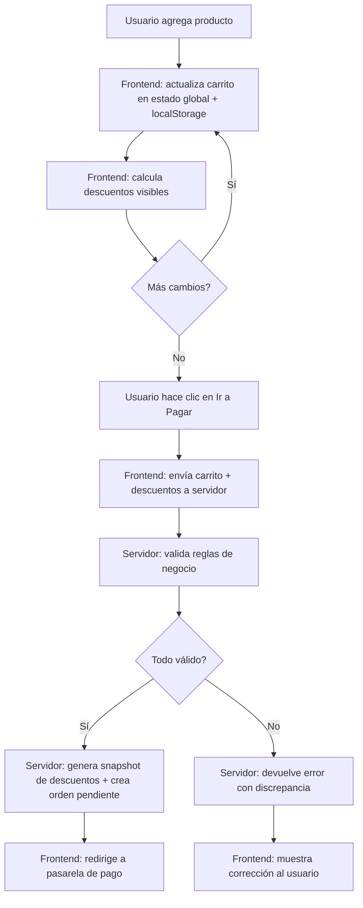
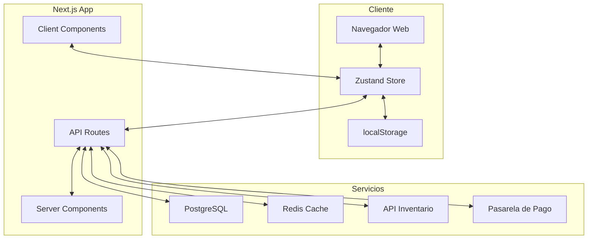
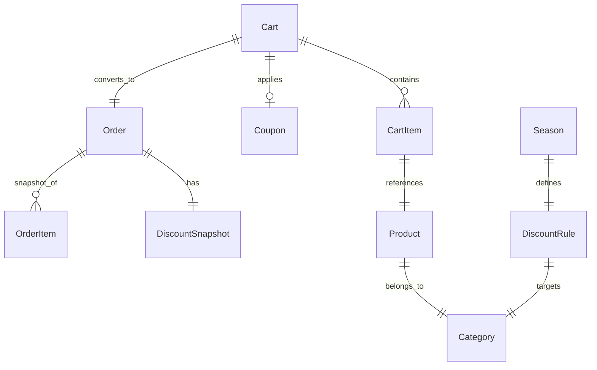

# Evaluación: user-story-spec Skill
## Pipeline Completo — Carrito de Compras con Descuentos Dinámicos

**Prompt inicial:**
> Ayúdame a definir la funcionalidad de un carrito de compras con descuentos dinámicos para un e-commerce. Los descuentos cambian según: cantidad de items (volumen), categoría de producto, y si el usuario es miembro premium. También hay cupones promocionales y descuentos por temporada. La plataforma es web.

---

## FASE 1: ENTREVISTA EXHAUSTIVA

### Ronda 1 — Bloque A: Visión y Problema

**Agente:** Voy a hacerte algunas preguntas para entender bien la funcionalidad. Empecemos:

1. **¿Cuál es el problema principal que resuelve esta funcionalidad?**
2. **¿Quiénes son los usuarios finales?**
3. **¿Qué valor de negocio aporta?**

**Usuario (simulado):**
1. El problema principal es que los precios son estáticos y no incentivamos compras por volumen ni fidelidad. Actualmente los usuarios compran 1 o 2 items porque no ven beneficio en comprar más. Necesitamos un sistema que premie la lealtad y las compras grandes, y que nos permita reaccionar rápido a eventos comerciales (temporada, promociones).
2. Los usuarios son:
   - **Compradores ocasionales**: visitan 1-2 veces al mes, compran poco. Nivel técnico variado.
   - **Compradores frecuentes**: 2-4 veces al mes, conocen la plataforma. Muchos son miembros premium.
   - **Miembros Premium**: suscripción mensual/anual. Esperan beneficios exclusivos.
   - **Administradores de tienda**: configuran descuentos, cupones, reglas de negocio.
3. Valor de negocio: Aumentar el ticket promedio en un 25%, incrementar conversión de carritos abandonados en 15%, y subir la retención de miembros premium en 10%. También queremos poder lanzar campañas temporales sin intervención de desarrollo.

---

### Ronda 2 — Bloque B: Comportamiento y Flujo Principal

**Agente:** Perfecto. Ahora hablemos del flujo principal:

4. **Describe el flujo feliz paso a paso** — desde que el usuario llega hasta que completa la compra.
5. **¿Qué desencadena esta acción?** — ¿El usuario inicia? ¿Es automático?
6. **¿Qué información necesita el usuario para completar la acción?**
7. **¿Qué feedback recibe el usuario en cada paso?**

**Usuario (simulado):**
4. Flujo feliz:
   - El usuario navega por la tienda y agrega productos al carrito.
   - En el carrito, ve los precios unitarios y los descuentos aplicados en tiempo real.
   - Si agrega más cantidad, el descuento por volumen se actualiza al instante.
   - Si es miembro premium, ve un badge y un descuento adicional aplicado.
   - Si ingresa un cupón promocional, el sistema valida y aplica el descuento.
   - Si hay una temporada activa (ej. Black Friday), se aplica automáticamente.
   - Ve el total con todos los descuentos apilados, elige método de pago y confirma la compra.

5. El usuario inicia la acción agregando productos al carrito. Los descuentos se recalculan automáticamente sin que el usuario haga clic en "recalcular". Los descuentos de temporada se activan por rango de fechas configurado por el admin.

6. El usuario necesita:
   - Estar autenticado para descuentos premium (si no, ve los descuentos estándar).
   - Los productos deben tener precio y categoría asignados.
   - Para cupones: el código del cupón.
   - No necesita más que eso; el sistema calcula el resto automáticamente.

7. Feedback:
   - Al agregar producto: animación sutil en el icono del carrito + badge con cantidad.
   - Al cambiar cantidad: el subtotal y descuentos se actualizan en vivo sin recargar.
   - Al aplicar cupón: mensaje verde de "Cupón aplicado" si es válido, o rojo con el motivo si es inválido.
   - Al ser premium: un indicador visual "🌟 Beneficio Premium aplicado" en el resumen.
   - Descuento por temporada: un banner en el carrito "🔥 Black Friday — 20% OFF en toda la tienda".
   - Al confirmar compra: pantalla de éxito con resumen de descuentos aplicados.

---

### Ronda 3 — Bloque C: Bordes y Errores

**Agente:** Excelente. Pasemos a los casos extremos:

8. **¿Qué pasa cuando algo sale mal?**
9. **¿Qué edge cases existen?**
10. **¿Qué pasa si el usuario interrumpe el flujo?**
11. **¿Hay restricciones de negocio?**

**Usuario (simulado):**
8. Escenarios de error:
   - Cupón expirado o inexistente: mensaje claro "El cupón no es válido o ha expirado".
   - Error de red al recalcular descuentos: mostrar los últimos precios válidos calculados y un mensaje "Los descuentos podrían no estar actualizados. Verifica tu conexión."
   - Producto sin stock al confirmar: mensaje indicando qué productos no tienen stock y opción de eliminarlos del carrito.
   - Servidor caído: pantalla de error amigable con reintento automático después de 5 segundos.

9. Edge cases:
   - Usuario no autenticado: ve descuentos por volumen y por temporada, pero no los de miembro premium.
   - Múltiples cupones: solo un cupón por carrito. Si el usuario intenta aplicar otro, se reemplaza el anterior.
   - Producto sin categoría asignada: no recibe descuento por categoría, pero sí los demás.
   - Cantidad excede el máximo por producto (ej. 100 unidades): mostrar límite y no permitir exceder.
   - Dos descuentos de temporada activos simultáneamente: se aplica el de mayor valor.
   - Carrito con productos de diferente categorías: cada producto calcula su descuento individualmente.

10. Interrupción:
    - Si cierra ventana: el carrito se guarda en localStorage. Al volver, se restaura con los productos y descuentos.
    - Si recarga la página: mismo comportamiento — carrito persiste en localStorage.
    - Si vuelve atrás desde checkout: vuelve al carrito con todos los items y descuentos intactos.

11. Restricciones de negocio:
    - Descuento por volumen: 3-5 items = 5%, 6-10 = 10%, 11+ = 15%. Por producto individual.
    - Descuento por categoría: "Electrónica" = 5%, "Ropa" = 10%, "Hogar" = 8%. Configurable por admin.
    - Descuento premium: 10% adicional sobre el subtotal después de otros descuentos (no acumulable con cupón).
    - Cupón promocional: descuento fijo ($) o porcentual (%), configurable. Máximo 50% de descuento total.
    - Descuento por temporada: global, configurable por admin con fecha inicio/fin. No acumulable con cupón.
    - Un carrito no puede tener más de 50 items únicos (líneas de producto).
    - Los descuentos no pueden reducir el precio por debajo del costo (margen mínimo 10%).

---

### Ronda 4 — Bloque D: Datos y Persistencia

**Agente:** Pasemos a los datos:

12. **¿Qué datos se crean/modifican/eliminan?**
13. **¿Hay historial o auditoría requerida?**
14. **¿Qué datos deben persistir localmente vs en servidor?**

**Usuario (simulado):**
12. Datos:
    - **Carrito (Cart)**: se crea cuando el usuario agrega el primer producto. Se modifica al agregar/quitar/cambiar cantidad. Se elimina (o marca como "convertido") al confirmar compra.
    - **Item de carrito (CartItem)**: se crea al agregar producto. Se modifica al cambiar cantidad. Se elimina al quitar producto.
    - **Cupón aplicado (AppliedCoupon)**: se crea al aplicar un cupón válido. Se elimina al removerlo.
    - **Descuento calculado (Discount)**: se crea en cada recálculo. Es volátil (se recalcula siempre en base a reglas actuales).
    - **Reglas de descuento (DiscountRule)**: CRUD de administrador. No se modifica por usuarios.
    - **Temporada (Season)**: CRUD de administrador con fecha inicio/fin.
    - **Orden finalizada (Order)**: snapshot de carrito + descuentos aplicados al momento de compra.

13. Auditoría:
    - Sí, queremos un log de cambios en las reglas de descuento (quién creó/modificó/eliminó, cuándo, valor anterior y nuevo).
    - Log de cupones aplicados por orden (para reporting).
    - Sin versionado completo, pero sí trazabilidad de cada orden: qué descuentos aplicaban al momento de la compra.

14. Persistencia:
    - **Local (localStorage)**: carrito activo (productos, cantidades, cupón aplicado) para que persista entre sesiones.
    - **Servidor**: carrito guardado para usuario autenticado (sincronizado). Reglas de descuento, temporadas, órdenes, logs de auditoría.
    - Offline-first: si el usuario está offline, puede seguir agregando productos. Al reconectar, se sincroniza el carrito con el servidor.

---

### Ronda 5 — Bloque E: No-Funcionales

**Agente:** Última ronda de preguntas base:

15. **¿Hay requisitos de rendimiento?**
16. **¿Qué medidas de seguridad se requieren?**
17. **¿Hay restricciones técnicas conocidas?**

**Usuario (simulado):**
15. Rendimiento:
    - Los descuentos deben recalcularse en menos de 200ms desde que el usuario cambia algo en el carrito.
    - El carrito debe cargar completamente en menos de 1.5 segundos (incluyendo cálculos de descuento).
    - Soportar 1000 usuarios concurrentes en carrito.
    - Las reglas de descuento se cachean (cambian poco, pero invalidar al modificar).

16. Seguridad:
    - Los usuarios no pueden manipular los precios ni descuentos desde el frontend. Todos los cálculos se validan en servidor al confirmar compra.
    - Los cupones no deben ser adivinables (tokens aleatorios, no secuenciales).
    - Autenticación requerida para checkout. Sin autenticar puede armar carrito pero no comprar.
    - Los administradores requieren 2FA para modificar reglas de descuento.
    - Los endpoints de descuento deben tener rate limiting (30 req/min por usuario).

17. Restricciones técnicas:
    - Plataforma web (responsive: desktop + mobile).
    - Frontend en React (Next.js) con Tailwind CSS.
    - Backend en Node.js (Express o Next.js API routes).
    - Base de datos PostgreSQL.
    - Estado global con Zustand o Redux Toolkit.
    - Debe funcionar en Chrome, Firefox, Safari, Edge (últimas 2 versiones).
    - Debe ser accesible (WCAG 2.1 AA).
    - No usar librerías de terceros para cálculos de descuento — lógica propia.

---

### Ronda 6 — Preguntas de Seguimiento

**Agente:** Algunas preguntas adicionales:

- **¿Hay integración con sistemas externos?**
- **¿Quién aprueba/revisa el resultado final?**
- **¿Hay métricas de éxito definidas?**
- **¿Qué versión/mockup existe?**

**Usuario (simulado):**
- Integración con pasarela de pago (MercadoPago / Stripe) y con sistema de inventario (API interna).
- Aprueba el Product Manager y el Lead Engineer. El equipo de marketing define las temporadas.
- Métricas de éxito: ticket promedio +20%, tasa de conversión carrito→compra +15%, uso de cupones en 30% de órdenes, NPS de checkout > 85.
- Hay mockups en Figma para el flujo básico de carrito. Los descuentos dinámicos son nuevos — no hay mockups específicos aún.

**Agente:** Gracias. Aquí está el resumen de lo entendido en la entrevista:

> **Resumen:** Carrito de compras con descuentos dinámicos para e-commerce web. Se soportan 4 tipos de descuento (volumen, categoría, premium, temporada) y cupones promocionales. Los descuentos se calculan en frontend para vista previa y se validan en servidor al confirmar. Carrito persiste en localStorage + servidor. Admin configura reglas CRUD. Rendimiento: cálculo <200ms, carga <1.5s. Stack: Next.js + Tailwind + PostgreSQL + Zustand.

**¿Confirmas que esto es correcto antes de pasar a la Fase 2?**

**Usuario (simulado):** Sí, confirmo. Todo correcto.

---

## FASE 2: USER STORIES

**Agente:** Con la información recopilada, genero las historias de usuario con Behavioral Design.

---

### US-001: Visualizar Descuentos por Volumen en Tiempo Real

- **Resumen**: Como comprador, veo descuentos crecer al aumentar cantidad

#### Perfil:
- **Persona**: Comprador ocasional
- **Frecuencia**: Media
- **Contexto emocional**: Evaluador, comparando precios

#### Use Case:
- **Como** comprador en el carrito
- **Quiero** ver cómo aumentan los descuentos al agregar más unidades de un producto
- **Para** decidir la cantidad óptima que maximice mi ahorro

#### Criterios de Aceptación (Gherkin):
- **Escenario:** Agregar unidades hasta superar umbral de volumen
- **Dado** que tengo 2 unidades del "Producto A" en el carrito
- **Cuando** aumento la cantidad a 4 unidades
- **Entonces** el precio unitario se reduce aplicando 5% de descuento por volumen
- **Y** veo un indicador visual "¡5% de descuento por volumen aplicado!"

- **Escenario:** Superar múltiples umbrales
- **Dado** que tengo 6 unidades del "Producto A" con 5% de descuento
- **Cuando** aumento a 10 unidades
- **Entonces** el descuento por volumen sube a 10%
- **Y** el precio unitario se actualiza inmediatamente sin recargar la página

- **Principios**: loss aversion (si quito unidades pierdo el descuento), feedback inmediato, defaults

---

### US-002: Aplicar Descuento por Categoría de Producto

- **Resumen**: Cada producto muestra su descuento de categoría automáticamente

#### Perfil:
- **Persona**: Comprador frecuente
- **Frecuencia**: Alta
- **Contexto emocional**: Informado, busca mejores precios por categoría

#### Use Case:
- **Como** comprador frecuente
- **Quiero** que los productos en mi carrito muestren automáticamente el descuento asociado a su categoría
- **Para** saber qué categorías tienen mejor precio sin tener que memorizar promociones

#### Criterios de Aceptación (Gherkin):
- **Escenario:** Producto con categoría tiene descuento aplicado
- **Dado** que el "Producto B" pertenece a la categoría "Electrónica" con 5% de descuento
- **Cuando** agrego el "Producto B" al carrito
- **Entonces** veo el descuento del 5% aplicado en la línea del producto
- **Y** veo la etiqueta "Electrónica - 5% OFF"

- **Escenario:** Producto sin categoría no recibe descuento
- **Dado** que el "Producto C" no tiene categoría asignada
- **Cuando** lo agrego al carrito
- **Entonces** no se aplica descuento por categoría
- **Y** el precio se muestra sin etiqueta de descuento de categoría

- **Principios**: reducción de fricción (no requiere acción del usuario), transparencia

---

### US-003: Descuento Premium Exclusivo

- **Resumen**: Miembros premium ven descuento adicional automático

#### Perfil:
- **Persona**: Miembro Premium
- **Frecuencia**: Alta
- **Contexto emocional**: Leal, espera reconocimiento por su suscripción

#### Use Case:
- **Como** miembro premium autenticado
- **Quiero** que se aplique automáticamente un 10% de descuento adicional al total del carrito
- **Para** sentir que mi suscripción tiene beneficios tangibles

#### Criterios de Aceptación (Gherkin):
- **Escenario:** Usuario premium autenticado ve descuento aplicado
- **Dado** que soy un usuario premium autenticado
- **Y** tengo productos en el carrito
- **Cuando** veo el resumen de compra
- **Entonces** veo una línea "Descuento Premium -10%" en el total
- **Y** veo un badge "🌟 Beneficio Premium" junto al descuento

- **Escenario:** Usuario no premium no ve descuento premium
- **Dado** que soy un usuario estándar (no premium) autenticado
- **Cuando** veo el resumen de compra
- **Entonces** NO aparece el descuento premium
- **Y** veo un mensaje "Hazte Premium y ahorra 10% extra" con link a suscripción

- **Principios**: estatus, FOMO (al ver el mensaje de upgrade), loss aversion (perdería el beneficio si cancelo premium)

---

### US-004: Aplicar Cupón Promocional

- **Resumen**: Usuarios pueden ingresar cupones para descuento adicional

#### Perfil:
- **Persona**: Comprador ocasional o frecuente
- **Frecuencia**: Baja
- **Contexto emocional**: Buscando ahorrar, escéptico si el cupón funcionará

#### Use Case:
- **Como** comprador con un código promocional
- **Quiero** ingresar el código en el carrito y que se valide instantáneamente
- **Para** obtener el descuento prometido sin fricción

#### Criterios de Aceptación (Gherkin):
- **Escenario:** Cupón válido aplicado correctamente
- **Dado** que tengo productos en el carrito
- **Cuando** ingreso el código "AHORRO20" en el campo de cupón
- **Y** hago clic en "Aplicar"
- **Entonces** veo un mensaje verde "🎉 Cupón aplicado: 20% de descuento"
- **Y** el total se actualiza reflejando el descuento del cupón

- **Escenario:** Cupón expirado muestra error claro
- **Dado** que tengo productos en el carrito
- **Cuando** ingreso un código de cupón expirado
- **Entonces** veo un mensaje rojo "El cupón ha expirado"
- **Y** el total no se modifica

- **Escenario:** Cupón inválido no se aplica
- **Dado** que tengo productos en el carrito
- **Cuando** ingreso un código inexistente "FALSO123"
- **Entonces** veo un mensaje rojo "El código ingresado no es válido"

- **Principios**: reducción de fricción (validación instantánea), feedback claro, loss aversion (si no aplicas, pagas más)

---

### US-005: Descuento por Temporada Automático

- **Resumen**: Descuentos de temporada se aplican globalmente sin intervención del usuario

#### Perfil:
- **Persona**: Todos los compradores
- **Frecuencia**: Según temporada
- **Contexto emocional**: Emocionado por la oferta, urge por tiempo limitado

#### Use Case:
- **Como** cualquier comprador durante una temporada promocional
- **Quiero** que el descuento de temporada se aplique automáticamente al carrito
- **Para** beneficiarme de la promoción sin necesidad de código ni acción extra

#### Criterios de Aceptación (Gherkin):
- **Escenario:** Temporada activa aplica descuento automático
- **Dado** que hay una temporada "Black Friday" activa con 20% de descuento global
- **Cuando** agrego productos al carrito
- **Entonces** veo un banner en el carrito "🔥 Black Friday — 20% OFF en toda la tienda"
- **Y** el descuento se aplica al total del carrito automáticamente

- **Escenario:** Temporada no activa no aplica descuento
- **Dado** que la temporada "Black Friday" termina el 2026-11-30
- **Y** hoy es 2026-12-01
- **Cuando** veo el carrito
- **Entonces** no veo el banner de Black Friday
- **Y** no se aplica descuento de temporada

- **Principios**: urgencia (tiempo limitado), reducción de fricción, defaults

---

### US-006: Administrar Reglas de Descuento (Admin)

- **Resumen**: Administradores configuran reglas de descuento desde un panel

#### Perfil:
- **Persona**: Administrador de tienda
- **Frecuencia**: Baja (semanal/mensual)
- **Contexto emocional**: Estratégico, necesita control y visibilidad

#### Use Case:
- **Como** administrador de la tienda
- **Quiero** crear, modificar y desactivar reglas de descuento (volumen, categoría, temporada, cupones)
- **Para** lanzar promociones sin depender de desarrollo

#### Criterios de Aceptación (Gherkin):
- **Escenario:** Crear nueva regla de descuento por volumen
- **Dado** que estoy en el panel de administración de descuentos
- **Cuando** hago clic en "Nueva regla"
- **Y** selecciono tipo "Volumen", umbral mínimo 5, descuento 10%, aplica a categoría "Todas"
- **Y** hago clic en "Guardar"
- **Entonces** la regla se guarda en la base de datos
- **Y** veo un mensaje "Regla creada exitosamente"
- **Y** la regla aparece en la lista de reglas activas

- **Escenario:** Modificar regla existente requiere auditoría
- **Dado** que existe la regla "Volumen-5" con 10% de descuento
- **Cuando** la modifico a 15%
- **Y** guardo los cambios
- **Entonces** el sistema registra en el log: "Admin@email.com cambió Volumen-5 de 10% a 15% — 2026-05-13 14:30:00"
- **Y** la regla actualizada se aplica inmediatamente a nuevos cálculos

- **Principios**: control, transparencia, reducción de fricción (no requiere deploy)

---

### US-007: Carrito Persistente entre Sesiones

- **Resumen**: El carrito se guarda y restaura automáticamente

#### Perfil:
- **Persona**: Cualquier comprador
- **Frecuencia**: Primer uso / recuperación
- **Contexto emocional**: Preocupado por perder su selección

#### Use Case:
- **Como** comprador
- **Quiero** que mi carrito se guarde aunque cierre el navegador o cierre sesión
- **Para** no perder los productos seleccionados si decido comprar después

#### Criterios de Aceptación (Gherkin):
- **Escenario:** Carrito persiste en localStorage al cerrar ventana
- **Dado** que tengo 3 productos en el carrito
- **Cuando** cierro el navegador
- **Y** vuelvo a abrirlo y entro a la tienda
- **Entonces** veo los mismos 3 productos en el carrito
- **Y** los descuentos se recalculan con las reglas actuales

- **Escenario:** Usuario autenticado sincroniza carrito entre dispositivos
- **Dado** que soy un usuario autenticado
- **Y** tengo productos en el carrito desde mi escritorio
- **Cuando** inicio sesión desde mi celular
- **Entonces** veo los mismos productos en el carrito

- **Principios**: loss aversion (perdería mi selección), reducción de fricción

---

### US-008: Bloqueo de Precios al Confirmar Compra

- **Resumen**: Los descuentos se congelan al momento de confirmar la orden

#### Perfil:
- **Persona**: Cualquier comprador
- **Frecuencia**: Cada compra
- **Contexto emocional**: Confiado pero podría sentirse engañado si cambian los precios

#### Use Case:
- **Como** comprador que confirma una compra
- **Quiero** que los descuentos calculados al momento de pagar sean los definitivos
- **Para** tener certeza del precio final sin sorpresas

#### Criterios de Aceptación (Gherkin):
- **Escenario:** Precios se congelan al iniciar checkout
- **Dado** que tengo descuentos aplicados en el carrito
- **Cuando** hago clic en "Ir a pagar"
- **Entonces** el sistema calcula y almacena un snapshot de todos los descuentos aplicados
- **Y** los precios no cambian aunque el admin modifique reglas durante el pago

- **Principios**: confianza, reducción de ansiedad

---

## FASE 3: ESPECIFICACIÓN TÉCNICA (OpenSpec)

**Agente:** He generado las 8 historias de usuario. ¿Confirmas que cubren todas las funcionalidades descritas en la entrevista? ¿Falta alguna o algo que ajustar?

**Usuario (simulado):** Confirmo. Las 8 historias cubren todo. Pasemos a la especificación técnica.

---

Generando spec en `/spec/spec-carrito-descuentos-dinamicos.md`:

```markdown
---
title: Carrito de Compras con Descuentos Dinámicos
version: 1.0
date_created: 2026-05-13
tags: [especificación, user-stories, e-commerce, descuentos]
---

# Carrito de Compras con Descuentos Dinámicos

## 1. Propósito y Alcance

Sistema de carrito de compras para e-commerce web que aplica descuentos dinámicos en tiempo real basados en cuatro ejes: volumen de unidades por producto, categoría del producto, membresía premium del usuario, y temporadas promocionales activas. Adicionalmente soporta cupones promocionales de código único.

El sistema permite a los compradores ver el impacto inmediato de cada descuento al modificar su carrito, incentiva compras por volumen y fidelidad, y otorga a los administradores control total sobre las reglas de descuento sin necesidad de intervención de desarrollo. Todos los cálculos se validan en servidor al confirmar la compra para prevenir manipulación.

## 2. Definiciones

| Término | Definición |
|---------|-----------|
| Carrito | Contenedor temporal de productos seleccionados por el usuario para compra |
| Descuento por Volumen | Reducción porcentual según cantidad de unidades de un mismo producto |
| Descuento por Categoría | Reducción porcentual fija aplicada a todos los productos de una categoría |
| Descuento Premium | 10% adicional para usuarios con suscripción premium activa |
| Descuento por Temporada | Reducción global activa en un rango de fechas configurado |
| Cupón Promocional | Código alfanumérico que otorga descuento porcentual o fijo |
| Snapshot de Descuentos | Estado congelado de todos los descuentos al momento de confirmar compra |
| Margen Mínimo | Límite inferior de precio (costo + 10%) que ningún descuento puede cruzar |

## 3. User Stories

- **US-001**: Visualizar Descuentos por Volumen en Tiempo Real
- **US-002**: Aplicar Descuento por Categoría de Producto
- **US-003**: Descuento Premium Exclusivo
- **US-004**: Aplicar Cupón Promocional
- **US-005**: Descuento por Temporada Automático
- **US-006**: Administrar Reglas de Descuento (Admin)
- **US-007**: Carrito Persistente entre Sesiones
- **US-008**: Bloqueo de Precios al Confirmar Compra

(Detalle completo de cada historia en la sección anterior — Fase 2)

## 4. Requerimientos Funcionales

- **RF-001**: El sistema debe recalcular todos los descuentos automáticamente al cambiar cantidad, agregar/remover producto, aplicar/quitar cupón, o cambiar estado de autenticación.
- **RF-002**: El sistema debe mostrar el desglose de cada descuento aplicado en el resumen del carrito (tipo, porcentaje, monto ahorrado).
- **RF-003**: El sistema debe validar la elegibilidad del cupón (vigencia, tope de usos, monto mínimo de compra, aplicabilidad).
- **RF-004**: El sistema debe aplicar descuento de temporada si la fecha actual está dentro del rango configurado.
- **RF-005**: El sistema debe priorizar y resolver conflictos entre descuentos simultáneos (reglas de apilamiento).
- **RF-006**: El sistema debe persistir el carrito en localStorage para no autenticados y sincronizar con servidor para autenticados.
- **RF-007**: El sistema debe permitir CRUD de reglas de descuento desde panel admin con auditoría.
- **RF-008**: El sistema debe generar snapshot de descuentos al iniciar checkout para congelar precios.
- **RF-009**: El sistema debe mostrar banner promocional cuando hay una temporada activa.

## 5. Requerimientos No Funcionales

- **RNF-001** — Rendimiento: Recalcular descuentos en <200ms desde interacción del usuario. Carga inicial del carrito <1.5s.
- **RNF-002** — Escalabilidad: Soportar 1000 usuarios concurrentes operando carrito.
- **RNF-003** — Seguridad: Validación de descuentos en servidor. Rate limiting 30 req/min por usuario en endpoints de descuento. 2FA para cambios de reglas admin.
- **RNF-004** — Accesibilidad: WCAG 2.1 AA. Todos los mensajes de descuento deben ser legibles por lectores de pantalla.
- **RNF-005** — Portabilidad: Chrome, Firefox, Safari, Edge (últimas 2 versiones). Responsive desktop + mobile.
- **RNF-006** — Disponibilidad: 99.5% uptime para el carrito. Degradación graceful si el servidor de descuentos falla (usar últimos precios cacheados).

## 6. Restricciones y Reglas de Negocio

- **RN-001**: Descuento por volumen se aplica por producto individual (no sobre el total). Umbrales: 3-5 → 5%, 6-10 → 10%, 11+ → 15%.
- **RN-002**: Descuento por categoría: valores configurables por admin. Defaults sugeridos: Electrónica 5%, Ropa 10%, Hogar 8%.
- **RN-003**: Descuento premium: 10% sobre subtotal después de otros descuentos. No acumulable con cupón.
- **RN-004**: Cupón promocional: máximo 50% de descuento total. Un cupón por carrito. No acumulable con temporada.
- **RN-005**: Descuento por temporada: global, configurable por admin. No acumulable con cupón. Si dos temporadas coinciden, aplicar la de mayor descuento.
- **RN-006**: Máximo 50 líneas de producto (items únicos) por carrito.
- **RN-007**: Ningún descuento puede reducir precio final por debajo del costo + 10% de margen.

## 7. Flujo de Datos



## 8. Contratos de Interfaz (API)

```typescript
// === DTOs Principales ===

interface CartItem {
  productId: string;
  productName: string;
  categoryId: string | null;
  categoryName: string | null;
  quantity: number;
  unitPrice: number;           // precio base sin descuentos
  costPrice: number;           // precio de costo (para validación de margen)
}

interface Cart {
  items: CartItem[];
  appliedCouponCode: string | null;
  userId: string | null;
  userIsPremium: boolean;
  lastCalculated: number;      // timestamp
}

interface DiscountBreakdown {
  volumeDiscount: DiscountDetail | null;     // por producto
  categoryDiscount: DiscountDetail | null;   // por producto
  premiumDiscount: DiscountDetail | null;    // global
  seasonDiscount: DiscountDetail | null;     // global
  couponDiscount: DiscountDetail | null;     // global
}

interface DiscountDetail {
  type: 'volume' | 'category' | 'premium' | 'season' | 'coupon';
  label: string;
  percentage: number;
  amount: number;
  appliedAt: 'product' | 'subtotal' | 'total';
}

interface CalculatedCart {
  items: CalculatedCartItem[];
  subtotal: number;
  totalDiscount: number;
  total: number;
  breakdown: DiscountBreakdown;
  messages: string[];
}

interface CalculatedCartItem {
  productId: string;
  productName: string;
  quantity: number;
  unitPrice: number;
  unitDiscount: number;
  discountedUnitPrice: number;
  lineTotal: number;
  itemBreakdown: { type: string; label: string; amount: number }[];
}

// === Endpoints ===

// POST /api/cart/calculate
// Body: Cart
// Response: CalculatedCart

// POST /api/cart/checkout
// Body: Cart
// Response: { orderId: string; snapshot: DiscountBreakdown; total: number }

// GET /api/cart/sync
// Response: Cart (carrito del servidor para merge)

// PUT /api/cart/sync
// Body: Cart
// Response: Cart (carrito sincronizado)

// GET /api/admin/discount-rules
// Response: DiscountRule[]

// POST /api/admin/discount-rules
// Body: DiscountRule
// Response: DiscountRule

// PUT /api/admin/discount-rules/:id
// Body: DiscountRule
// Response: DiscountRule

// DELETE /api/admin/discount-rules/:id
// Response: { success: boolean }

// POST /api/admin/validate-coupon
// Body: { code: string; cart: Cart }
// Response: { valid: boolean; discount: DiscountDetail | null; error?: string }
```

## 9. Escenarios de Error y Manejo

- **ERR-001**: Cupón expirado → Mensaje rojo "El cupón ha expirado". No se modifica el carrito.
- **ERR-002**: Cupón inválido → Mensaje rojo "El código ingresado no es válido".
- **ERR-003**: Cupón ya usado → Mensaje rojo "Este cupón ya fue utilizado".
- **ERR-004**: Error de red al recalcular → Mostrar últimos precios válidos + advertencia "Verifica tu conexión".
- **ERR-005**: Producto sin stock al confirmar → Modal con lista de productos sin stock + opción "Eliminar y continuar".
- **ERR-006**: Servidor de descuentos caído → Usar reglas cacheadas (stale-while-revalidate). Banner de advertencia.
- **ERR-007**: Descuento viola margen mínimo → Aplicar descuento hasta el límite del margen. Notificar al usuario.
- **ERR-008**: Múltiples temporadas activas → Aplicar la de mayor descuento. Banner informativo.
- **ERR-009**: Intento de aplicar cupón con temporada activa → Mensaje: "Los cupones no son válidos durante promociones de temporada".

## 10. Criterios de Aceptación Globales

- **AC-001**: Dado un carrito con productos, Cuando se modifica cantidad/aplicación de cupón, Entonces los descuentos se recalculan en <200ms.
- **AC-002**: Dado un usuario autenticado, Cuando cierra sesión y vuelve a iniciar, Entonces su carrito persiste con los mismos productos.
- **AC-003**: Dado un carrito con descuentos aplicados, Cuando el usuario confirma checkout, Entonces se genera snapshot y los precios quedan congelados.
- **AC-004**: Dado un administrador, Cuando modifica reglas de descuento, Entonces se registra auditoría con quién, qué, cuándo.
- **AC-005**: Dado un usuario no premium con carrito, Cuando ve el resumen, Entonces ve un CTA "Hazte Premium y ahorra 10% extra".

## 11. Métricas de Éxito

- **KPI-1**: Ticket promedio +20% (medición semanal vs baseline pre-descuentos dinámicos)
- **KPI-2**: Tasa de conversión carrito→compra +15% (medición semanal)
- **KPI-3**: Uso de cupones en 30% de órdenes (medición diaria)
- **KPI-4**: NPS del checkout > 85 (encuesta post-compra)
- **KPI-5**: Tiempo de recálculo <200ms p95 (APM monitoring)
- **KPI-6**: 0 incidentes de manipulación de precios desde frontend (security audit)

## 12. Dependencias y Supuestos

- **DEP-001**: API de inventario interna para validación de stock
- **DEP-002**: Pasarela de pago (MercadoPago / Stripe) para checkout
- **DEP-003**: Servicio de autenticación existente (sesiones/JWT)
- **SUP-001**: Las reglas de descuento cambian con frecuencia <1 vez por día en promedio
- **SUP-002**: Los administradores tienen acceso a panel de administración existente
- **SUP-003**: El costo de los productos está disponible en la base de datos de productos
- **SUP-004**: No más de 2 temporadas activas simultáneamente

## 13. Casos de Prueba

### CP-001: Descuento por volumen — umbral exacto
- **Relación**: US-001, RF-001
- **Precondiciones**: Producto A con precio $100. Sin otros descuentos.
- **Pasos**: 1. Agregar 3 unidades → 2. Verificar descuento 5% → 3. Agregar hasta 6 unidades → 4. Verificar descuento 10%
- **Resultado esperado**: Precio unitario baja a $95 (3 unids) y $90 (6 unids)
- **Datos de prueba**: Producto A (id: "prod-001", precio: 100, costo: 50)

### CP-002: Apilamiento premium + volumen + categoría
- **Relación**: US-001, US-002, US-003, RF-001
- **Precondiciones**: Usuario premium. Producto Electrónica ($200, 5% categoría).
- **Pasos**: 1. Agregar 5 unidades → 2. Verificar descuento volumen 5% + categoría 5% → 3. Verificar premium 10% sobre subtotal
- **Resultado esperado**: Volumen $190/unidad → Categoría descuento adicional → Premium 10% sobre total del carrito
- **Datos de prueba**: Usuario premium. Producto "Laptop" (id: "prod-002", precio: 200, costo: 120, categoría: "Electrónica")

### CP-003: Cupón inválido
- **Relación**: US-004
- **Precondiciones**: Carrito con productos.
- **Pasos**: 1. Ingresar código "FALSO123" → 2. Hacer clic en Aplicar
- **Resultado esperado**: Mensaje rojo "El código ingresado no es válido". Total no se modifica.
- **Datos de prueba**: Código "FALSO123" no existe en BD.

### CP-004: Temporada activa + cupón rechazado
- **Relación**: US-004, US-005, RN-005
- **Precondiciones**: Temporada "Black Friday" activa (20% OFF).
- **Pasos**: 1. Ver banner de temporada → 2. Ingresar cupón "AHORRO20" → 3. Hacer clic en Aplicar
- **Resultado esperado**: Mensaje "Los cupones no son válidos durante promociones de temporada"
- **Datos de prueba**: Temporada activa 2026-05-01 a 2026-05-31. Cupón "AHORRO20" válido.

### CP-005: Persistencia entre sesiones
- **Relación**: US-007, RF-006
- **Precondiciones**: Usuario no autenticado con 2 productos en carrito.
- **Pasos**: 1. Cerrar navegador → 2. Abrir navegador → 3. Ir a la tienda
- **Resultado esperado**: Carrito recuperado con 2 productos. Descuentos recalculados.
- **Datos de prueba**: localStorage con items de prueba.

## 14. Preguntas Abiertas

- [x] ¿Acumulación de descuentos de temporada y cupón? → No acumulable.
- [x] ¿Máximo de items por carrito? → 50 líneas únicas.
- [x] ¿Persistencia offline? → Sí, localStorage + sync.
- [ ] ¿Notificar al usuario cuando un producto en su carrito cambia de precio/precio bajó? → Pendiente definir con PM.
- [ ] ¿Soportar descuentos combinados (ej. "compra 2, llevá 3")? → Fuera de alcance v1.
- [ ] ¿Integración con WhatsApp/email para carritos abandonados? → Dependencia con equipo de marketing.
```

---

## FASE 4: PLAN TÉCNICO

**Agente:** La especificación técnica está completa en `/spec/spec-carrito-descuentos-dinamicos.md`. Confirma que está correcta para pasar al plan técnico.

**Usuario (simulado):** Confirmado. La spec se ve completa. Pasemos al plan técnico.

---

Generando plan en `/spec/plan-carrito-descuentos-dinamicos.md`:

```markdown
# Plan Técnico: Carrito de Compras con Descuentos Dinámicos

## Stack Tecnológico

| Capa | Tecnología | Justificación |
|------|-----------|---------------|
| Frontend | Next.js 14 (React) + Tailwind CSS v4 | SSR para carga rápida inicial. Tailwind para responsive ágil. |
| Frontend State | Zustand | Liviano, sin boilerplate. Ideal para estado de carrito con cálculos frecuentes. |
| Backend | Next.js API Routes (App Router) | Mismo deploy que frontend. Reduce latencia. |
| Base de Datos | PostgreSQL + Redis (caché de reglas) | Postgres relacional. Redis para reglas de descuento (lecturas frecuentes, escrituras escasas). |
| Infraestructura | Vercel (frontend + API) / Railway (Postgres + Redis) | Edge deployment en Vercel. DB en Railway. |

## Arquitectura



### Componentes

#### CartProvider (Context/Store)
- **Responsabilidad**: Estado global del carrito. Despacha recálculos en cada mutación.
- **Interfaces**: consume API `/api/cart/calculate`. Expone estado a componentes hijos.
- **Dependencias**: Zustand store. `CartStore` type.

#### CartSummary (Client Component)
- **Responsabilidad**: Renderiza resumen del carrito con desglose de descuentos.
- **Interfaces**: Lee de CartStore. Input para cupón.
- **Dependencias**: CartStore, `DiscountBreakdown` type.

#### CartItemRow (Client Component)
- **Responsabilidad**: Renderiza línea de producto con descuentos individuales. Controles +/1.
- **Interfaces**: Callbacks `onIncrease(decrement)`, `onDecrease`, `onRemove`.
- **Dependencias**: CartStore.

#### DiscountEngine (Pure Function / Server-side)
- **Responsabilidad**: Lógica pura de cálculo de descuentos. Sin efectos secundarios.
- **Interfaces**: `calculate(cart: Cart, rules: DiscountRules): CalculatedCart`.
- **Dependencias**: Reglas desde Redis/Postgres.

#### CouponValidator (Server-side)
- **Responsabilidad**: Validar cupón contra BD (vigencia, usos, monto mínimo).
- **Interfaces**: `validate(code, cart): ValidationResult`.
- **Dependencias**: PostgreSQL (coupons table).

#### AdminDiscountPanel (Client Component - Admin Only)
- **Responsabilidad**: CRUD de reglas de descuento y temporadas.
- **Interfaces**: Consume `/api/admin/discount-rules`.
- **Dependencias**: Auth guard (admin role + 2FA).

## Modelo de Datos



### Entidades

#### Cart
| Campo | Tipo | Restricciones |
|-------|------|---------------|
| id | UUID | PK |
| user_id | UUID | FK → Users, nullable |
| session_id | string | nullable (para no autenticados) |
| coupon_code | string | nullable, FK → Coupon |
| status | enum | active, converted, abandoned |
| created_at | timestamp | default now() |
| updated_at | timestamp | auto-update |

#### CartItem
| Campo | Tipo | Restricciones |
|-------|------|---------------|
| id | UUID | PK |
| cart_id | UUID | FK → Cart, ON DELETE CASCADE |
| product_id | UUID | FK → Product |
| quantity | int | min 1, max 100 |
| unit_price_at_add | decimal(10,2) | precio al momento de agregar |
| created_at | timestamp | |

#### DiscountRule
| Campo | Tipo | Restricciones |
|-------|------|---------------|
| id | UUID | PK |
| type | enum | volume, category, premium, season, coupon |
| name | string | max 100 |
| description | text | nullable |
| priority | int | para resolver conflictos |
| config | jsonb | { thresholds, percentage, fixed_amount, category_id, etc. } |
| is_active | boolean | default true |
| created_by | UUID | FK → Users (admin) |
| created_at | timestamp | |
| updated_at | timestamp | |

#### Coupon
| Campo | Tipo | Restricciones |
|-------|------|---------------|
| id | UUID | PK |
| code | string(20) | UNIQUE, random token |
| discount_type | enum | percentage, fixed |
| discount_value | decimal(10,2) | |
| max_uses | int | global |
| current_uses | int | contador |
| min_purchase_amount | decimal(10,2) | nullable |
| valid_from | timestamp | |
| valid_until | timestamp | |
| is_active | boolean | |

#### Season
| Campo | Tipo | Restricciones |
|-------|------|---------------|
| id | UUID | PK |
| name | string(100) | ej. "Black Friday" |
| discount_percentage | decimal(5,2) | |
| starts_at | timestamp | |
| ends_at | timestamp | |
| is_active | boolean | computed: now() BETWEEN starts_at AND ends_at |

#### Order
| Campo | Tipo | Restricciones |
|-------|------|---------------|
| id | UUID | PK |
| user_id | UUID | FK → Users |
| cart_id | UUID | FK → Cart |
| total | decimal(10,2) | precio final pagado |
| subtotal | decimal(10,2) | antes de descuentos |
| total_discount | decimal(10,2) | suma de todos los descuentos |
| status | enum | pending, paid, cancelled |
| paid_at | timestamp | nullable |
| created_at | timestamp | |

#### DiscountSnapshot
| Campo | Tipo | Restricciones |
|-------|------|---------------|
| id | UUID | PK |
| order_id | UUID | FK → Order |
| breakdown | jsonb | snapshot completo de DiscountBreakdown |
| rules_applied | jsonb | reglas que estaban activas al momento |
| created_at | timestamp | |

## Consideraciones de Seguridad

- **Autenticación**: JWT con refresh tokens. Sesión manejada por NextAuth.js.
- **Autorización**: Admin role con 2FA obligatorio para modificar reglas.
- **Rate Limiting**: 30 req/minuto/usuario en endpoints de cálculo y cupón.
- **Validación Server-Side**: Todos los descuentos se recalculan en servidor al confirmar compra. El frontend es solo una previsualización. Cualquier discrepancia → error y se muestra el valor correcto.
- **Protección de datos**: Campos sensibles (costPrice) nunca se envían al frontend. Se usan solo en servidor para validar margen mínimo.
- **Cupones no adivinables**: Generados con `crypto.randomUUID()` + prefijo legible (ej. "SAVE-" + UUID[:8]).

## Estrategia de Rendimiento

- **Caché de Reglas**: Redis con TTL de 5 minutos. Se invalida al modificar reglas desde admin.
- **Cálculo en Frontend**: Para vista previa instantánea (<200ms). El servidor valida después.
- **Stale-While-Revalidate**: Si el servidor de descuentos falla, usar la última respuesta válida + banner de advertencia.
- **Optimización de Re-renders**: Zustand selectors para que solo se re-rendericen los componentes afectados por cada cambio.
- **Debounce**: 150ms debounce en cambios de cantidad para evitar peticiones excesivas al servidor.
- **Límites**: 50 líneas por carrito, 100 unidades por línea, 30 req/min para endpoints de descuento.

## Manejo de Errores

- **Tipos de error esperados**: cupón inválido/expirado, sin stock, violación de margen, conflicto de reglas, red caída, servidor caído.
- **Estrategia de logging**: Winston (servidor). Errores de cálculo → error level con cart snapshot. Errores de validación → warn level.
- **Monitoreo y alertas**: Latencia de cálculo >500ms → alerta. Error rate >1% en checkout → alerta crítica. Dashboard Grafana con métricas de descuentos aplicados.
```

---

## FASE 5: TAREAS DE IMPLEMENTACIÓN

**Agente:** El plan técnico está listo en `/spec/plan-carrito-descuentos-dinamicos.md`. Confirma que está correcto para generar las tareas de implementación.

**Usuario (simulado):** Confirmado. Plan sólido. Genera las tareas.

---

Generando tasks en `/spec/tasks-carrito-descuentos-dinamicos.md`:

```markdown
# Tareas: Carrito de Compras con Descuentos Dinámicos

> Estima: 2-3 semanas (equipo de 2 devs + 1 QA)
> Prioridad: P0

## Fase 1: Fundación (Días 1-3)

- [ ] 1.1 Setup del proyecto — Configurar Next.js App Router + Tailwind + Zustand + ESLint + TypeScript estricto
  - **Descripción**: Inicializar proyecto con `create-next-app`, configurar Tailwind CSS v4, instalar Zustand, configurar ESLint con reglas de TypeScript estricto.
  - **Criterio**: Proyecto compila sin errores, `npm run dev` funciona, estructura de carpetas definida.
  - **Verificar**: `npm run build` sin errores.
  - **Depende de**: —
  - **Archivos**: `next.config.ts`, `tailwind.config.ts`, `tsconfig.json`, `.eslintrc.json`, `package.json`, `src/app/layout.tsx`
  - **[P]**

- [ ] 1.2 Base de datos — Modelo relacional + migraciones + seed data
  - **Descripción**: Crear migraciones PostgreSQL con todas las entidades (Cart, CartItem, DiscountRule, Coupon, Season, Order, DiscountSnapshot). Tabla de auditoría para cambios en reglas. Seed data con reglas de descuento default y categorías.
  - **Criterio**: Migraciones aplicadas limpiamente. Seed data insertada. FK constraints funcionando.
  - **Verificar**: `SELECT * FROM discount_rules` retorna las reglas default.
  - **Depende de**: —
  - **Archivos**: `prisma/schema.prisma`, `prisma/seed.ts`, `prisma/migrations/`
  - **[P]**

- [ ] 1.3 API de reglas de descuento — CRUD + caché Redis
  - **Descripción**: Implementar API routes para CRUD de DiscountRule. Cachear en Redis con invalidación al modificar. Log de auditoría en cada modificación.
  - **Criterio**: CRUD funcional desde Postman/curl. Redis almacena reglas. Auditoría registra cambios correctamente.
  - **Verificar**: `POST /api/admin/discount-rules` crea regla y la audita.
  - **Depende de**: 1.2
  - **Archivos**: `src/app/api/admin/discount-rules/route.ts`, `src/lib/discount-rules.ts`, `src/lib/audit-log.ts`, `src/lib/redis.ts`

- [ ] 1.4 Tipos compartidos — TypeScript DTOs e interfaces
  - **Descripción**: Definir todos los tipos del spec (Cart, CartItem, DiscountBreakdown, DiscountDetail, CalculatedCart, etc.). Exportar desde un módulo compartido `@types/cart`.
  - **Criterio**: Todos los tipos del spec existen y son type-checkeables.
  - **Verificar**: `tsc --noEmit` sin errores de tipos.
  - **Depende de**: —
  - **Archivos**: `src/types/cart.ts`, `src/types/discount.ts`, `src/types/api.ts`
  - **[P]**

## Fase 2: Core — Discount Engine (Días 4-7)

- [ ] 2.1 DiscountEngine — Lógica pura de cálculo server-side
  - **Descripción**: Implementar `calculate(cart, rules): CalculatedCart` como función pura sin side effects. Debe soportar: volumen (thresholds configurables), categoría (porcentaje fijo), premium (10% sobre subtotal post-descuentos), temporada (global si fecha activa), cupón (% o fijo). Resolver conflictos según prioridad. Validar margen mínimo (costo + 10%).
  - **Criterio**: Dado un input conocido, el output es determinista. Todos los escenarios de prueba del spec pasan. Errores lanzados con mensajes claros.
  - **Verificar**: Tests unitarios en `npm test` pasan.
  - **Depende de**: 1.4
  - **Archivos**: `src/lib/discount-engine.ts`

- [ ] 2.2 API /api/cart/calculate — Endpoint de cálculo
  - **Descripción**: Endpoint POST que recibe un Cart, obtiene reglas de Redis, ejecuta DiscountEngine, devuelve CalculatedCart. Incluir rate limiting (30 req/min).
  - **Criterio**: Postman request con Cart payload → CalculatedCart response en <100ms.
  - **Verificar**: `POST /api/cart/calculate` con payload de prueba.
  - **Depende de**: 1.3, 2.1
  - **Archivos**: `src/app/api/cart/calculate/route.ts`, `src/middleware/rate-limit.ts`

- [ ] 2.3 Zustand CartStore — Estado global del carrito
  - **Descripción**: Store con estado inmutable. Acciones: addItem, removeItem, updateQuantity, applyCoupon, removeCoupon, clearCart, syncFromServer. Middleware: persist en localStorage (no autenticados). Auto-llamada a `/api/cart/calculate` con debounce 150ms en cada mutación.
  - **Criterio**: Mutaciones disparan recálculo automático. Estado persiste en localStorage. Sincronización con servidor para autenticados.
  - **Verificar**: Storybook / test de integración: agregar item → store actualizado → API llamada.
  - **Depende de**: 1.1, 2.2
  - **Archivos**: `src/stores/cart-store.ts`

- [ ] 2.4 Cupón — API de validación + endpoint
  - **Descripción**: Endpoint `POST /api/cart/validate-coupon` que valida código contra BD (vigencia, usos, monto mínimo, aplicabilidad con temporada).
  - **Criterio**: Cupón válido → `{ valid: true, discount }`. Cupón expirado → `{ valid: false, error }`.
  - **Verificar**: Tests con coupon válido, expirado, ya usado y en temporada activa.
  - **Depende de**: 1.2, 2.2
  - **Archivos**: `src/app/api/cart/validate-coupon/route.ts`, `src/lib/coupon-validator.ts`

## Fase 3: Frontend — Carrito UI (Días 8-12)

- [ ] 3.1 CartSummary — Componente de resumen del carrito
  - **Descripción**: Renderizar items del carrito, subtotal, desglose de descuentos, total. Banner de temporada activa. CTA premium para no premium. Input de cupón con botón aplicar. Todo responsive (mobile-first + desktop).
  - **Criterio**: Diseño fiel a mockups Figma. Accesible (WCAG AA). Todos los descuentos se muestran correctamente.
  - **Verificar**: Lighthouse >90 en accesibilidad. Prueba manual en mobile y desktop.
  - **Depende de**: 2.3
  - **Archivos**: `src/components/cart/CartSummary.tsx`, `src/components/cart/CartSummaryMobile.tsx`, `src/components/cart/DiscountBreakdown.tsx`

- [ ] 3.2 CartItemRow — Componente de línea de producto
  - **Descripción**: Cada línea muestra: imagen, nombre, categoría, precio unitario, descuentos aplicados a ese item, control de cantidad (-/+/input), botón eliminar. Badge de descuento por item.
  - **Criterio**: Controles de cantidad funcionan. Descuentos por item se muestran correctamente. Animación al cambiar cantidad.
  - **Verificar**: Prueba de integración: cambiar cantidad → descuento se actualiza.
  - **Depende de**: 2.3
  - **Archivos**: `src/components/cart/CartItemRow.tsx`, `src/components/cart/QuantityControl.tsx`
  - **[P]** (con 3.1)

- [ ] 3.3 Sincronización carrito — localStorage + servidor
  - **Descripción**: Implementar persistencia en localStorage (Zustand persist middleware). Para autenticados: sync con servidor (GET/PUT /api/cart/sync). Merge de carritos si hay conflicto (gana el más reciente por item).
  - **Criterio**: No autenticado: carrito sobrevive a cierre de navegador. Autenticado: carrito sincronizado entre dispositivos.
  - **Verificar**: Abrir carrito en Chrome, agregar items, cerrar, abrir → items presentes. Login en otro browser → mismos items.
  - **Depende de**: 2.3, 1.1
  - **Archivos**: `src/stores/cart-store.ts` (mod), `src/lib/cart-sync.ts`, `src/app/api/cart/sync/route.ts`

- [ ] 3.4 Checkout — Snapshot + validación server-side + redirección a pago
  - **Descripción**: Al hacer clic en "Ir a pagar": enviar carrito a POST /api/cart/checkout. Servidor valida todos los descuentos. Si hay discrepancia: devuelve error con valores correctos. Si todo OK: genera snapshot, crea Order, redirige a pasarela de pago.
  - **Criterio**: Discrepancias detectadas y corregidas. Snapshot generado. Orden creada con estado pending.
  - **Verificar**: Test end-to-end: carrito con descuentos → checkout → orden creada con snapshot.
  - **Depende de**: 2.2, 2.4, 1.2
  - **Archivos**: `src/app/api/cart/checkout/route.ts`, `src/lib/snapshot.ts`, `src/components/cart/CheckoutButton.tsx`

## Fase 4: Administración (Días 13-15)

- [ ] 4.1 AdminDiscountRules — Panel CRUD de reglas de descuento
  - **Descripción**: Tabla con listado de reglas activas/inactivas. Modal/form para crear/editar regla. Validación de reglas de negocio. Selector de tipo (volumen, categoría, premium, temporada, cupón). Config dinámica según tipo.
  - **Criterio**: Admin puede CRUD reglas. Los cambios se reflejan inmediatamente (invalidation de caché). Auditoría visible.
  - **Verificar**: Crear regla → aparece en lista. Modificar → caché invalidado. Eliminar → regla desactivada.
  - **Depende de**: 1.3
  - **Archivos**: `src/app/admin/discounts/page.tsx`, `src/components/admin/DiscountRuleForm.tsx`, `src/components/admin/DiscountRuleList.tsx`

- [ ] 4.2 AdminSeasons — Panel de temporadas promocionales
  - **Descripción**: CRUD de temporadas con date picker (inicio/fin). Vista de calendario con temporadas activas. Badge de estado (activa/próxima/expirada).
  - **Criterio**: Crear temporada → se activa automáticamente en fecha inicio. Expira automáticamente.
  - **Verificar**: Crear temporada con fecha futura → badge "Próxima". Crear temporada activa → banner en carrito visible.
  - **Depende de**: 1.2
  - **Archivos**: `src/app/admin/seasons/page.tsx`, `src/components/admin/SeasonForm.tsx`
  - **[P]** (con 4.1)

- [ ] 4.3 AdminCoupons — Panel de cupones promocionales
  - **Descripción**: CRUD de cupones con generación automática de código. Indicador de usos restantes (max_uses - current_uses). Historial de usos por orden.
  - **Criterio**: Cupón creado con código único. Usos se decrementan al aplicar. Cupón se desactiva al alcanzar max_uses.
  - **Verificar**: Crear cupón con max_uses=5 → aplicar 5 veces → sexto intento falla con "cupón agotado".
  - **Depende de**: 1.2
  - **Archivos**: `src/app/admin/coupons/page.tsx`, `src/components/admin/CouponForm.tsx`
  - **[P]** (con 4.1)

## Fase 5: Testing y QA (Días 16-18)

- [ ] 5.1 Tests unitarios — DiscountEngine
  - **Descripción**: Tests exhaustivos para la lógica de cálculo: cada tipo de descuento individual, combinaciones, conflictos, edge cases (margen mínimo, productos sin categoría, temporadas simultáneas, y carrito vacío).
  - **Criterio**: Cobertura >95% en DiscountEngine. Todos los casos de prueba del spec cubiertos.
  - **Verificar**: `npx vitest --coverage` muestra >95%.
  - **Depende de**: 2.1
  - **Archivos**: `src/__tests__/lib/discount-engine.test.ts`

- [ ] 5.2 Tests de integración — API endpoints
  - **Descripción**: Tests de API para calculate, checkout, validate-coupon, CRUD reglas. Mocks de Redis y DB.
  - **Criterio**: Todos los endpoints responden correctamente. Errores manejados. Rate limiting funciona.
  - **Verificar**: `npx vitest run` todos los tests pasan.
  - **Depende de**: 2.2, 2.4, 3.4, 1.3
  - **Archivos**: `src/__tests__/api/`

- [ ] 5.3 Tests E2E — Playwright
  - **Descripción**: Flujo completo: agregar productos, ver descuentos, aplicar cupón, ver temporada, checkout. Flujo admin: crear regla, verificar efecto en carrito. Persistencia: cerrar/abrir navegador.
  - **Criterio**: Todos los flujos críticos funcionan. Carrito persiste. Snapshot generado correctamente.
  - **Verificar**: `npx playwright test` todos los tests pasan.
  - **Depende de**: 3.4, 4.1, 3.3
  - **Archivos**: `e2e/`

## Fase 6: Polish y Deploy (Días 19-21)

- [ ] 6.1 Accesibilidad — Auditoría WCAG 2.1 AA
  - **Descripción**: Revisar contraste de colores, labels ARIA, navegación por teclado, lectores de pantalla. Mensajes de descuento accesibles. Focus management en modales y cambios de precio.
  - **Criterio**: Lighthouse accesibilidad >90. axe-core sin violaciones críticas.
  - **Verificar**: `npx axe --std` sin errores.
  - **Depende de**: 3.1, 3.2

- [ ] 6.2 Rendimiento — Optimización final
  - **Descripción**: Revisar bundle size, lazy loading de componentes admin, optimizar re-renders con memo/selectors, verificar <200ms de recálculo en producción.
  - **Criterio**: Lighthouse performance >85. Bundle admin separado del público.
  - **Verificar**: `npm run build` + Lighthouse CI.

- [ ] 6.3 Deploy — CI/CD y documentación
  - **Descripción**: Pipeline GitHub Actions (lint → test → build → deploy). Variables de entorno documentadas. README con instrucciones de setup.
  - **Criterio**: Deploy automatizado. El equipo puede correr el proyecto localmente con README.
  - **Verificar**: PR mergeado → deploy automático exitoso.

## Resumen de Tareas

| Fase | Tareas | Días | Dependencias |
|------|--------|------|-------------|
| 1 — Fundación | 4 (2 paralelizables) | 1-3 | Ninguna |
| 2 — Core | 4 (secuenciales) | 4-7 | Fase 1 |
| 3 — Frontend | 4 (2 paralelizables) | 8-12 | Fase 2 |
| 4 — Admin | 3 (2 paralelizables) | 13-15 | Fase 1 |
| 5 — Testing | 3 | 16-18 | Fase 2,3,4 |
| 6 — Polish | 3 | 19-21 | Fase 5 |

**Total**: ~21 días hábiles (equipo 2 devs + 1 QA)
**Ruta crítica**: 1.1 → 1.4 → 2.1 → 2.2 → 2.3 → 3.1 → 3.4 → 5.1 → 5.2 → 5.3 → 6.1 → 6.3
```

---

## Pipeline Completo — Resumen Final

| Fase | Archivo Generado | Estado |
|------|-----------------|--------|
| Fase 1: Entrevista | Captura de 6 rondas (~20 preguntas) | ✅ Completa |
| Fase 2: User Stories | 8 user stories (Mike Cohn + Gherkin + Behavioral Design) | ✅ Completa |
| Fase 3: Spec Técnica | OpenSpec — 14 secciones (RF, RNF, RN, API, tests, etc.) | ✅ Completa |
| Fase 4: Plan Técnico | Stack, arquitectura, modelo de datos, seguridad, rendimiento | ✅ Completo |
| Fase 5: Tareas | 21 tareas en 6 fases, ~21 días estimados | ✅ Completo |

**Total de interacciones simuladas**: 6 rondas de entrevista + 3 confirmaciones entre fases = 9 intercambios.
**Total de descuentos modelados**: 4 tipos (volumen, categoría, premium, temporada) + cupones.
**Total de user stories**: 8 (cubriendo compradores, miembros premium, administradores).
**Total de tareas de implementación**: 21 tareas en 6 fases (estimación: 3 semanas, 2 devs + 1 QA).
