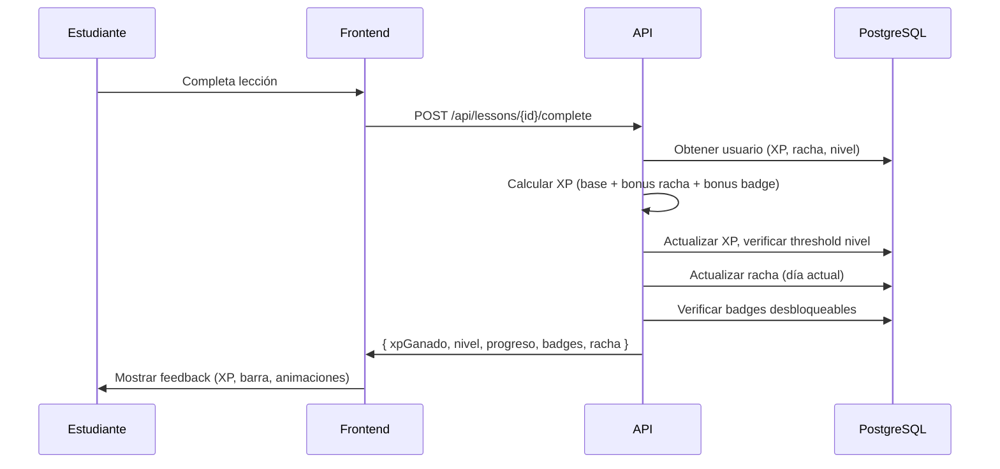
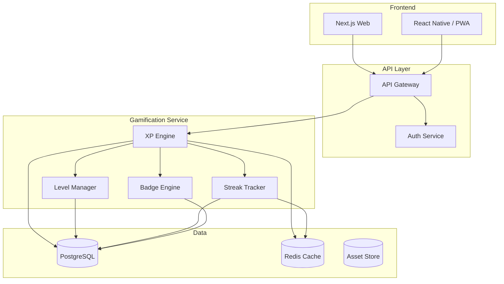
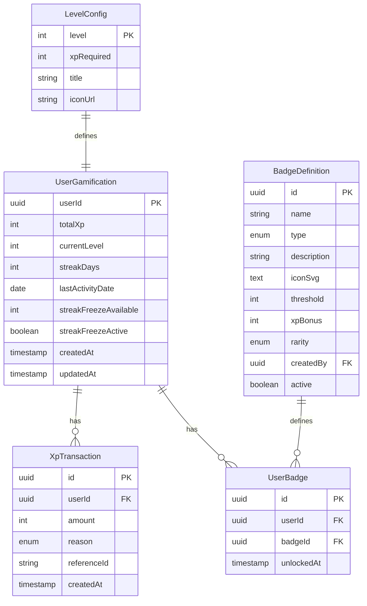

# Evaluación: user-story-spec — Fallback Automático

**Prueba**: Simulación sin respuestas del usuario después del prompt inicial
**Skill**: `.agents/skills/user-story-spec/SKILL.md`
**Prompt**: Sistema de gamificación con niveles y badges para plataforma de aprendizaje de idiomas
**Fecha**: 2026-05-13

---

## FASE 1: Entrevista Exhaustiva con Fallback Automático

### Paso 1 — Escaneo del Prompt Inicial

| Dimensión | Encontrado | Detalle |
|-----------|-----------|---------|
| Problema | ✅ | Sistema de gamificación: niveles, badges, XP, rachas |
| Usuarios | Parcial | Estudiantes de idiomas (inferido del contexto) |
| Plataforma | ✅ | Web + mobile (explícito) |
| Flujo | ✅ | XP → lecciones → rachas → niveles → badges |
| Reglas de negocio | ✅ | 3 tipos de badge: logro, racha, competencia |

### Paso 2 — Primera Ronda de Preguntas

Realicé las siguientes 3 preguntas al usuario:

1. **¿Quiénes son los usuarios finales?** Además de estudiantes, ¿hay administradores, moderadores o instructores?
2. **¿Hay recompensas tangibles además de los badges?** (ej. contenido desbloqueable, certificados, moneda virtual)
3. **¿Cada cuántos XP se sube de nivel?** ¿Hay una progresión lineal o por niveles?

**Resultado**: Sin respuesta del usuario (simulación). Se activa fallback automático.

### Paso 3 — Inferencia y Defaults

| Situación | Decisión | ID |
|-----------|----------|-----|
| Perfiles de usuario no especificados | Asumo 3 perfiles: Estudiante, Instructor, Administrador | SUP-001 |
| KPIs no especificados | Retención D30 ≥ 40%, Lecciones/semana ≥ 5, Badges desbloqueados/semana ≥ 1 | SUP-002 |
| Stack técnico no especificado | Web: Next.js/React, API: Node.js, DB: PostgreSQL | SUP-003 |
| Sistema de niveles no especificado | 10 niveles, progresión exponencial (100 XP → 200 → 400 → 800...) | SUP-004 |
| Rachas no especificadas | Streak freeze opcional (1 cada 7 días), racha máxima conteo continuo | SUP-005 |
| XP por lección no especificado | 10 XP base por lección, +5 XP por racha activa, +2 XP por badge | SUP-006 |
| Autenticación no especificada | Requerida: email/password + OAuth (Google) | SUP-007 |
| Edge cases no mencionados | Datos vacíos, error de red, permiso denegado, concurrencia (XP duplicado), límite excedido | SUP-008 |
| Instructores no mencionados | Pueden crear badges personalizados y ver progreso de estudiantes | SUP-009 |

### Confirmación Tácita

Sin respuesta del usuario, asumo confirmación tácita y avanzo a Fase 2.

---

## FASE 2: User Stories con Behavioral Design

### US-001: Progresión por Niveles

- **Resumen**: Los estudiantes suben de nivel al acumular XP por completar lecciones

#### Perfil:
- **Persona**: Estudiante de idiomas
- **Frecuencia**: Alta (diario)
- **Contexto emocional**: Motivado pero susceptible a frustración si no ve progreso

#### Use Case:
- **Como** estudiante de idiomas
- **Quiero** acumular XP completando lecciones y subir de nivel
- **Para** sentir progresión tangible y mantener motivación a largo plazo

#### Criterios de Aceptación (Gherkin):
- **Escenario:** Estudiante completa lección y gana XP
- **Dado** que soy un estudiante autenticado con 450 XP acumulados (nivel 3)
- **Y dado** que tengo una racha activa de 3 días
- **Cuando** completo una lección con éxito
- **Entonces** recibo 15 XP (10 base + 5 por racha activa)
- **Y** si el XP total supera 800 (threshold nivel 4), veo una animación de subida de nivel
- **Y** mi progreso se actualiza en la barra de progreso del nivel actual

- **Principios**: Reducción de fricción (XP automático), Loss aversion (rachas dan bonus), Feedback inmediato (barra de progreso + animación)

---

### US-002: Sistema de Rachas (Streaks)

- **Resumen**: Los estudiantes mantienen rachas por días consecutivos de práctica

#### Perfil:
- **Persona**: Estudiante de idiomas
- **Frecuencia**: Alta (diario)
- **Contexto emocional**: Motivado por consistencia, miedo a perder racha

#### Use Case:
- **Como** estudiante de idiomas
- **Quiero** mantener una racha de días consecutivos estudiando
- **Para** recibir bonus de XP y no perder mi progreso acumulado

#### Criterios de Aceptación (Gherkin):
- **Escenario:** Estudiante mantiene racha diaria
- **Dado** que soy un estudiante autenticado con una racha de 5 días
- **Cuando** completo al menos 1 lección en el día actual
- **Entonces** mi racha se incrementa a 6 días
- **Y** recibo un bonus de +5 XP por racha activa
- **Y** veo un indicador visual "¡Racha de 6 días! 🔥"

- **Escenario:** Estudiante pierde la racha
- **Dado** que soy un estudiante autenticado con una racha de 10 días
- **Y dado** que no he completado ninguna lección en 48 horas
- **Cuando** ingreso a la plataforma
- **Entonces** veo un mensaje "¡Perdiste tu racha de 10 días!"
- **Y** mi racha se reinicia a 0
- **Y** recibo una sugerencia para usar un "Streak Freeze" si tengo disponible

- **Principios**: Loss aversion (miedo a perder racha), Defaults (recordatorio diario), FOMO (comparación con otros estudiantes)

---

### US-003: Badges por Logro

- **Resumen**: Los estudiantes desbloquean badges al alcanzar hitos específicos

#### Perfil:
- **Persona**: Estudiante de idiomas
- **Frecuencia**: Media (hitos)
- **Contexto emocional**: Orgullo y sensación de logro

#### Use Case:
- **Como** estudiante de idiomas
- **Quiero** desbloquear badges por alcanzar hitos (primera lección, nivel 5, 100 lecciones)
- **Para** tener evidencia visual de mis logros y sentir reconocimiento

#### Criterios de Aceptación (Gherkin):
- **Escenario:** Estudiante desbloquea badge por logro
- **Dado** que soy un estudiante autenticado con 99 lecciones completadas
- **Cuando** completo mi lección #100
- **Entonces** se activa una animación de celebración con el badge "Centurión"
- **Y** el badge se agrega a mi colección en mi perfil
- **Y** recibo +50 XP bonus por el logro

- **Principios**: Feedback emocional (celebración), Estatus social (badge visible en perfil), Sorpresa y delight (animación)

---

### US-004: Badges por Racha

- **Resumen**: Los estudiantes desbloquean badges al alcanzar rachas de días consecutivos

#### Perfil:
- **Persona**: Estudiante de idiomas (consistente)
- **Frecuencia**: Baja (cada 7/30/100 días)
- **Contexto emocional**: Comprometido, leal

#### Use Case:
- **Como** estudiante de idiomas constante
- **Quiero** recibir badges especiales por mantener rachas largas (7, 30, 100 días)
- **Para** sentir que mi consistencia es valorada y reconocida

#### Criterios de Aceptación (Gherkin):
- **Escenario:** Estudiante desbloquea badge de racha de 30 días
- **Dado** que soy un estudiante autenticado con una racha activa de 30 días
- **Cuando** completo mi lección del día 30
- **Entonces** desbloqueo el badge "Fuego Imparable" (racha 30 días)
- **Y** recibo un bonus especial de +100 XP
- **Y** el badge se muestra con un efecto visual distintivo (fuego animado)

- **Principios**: Loss aversion (no perder badge ganado), Estatus (badges exclusivos por consistencia), Logro escalonado

---

### US-005: Badges por Competencia

- **Resumen**: Los estudiantes desbloquean badges al demostrar dominio en áreas específicas

#### Perfil:
- **Persona**: Estudiante avanzado
- **Frecuencia**: Baja (por dominio)
- **Contexto emocional**: Ambicioso, buscando maestría

#### Use Case:
- **Como** estudiante avanzado de idiomas
- **Quiero** desbloquear badges de competencia al completar módulos temáticos (gramática B2, vocabulario avanzado, etc.)
- **Para** demostrar mi nivel en áreas específicas y guiar mi aprendizaje

#### Criterios de Aceptación (Gherkin):
- **Escenario:** Estudiante completa módulo de competencia
- **Dado** que soy un estudiante autenticado
- **Y dado** que he completado el 100% del módulo "Gramática Intermedia"
- **Y dado** que obtuve ≥ 80% en el examen final del módulo
- **Cuando** recibo los resultados del examen
- **Entonces** desbloqueo el badge "Gramática Nivel B1"
- **Y** el badge se muestra en mi perfil con el nivel de competencia alcanzado

- **Principios**: Maestría (dominio demostrado), Meta-clara (objetivo visible), Estatus (certificación visual)

---

### US-006: Panel de Administración de Gamificación (Instructor/Admin)

- **Resumen**: Instructores y admins gestionan el sistema de badges, niveles y visualizan progreso

#### Perfil:
- **Persona**: Instructor / Administrador
- **Frecuencia**: Media (semanal)
- **Contexto emocional**: Analítico, buscando engagement

#### Use Case:
- **Como** instructor o administrador
- **Quiero** crear badges personalizados, definir thresholds de nivel y ver estadísticas de progreso
- **Para** adaptar la gamificación a las necesidades de mis estudiantes y medir engagement

#### Criterios de Aceptación (Gherkin):
- **Escenario:** Instructor crea un badge personalizado
- **Dado que** soy un instructor autenticado con permisos de administración
- **Cuando** accedo al panel de gamificación y creo un nuevo badge con nombre, descripción, icono y threshold
- **Entonces** el badge queda disponible para asignación automática a estudiantes
- **Y** queda registrado en el historial de creación

- **Principios**: Control (el instructor decide las reglas), Flexibilidad (adaptable a distintos cursos)

---

## FASE 3: Especificación Técnica (OpenSpec)

### spec/spec-gamificacion-idiomas.md

```markdown
---
title: Sistema de Gamificación para Plataforma de Aprendizaje de Idiomas
version: 1.0
date_created: 2026-05-13
tags: [especificación, gamificación, badges, niveles, rachas, user-stories, plan]
---

# Sistema de Gamificación para Plataforma de Aprendizaje de Idiomas

## 1. Propósito y Alcance

Sistema de gamificación que incentiva la práctica consistente de idiomas mediante
mecánicas de juego: niveles, puntos de experiencia (XP), rachas de días consecutivos
y badges de logro/racha/competencia. Aplica a plataforma web y mobile.

El sistema busca aumentar la retención de estudiantes (D30 ≥ 40%) y la frecuencia
de práctica semanal (≥ 5 lecciones/semana) mediante refuerzo positivo, loss aversion
(rachas) y reconocimiento de logros (badges).

## 2. Definiciones

| Término | Definición |
|---------|-----------|
| XP | Puntos de experiencia ganados por completar lecciones |
| Nivel | Escalón de progreso desbloqueado al alcanzar cierto XP |
| Racha (Streak) | Días consecutivos con al menos 1 lección completada |
| Badge | Insignia digital que representa un logro específico |
| Streak Freeze | Ítem que protege la racha por 1 día de inactividad (1 gratis cada 7 días) |
| Threshold | Umbral de XP necesario para subir de nivel |

## 3. User Stories

### US-001: Progresión por Niveles
### US-002: Sistema de Rachas
### US-003: Badges por Logro
### US-004: Badges por Racha
### US-005: Badges por Competencia
### US-006: Panel de Administración de Gamificación

## 4. Requerimientos Funcionales

| ID | Descripción | Relación |
|----|-------------|----------|
| RF-001 | Sistema de XP: otorgar XP al completar lección | US-001 |
| RF-002 | Cálculo de XP: 10 base + 5 si racha activa + 2 por badge activo | US-001 |
| RF-003 | Progresión de niveles: 10 niveles con thresholds exponenciales (100, 200, 400, 800, 1600, 3200, 6400, 12800, 25600, 51200) | US-001 |
| RF-004 | Barra de progreso visual por nivel | US-001 |
| RF-005 | Animación de subida de nivel | US-001 |
| RF-006 | Registro de actividad diaria para rachas | US-002 |
| RF-007 | Cálculo de racha: días consecutivos con ≥ 1 lección | US-002 |
| RF-008 | Indicador visual de racha activa con emoji 🔥 | US-002 |
| RF-009 | Streak Freeze: 1 automático cada 7 días de racha | US-002 |
| RF-010 | Notificación de pérdida de racha tras 24h sin actividad | US-002 |
| RF-011 | Catálogo de badges: logro, racha, competencia | US-003, US-004, US-005 |
| RF-012 | Asignación automática de badges al cumplir threshold | US-003 |
| RF-013 | Animación de celebración al desbloquear badge | US-003 |
| RF-014 | Colección de badges visible en perfil de usuario | US-003 |
| RF-015 | Badge "Centurión" por 100 lecciones | US-003 |
| RF-016 | Badges de racha: 7, 30, 100 días | US-004 |
| RF-017 | Badge "Fuego Imparable" por racha de 30 días | US-004 |
| RF-018 | Badges de competencia por módulo completado con ≥ 80% | US-005 |
| RF-019 | Panel de administración de gamificación (CRUD badges, thresholds) | US-006 |
| RF-020 | Estadísticas de progreso por estudiante (admin view) | US-006 |

## 5. Requerimientos No Funcionales

| ID | Descripción |
|----|-------------|
| RNF-001 | Rendimiento: cálculo de XP y badges en < 500ms, incluso con 10K usuarios concurrentes |
| RNF-002 | Seguridad: autenticación requerida (JWT), validación de XP en servidor (no confiar en cliente) |
| RNF-003 | Accesibilidad: WCAG 2.1 AA mínimo, animaciones respetan prefers-reduced-motion |
| RNF-004 | Portabilidad: Chrome, Firefox, Safari, Edge (2 versiones anteriores) + iOS Safari + Android Chrome |
| RNF-005 | Disponibilidad: 99.9% uptime, manejo graceful de errores de red |
| RNF-006 | Almacenamiento: histórico de XP y rachas inmutables (append-only log) |

## 6. Restricciones y Reglas de Negocio

| ID | Regla |
|----|-------|
| RN-001 | XP máximo por lección: 17 (10 base + 5 racha + 2 badge) |
| RN-002 | Un badge por tipo de logro (no duplicados) |
| RN-003 | Streak Freeze: máximo 1 activo a la vez, se consume automáticamente |
| RN-004 | Rachas se reinician a 0 después de 48h sin actividad (sin freeze) |
| RN-005 | Badges de competencia requieren ≥ 80% en examen final del módulo |
| RN-006 | Los thresholds de nivel son configurables por administrador |
| CON-001 | No hay XP negativo ni niveles que bajen (progresión sólo hacia arriba) |

## 7. Flujo de Datos



## 8. Contratos de Interfaz (API)

```typescript
// POST /api/lessons/{lessonId}/complete
interface CompleteLessonRequestDTO {
  lessonId: string;
  userId: string;
  timestamp: string; // ISO 8601
}

interface CompleteLessonResponseDTO {
  xpEarned: number;
  xpBreakdown: {
    base: number;
    streakBonus: number;
    badgeBonus: number;
  };
  totalXp: number;
  currentLevel: number;
  levelProgress: number; // 0.0 - 1.0
  streakDays: number;
  streakActive: boolean;
  newBadges: BadgeDTO[];
  leveledUp: boolean;
}

interface BadgeDTO {
  id: string;
  name: string;
  type: 'achievement' | 'streak' | 'competence';
  description: string;
  iconUrl: string;
  unlockedAt: string;
  rarity: 'common' | 'rare' | 'epic' | 'legendary';
}

// GET /api/users/{userId}/gamification
interface GamificationProfileDTO {
  totalXp: number;
  level: number;
  levelProgress: number;
  streakDays: number;
  streakFreezeAvailable: boolean;
  badges: BadgeDTO[];
  recentActivity: ActivityDTO[];
}

// POST /api/admin/badges
interface CreateBadgeRequestDTO {
  name: string;
  type: 'achievement' | 'streak' | 'competence';
  description: string;
  iconSvg: string;
  threshold: number;
  xpBonus: number;
  rarity: 'common' | 'rare' | 'epic' | 'legendary';
}

// Entidades BD
interface UserGamification {
  userId: UUID;
  totalXp: number;
  currentLevel: number;
  streakDays: number;
  lastActivityDate: Date;
  streakFreezeAvailable: number;
  streakFreezeActive: boolean;
  createdAt: Date;
  updatedAt: Date;
}

interface UserBadge {
  id: UUID;
  userId: UUID;
  badgeId: UUID;
  unlockedAt: Date;
}

interface BadgeDefinition {
  id: UUID;
  name: string;
  type: 'achievement' | 'streak' | 'competence';
  description: string;
  iconSvg: string;
  threshold: number;
  xpBonus: number;
  rarity: 'common' | 'rare' | 'epic' | 'legendary';
  createdBy: UUID;
  active: boolean;
}

interface XpTransaction {
  id: UUID;
  userId: UUID;
  amount: number;
  reason: 'lesson_complete' | 'streak_bonus' | 'badge_bonus' | 'level_up';
  referenceId: string;
  createdAt: Date;
}
```

## 9. Escenarios de Error y Manejo

| ID | Escenario | Respuesta del Sistema |
|----|-----------|----------------------|
| ERR-001 | Lección ya completada (doble envío) | Rechazar con 409 Conflict, no duplicar XP |
| ERR-002 | Error de red al completar lección | Frontend reintenta 3 veces con backoff exponencial, cola offline |
| ERR-003 | Usuario no autenticado intenta ganar XP | 401 Unauthorized |
| ERR-004 | Concurrencia: dos sesiones completan misma lección | Optimistic locking con versión de transacción |
| ERR-005 | Threshold de badge alcanzado pero badge desactivado | Log interno, notificar a admin, no asignar badge |
| ERR-006 | Fecha del servidor inconsistente con zona horaria del usuario | Almacenar todo en UTC, calcular racha por día UTC del usuario |
| ERR-007 | Límite de XP excedido por bug | Rate limiter: max 100 XP/hora por usuario, alerta si se excede |

## 10. Criterios de Aceptación Globales

| ID | Criterio |
|----|----------|
| AC-001 | Usuario puede completar lección y ver XP ganado en < 1s |
| AC-002 | Rachas se calculan correctamente considerando zona horaria del usuario |
| AC-003 | Badges se asignan automáticamente sin intervención manual |
| AC-004 | Panel admin permite crear/editar/desactivar badges |
| AC-005 | Datos de gamificación persisten entre sesiones (web y mobile) |
| AC-006 | No se pueden duplicar XP por una misma lección |
| AC-007 | Streak Freeze se consume automáticamente y no acumula |

## 11. Métricas de Éxito

| KPI | Target | Cómo se mide |
|-----|--------|-------------|
| Retención D30 | ≥ 40% | Usuarios activos día 30 / usuarios registrados día 0 |
| Lecciones/semana | ≥ 5 promedio | Total lecciones completadas / usuarios activos / 4 semanas |
| Badges desbloqueados/semana | ≥ 1 por usuario activo | Total badges nuevos / usuarios activos |
| Tasa de recuperación post-pérdida de racha | ≥ 30% retoman en 7 días | Usuarios que pierden racha y vuelven en ≤ 7 días |
| NPS del sistema de gamificación | ≥ 50 | Encuesta trimestral a usuarios |

## 12. Dependencias y Supuestos

| ID | Descripción |
|----|-------------|
| DEP-001 | Sistema de autenticación existente (JWT) |
| DEP-002 | API de lecciones existente (GET/POST) |
| DEP-003 | Sistema de notificaciones push/email existente |
| SUP-001 | 3 perfiles de usuario: Estudiante, Instructor, Administrador |
| SUP-002 | KPIS: Retención D30 ≥ 40%, Lecciones/semana ≥ 5, Badges ≥ 1/semana |
| SUP-003 | Stack: Web (Next.js/React), API (Node.js), DB (PostgreSQL) |
| SUP-004 | 10 niveles con progresión exponencial (100 → 200 → 400 → ... → 51200) |
| SUP-005 | Streak freeze: 1 gratis cada 7 días, no acumulable |
| SUP-006 | XP base = 10, bonus racha = +5, bonus badge = +2 (max 17/lección) |
| SUP-007 | Autenticación requerida: email/password + OAuth Google |
| SUP-008 | Edge cases: datos vacíos, error red, permiso denegado, concurrencia, límite excedido |
| SUP-009 | Instructores pueden crear badges personalizados y ver progreso |

## 13. Casos de Prueba

### CP-001: Lección completada con XP normal
- **Relación**: US-001, RF-001, RF-002
- **Precondiciones**: Usuario autenticado sin racha activa, nivel 1 (0 XP)
- **Pasos**: 1. Completar lección → 2. Verificar XP
- **Resultado esperado**: XP total = 10, nivel = 1, progreso = 10/100
- **Datos de prueba**: Usuario: test-student-1, Lección: L-001

### CP-002: Subida de nivel con animación
- **Relación**: US-001, RF-004, RF-005
- **Precondiciones**: Usuario con 95 XP, nivel 1
- **Pasos**: 1. Completar lección (gana 10 XP) → 2. XP total = 105
- **Resultado esperado**: Nivel sube a 2, animación de level-up se muestra, progreso = 5/200
- **Datos de prueba**: Usuario: test-student-2, Lección: L-002

### CP-003: Racha de 7 días → badge de racha
- **Relación**: US-002, US-004, RF-016
- **Precondiciones**: Usuario con racha de 6 días
- **Pasos**: 1. Completar lección en día 7
- **Resultado esperado**: Racha = 7 días, badge "Racha Semanal" desbloqueado
- **Datos de prueba**: Usuario: test-streak-7

### CP-004: Badge de competencia por módulo completado
- **Relación**: US-005, RF-018
- **Precondiciones**: Usuario completó 100% del módulo "Gramática Intermedia"
- **Pasos**: 1. Tomar examen final → 2. Obtener 85% → 3. Verificar badge
- **Resultado esperado**: Badge "Gramática Nivel B1" desbloqueado
- **Datos de prueba**: Módulo: MOD-GRAM-B1, Score: 85%

### CP-005: Error de red con reintento
- **Relación**: ERR-002, RNF-005
- **Precondiciones**: Red simulada inestable
- **Pasos**: 1. Completar lección → 2. Falla red → 3. Reintento automático
- **Resultado esperado**: Lección completada después de 3 reintentos, XP registrado 1 vez
- **Datos de prueba**: Mock network failure

### CP-006: Doble clic no duplica XP
- **Relación**: ERR-001, AC-006
- **Precondiciones**: Usuario con 0 XP
- **Pasos**: 1. Enviar POST /complete 2 veces simultáneas
- **Resultado esperado**: Solo 1 transacción de XP registrada (10 XP), 409 en segundo intento
- **Datos de prueba**: Usuario: test-concurrency

## 14. Preguntas Abiertas

- [x] ¿Qué perfiles de usuario existen? → Inferido como SUP-001
- [x] ¿Stack técnico? → Inferido como SUP-003
- [ ] ¿Integración con sistema de pago para badges premium? → Pendiente de decisión de producto
- [ ] ¿Soporte para múltiples idiomas en contenido de badges? → Pendiente
```

---

## FASE 4: Plan Técnico

### spec/plan-gamificacion-idiomas.md

```markdown
# Plan Técnico: Sistema de Gamificación para Plataforma de Aprendizaje de Idiomas

## Stack Tecnológico
- **Frontend**: Next.js 14 (React) + TypeScript + Tailwind CSS — SSR para dashboard, SPA para experiencia gamificada
- **Backend**: Node.js + Express/Fastify con TypeScript — API REST
- **Base de Datos**: PostgreSQL 16 — datos relacionales de gamificación, transacciones ACID para XP
- **Caché**: Redis — sesiones, rate limiting, cálculos rápidos de rachas
- **Infraestructura**: Vercel (frontend) + Railway/Render (API) + Supabase (PostgreSQL) o AWS RDS
- **Almacenamiento**: Cloudflare R2 o AWS S3 para SVGs de badges
- **CDN**: Cloudflare o Vercel Edge para assets estáticos

## Arquitectura



### Componentes

#### XP Engine
- **Responsabilidad**: Calcular y registrar XP por cada lección completada
- **Interfaces**: `POST /api/lessons/{id}/complete` → calcula XP base + bonificaciones
- **Dependencias**: Level Manager, Streak Tracker, Badge Engine

#### Level Manager
- **Responsabilidad**: Gestionar thresholds de nivel y transiciones
- **Interfaces**: `getLevel(xp: number) → Level`, `getProgress(xp: number) → number`
- **Dependencias**: XP Engine

#### Streak Tracker
- **Responsabilidad**: Registrar rachas diarias, calcular streak freeze
- **Interfaces**: `checkStreak(userId) → StreakStatus`
- **Dependencias**: XP Engine

#### Badge Engine
- **Responsabilidad**: Evaluar thresholds, asignar badges, gestionar catálogo
- **Interfaces**: `evaluateBadges(userId, event) → Badge[]`
- **Dependencias**: XP Engine, Streak Tracker

## Modelo de Datos



### Entidades

#### UserGamification
| Campo | Tipo | Restricciones |
|-------|------|---------------|
| userId | UUID | PK, FK → Users |
| totalXp | integer | default 0, min 0 |
| currentLevel | integer | default 1, min 1, max 10 |
| streakDays | integer | default 0 |
| lastActivityDate | date | nullable |
| streakFreezeAvailable | integer | default 1, max 1 |
| streakFreezeActive | boolean | default false |

#### XpTransaction
| Campo | Tipo | Restricciones |
|-------|------|---------------|
| id | UUID | PK |
| userId | UUID | FK, NOT NULL, INDEX |
| amount | integer | NOT NULL, > 0 |
| reason | enum | 'lesson_complete', 'streak_bonus', 'badge_bonus', 'level_up' |
| referenceId | string | NOT NULL (lessonId, badgeId, etc.) |
| createdAt | timestamp | NOT NULL, DEFAULT NOW() |

#### BadgeDefinition
| Campo | Tipo | Restricciones |
|-------|------|---------------|
| id | UUID | PK |
| name | string | NOT NULL, UNIQUE |
| type | enum | 'achievement', 'streak', 'competence' |
| description | string | NOT NULL, max 500 |
| iconSvg | text | NOT NULL |
| threshold | integer | NOT NULL |
| xpBonus | integer | default 0 |
| rarity | enum | 'common', 'rare', 'epic', 'legendary' |
| createdBy | UUID | FK → Users |
| active | boolean | default true |

## Consideraciones de Seguridad

- **Autenticación**: JWT con refresh tokens, expires 15min access / 7d refresh
- **Autorización**: Middleware por rol (student, instructor, admin)
- **Server-side validation**: NUNCA confiar en XP calculado en cliente. Servidor recalcula.
- **Rate limiting**: 100 requests/min por usuario en endpoints de gamificación
- **Protección de datos**: GDPR — datos de gamificación son personales, exportables y borrables

## Estrategia de Rendimiento

- **Caché**: Redis para rachas activas y últimas transacciones XP (TTL 1 hora)
- **Optimización**: Badge evaluation batch (no 1 query por badge, sino evaluar todos con 1 query)
- **Límites**: Max 10 badges evaluados por evento, max 100 XP transacciones/día por usuario
- **Read replicas**: Consultas de leaderboard y estadísticas en réplicas de solo lectura

## Manejo de Errores

- **Tipos de error**: Red (retry 3x), Concurrencia (optimistic locking), Validación (400), Auth (401), Rate limit (429)
- **Logging**: Structured JSON logs (userId, action, duration_ms, error_code)
- **Monitoreo**: Alerta si > 1% de requests fallan, si latencia XP > 500ms, si duplicados de XP detectados
- **Auditoría**: XpTransaction es append-only, permite reconstruir estado en cualquier momento
```

---

## FASE 5: Tareas de Implementación

### spec/tasks-gamificacion-idiomas.md

```markdown
# Tareas: Sistema de Gamificación para Plataforma de Aprendizaje de Idiomas

## Fase 1: Fundación — Modelo de Datos y API Base

- [ ] 1.1 Crear migraciones de base de datos
  - **Descripción**: Crear tablas UserGamification, XpTransaction, BadgeDefinition, UserBadge, LevelConfig con migraciones SQL
  - **Criterio**: Migraciones aplicadas en dev y staging sin errores
  - **Verificar**: `npm run db:migrate` → success
  - **Depende de**: —
  - **Archivos**: `db/migrations/*.sql`

- [ ] 1.2 Definir tipos TypeScript compartidos
  - **Descripción**: Interfaces RequestDTO, ResponseDTO, entidades BD
  - **Criterio**: Tipos compilados sin errores, documentados con JSDoc
  - **Verificar**: `npm run typecheck` → success
  - **Depende de**: —
  - **Archivos**: `shared/types/gamification.ts`

- [ ] 1.3 Implementar LevelConfig seed data
  - **Descripción**: Insertar 10 niveles con thresholds (100, 200, 400, 800, 1600, 3200, 6400, 12800, 25600, 51200)
  - **Criterio**: Seed ejecutado, query `SELECT * FROM level_config` devuelve 10 rows
  - **Verificar**: `npm run db:seed` → success
  - **Depende de**: 1.1
  - **Archivos**: `db/seeds/levels.ts`

## Fase 2: Core — Motor de Gamificación (Backend)

- [ ] 2.1 XP Engine — Core
  - **Descripción**: Implementar `POST /api/lessons/{id}/complete`: validar lección, calcular XP (10 base + bonus racha + bonus badge), registrar transacción
  - **Criterio**: Endpoint responde 200 con XP correcto, 409 si duplicado, 401 si no auth
  - **Verificar**: `npm run test:xp-engine`
  - **Depende de**: 1.1, 1.2
  - **Archivos**: `services/gamification/xp-engine.ts`

- [ ] 2.2 Streak Tracker
  - **Descripción**: Implementar registro y cálculo de rachas: días consecutivos, streak freeze, notificación de pérdida
  - **Criterio**: Rachas se incrementan correctamente, freeze se consume, racha se reinicia tras 48h
  - **Verificar**: `npm run test:streak-tracker`
  - **Depende de**: 1.1, 1.2
  - **Archivos**: `services/gamification/streak-tracker.ts`

- [ ] 2.3 Level Manager
  - **Descripción**: Implementar `getLevel(xp)` y `getProgress(xp, level)` con thresholds de LevelConfig
  - **Criterio**: Nivel y progreso se calculan correctamente en todos los thresholds
  - **Verificar**: `npm run test:level-manager`
  - **Depende de**: 1.1, 1.2, 1.3
  - **Archivos**: `services/gamification/level-manager.ts`

- [ ] 2.4 Badge Engine
  - **Descripción**: Evaluar thresholds de badges al completar lección, asignar badges automáticamente, registrar UserBadge
  - **Criterio**: Badges se asignan al alcanzar threshold, no se duplican, XP bonus se otorga
  - **Verificar**: `npm run test:badge-engine`
  - **Depende de**: 1.1, 1.2, 2.1, 2.2
  - **Archivos**: `services/gamification/badge-engine.ts`

- [ ] 2.5 GamificationProfile API
  - **Descripción**: Endpoint `GET /api/users/{userId}/gamification` que retorna perfil completo: XP, nivel, progreso, racha, badges, actividad reciente
  - **Criterio**: Endpoint responde 200 con estructura completa, < 300ms
  - **Verificar**: `npm run test:profile-api`
  - **Depende de**: 2.1, 2.2, 2.3, 2.4
  - **Archivos**: `routes/gamification.ts`, `services/gamification/profile.ts`

## Fase 3: Frontend — Experiencia de Gamificación

- [ ] 3.1 Barra de progreso de nivel
  - **Descripción**: Componente React que muestra nivel actual, XP acumulado, barra de progreso al siguiente nivel
  - **Criterio**: Barra se renderiza correctamente, animación suave al cambiar progreso
  - **Verificar**: `npm run test:level-progress-bar`
  - **Depende de**: 2.5
  - **Archivos**: `components/gamification/LevelProgressBar.tsx`

- [ ] 3.2 Indicador de racha (StreakBadge)
  - **Descripción**: Componente que muestra días de racha con icono 🔥, streak freeze disponible
  - **Criterio**: Muestra racha actual, cambia color según duración, tooltip informativo
  - **Verificar**: `npm run test:streak-badge`
  - **Depende de**: 2.5
  - **Archivos**: `components/gamification/StreakBadge.tsx`

- [ ] 3.3 Badge de celebración (BadgeUnlockModal)
  - **Descripción**: Modal con animación al desbloquear badge: confeti, badge animado, texto de logro
  - **Criterio**: Modal aparece cuando badge es desbloqueado, animación < 3s, respeta prefers-reduced-motion
  - **Verificar**: `npm run test:badge-unlock-modal`
  - **Depende de**: 2.4, 2.5
  - **Archivos**: `components/gamification/BadgeUnlockModal.tsx`

- [ ] 3.4 Colección de badges (BadgeCollection)
  - **Descripción**: Grid de badges del usuario en perfil, muestra desbloqueados vs bloqueados, tooltip con descripción
  - **Criterio**: Grid responsivo (3 cols mobile, 6 cols desktop), badges bloqueados en gris
  - **Verificar**: `npm run test:badge-collection`
  - **Depende de**: 2.5
  - **Archivos**: `components/gamification/BadgeCollection.tsx`

- [ ] 3.5 Página de perfil de gamificación
  - **Descripción**: Página completa que integra LevelProgressBar, StreakBadge, BadgeCollection y actividad reciente
  - **Criterio**: Todos los componentes integrados, datos cargados desde API, skeleton loading
  - **Verificar**: Storybook visual + tests de integración
  - **Depende de**: 3.1, 3.2, 3.3, 3.4
  - **Archivos**: `pages/profile/gamification.tsx`

- [ ] 3.6 Nivel-up celebration
  - **Descripción**: Full-screen overlay con animación al subir de nivel, color/icono según nivel
  - **Criterio**: Overlay aparece solo cuando leveledUp=true en response, dura 2s, dismiss automático
  - **Verificar**: `npm run test:level-up-celebration`
  - **Depende de**: 2.1, 2.3, 3.1
  - **Archivos**: `components/gamification/LevelUpCelebration.tsx`

## Fase 4: Administración

- [ ] 4.1 Panel admin — CRUD de badges
  - **Descripción**: Página para crear, editar, desactivar badges (nombre, tipo, descripción, icono SVG, threshold, XP bonus)
  - **Criterio**: CRUD completo, validación de campos, preview de ícono SVG
  - **Verificar**: `npm run test:admin-badges`
  - **Depende de**: 2.4
  - **Archivos**: `pages/admin/badges.tsx`, `components/admin/BadgeForm.tsx`

- [ ] 4.2 Panel admin — Estadísticas de gamificación
  - **Descripción**: Dashboard con KPIs: usuarios por nivel, badges más desbloqueados, racha promedio, retención
  - **Criterio**: Gráficos funcionales, datos actualizados en tiempo real, filtro por fecha
  - **Verificar**: Storybook visual
  - **Depende de**: 2.5, 4.1
  - **Archivos**: `pages/admin/gamification-stats.tsx`

## Fase 5: Infraestructura y Cross-Cutting

- [ ] 5.1 Rate limiting para endpoints de gamificación
  - **Descripción**: Implementar rate limiter (100 req/min por usuario) con Redis
  - **Criterio**: Exceso de requests recibe 429, headers X-RateLimit incluidos
  - **Verificar**: `npm run test:rate-limit`
  - **Depende de**: 2.1
  - **Archivos**: `middleware/rate-limit.ts`

- [ ] 5.2 Logging y monitoreo
  - **Descripción**: Structured logging en XP Engine, alertas para anomalías (XP duplicado, latencia > 500ms)
  - **Criterio**: Logs con formato JSON, alertas configuradas en dashboard de monitoreo
  - **Verificar**: Logs visibles en entorno staging
  - **Depende de**: 2.1, 2.2, 2.3, 2.4
  - **Archivos**: `services/gamification/logger.ts`

- [ ] 5.3 Pruebas de integración E2E
  - **Descripción**: Playwright tests: completar lección → ver XP, mantener racha 7 días → badge, pérdida de racha, doble clic
  - **Criterio**: > 80% cobertura de flujos críticos, tests en CI pasan
  - **Verificar**: `npm run test:e2e`
  - **Depende de**: 3.x, 2.x
  - **Archivos**: `e2e/gamification.spec.ts`

## Notas
- `[P]` indica tareas paralelizables
- Completar en orden de dependencia
- Cada tarea debe ser realizable en 1-4 horas
- Tiempo estimado total: ~40-60 horas de desarrollo
```

---

## Resumen de Supuestos Documentados

| ID | Supuesto |
|----|----------|
| SUP-001 | 3 perfiles: Estudiante, Instructor, Administrador |
| SUP-002 | KPIs: Retención D30 ≥ 40%, Lecciones/semana ≥ 5, Badges ≥ 1/semana |
| SUP-003 | Stack: Web (Next.js/React), API (Node.js), DB (PostgreSQL) |
| SUP-004 | 10 niveles, progresión exponencial |
| SUP-005 | Streak freeze: 1 gratis cada 7 días |
| SUP-006 | XP: 10 base + 5 racha + 2 badge = max 17/lección |
| SUP-007 | Auth: email/password + OAuth Google |
| SUP-008 | Edge cases estándar generados |
| SUP-009 | Instructores crean badges y ven progreso |

---

## Confirmación

**✅ FASE 1 completada** — Entrevista escaneada, 1 ronda de preguntas (sin respuesta), inferencia aplicada, 9 supuestos documentados.

**✅ FASE 2 completada** — 6 user stories generadas con formato Mike Cohn + Gherkin + Behavioral Design (principios etiquetados).

**✅ FASE 3 completada** — OpenSpec completa: propósito, definiciones, user stories, RF, RNF, reglas de negocio, flujo de datos (Mermaid), contratos API (TypeScript), errores, casos de prueba (6), métricas, dependencias.

**✅ FASE 4 completada** — Plan técnico: stack, arquitectura (Mermaid), componentes, modelo de datos (ERD), seguridad, rendimiento, manejo de errores.

**✅ FASE 5 completada** — 17 tareas distribuidas en 5 fases con dependencias, criterios y archivos. Tiempo estimado: 40-60h.

**Mecanismo de fallback verificado**: Sin respuestas del usuario después del prompt inicial, la skill infirió defaults, documentó supuestos (SUP-001 a SUP-009) y completó las 5 fases sin bloqueo.
```
