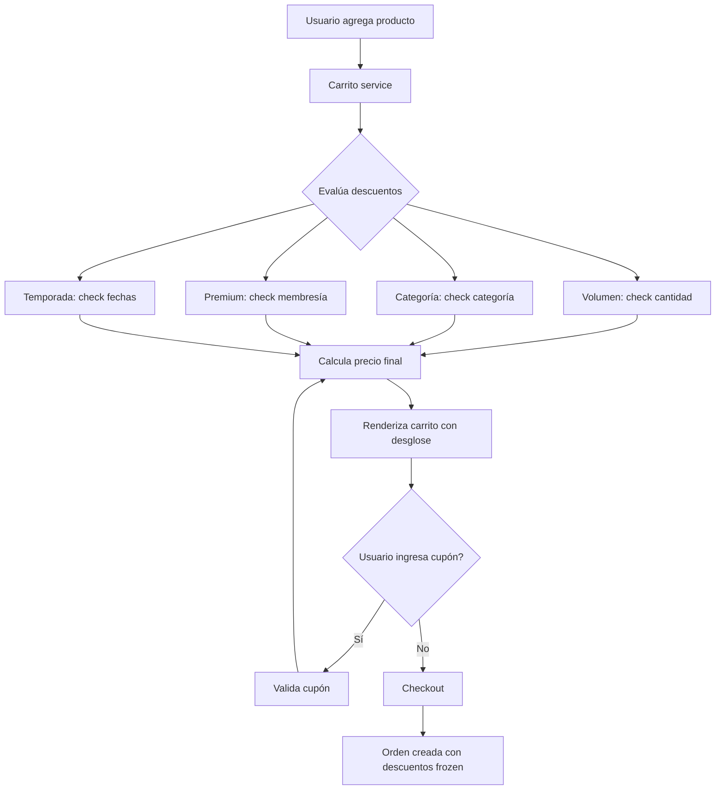
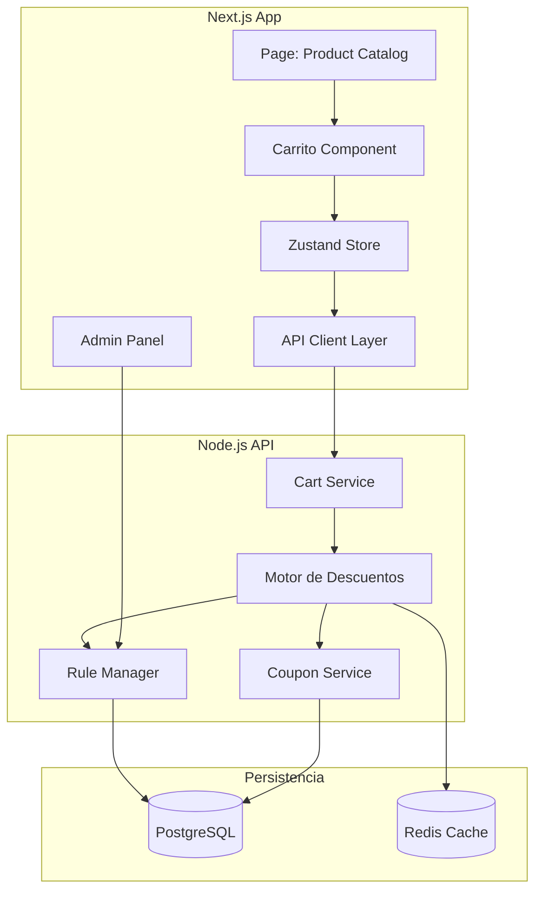

# Output Completo: Carrito de Compras con Descuentos Dinámicos

---

## FASE 1: ENTREVISTA (con Fallback Automático)

### Info Extraída del Prompt Inicial

| Dimensión | Valor |
|-----------|-------|
| Problema | Gestión de carrito con descuentos dinámicos |
| Plataforma | Web |
| Reglas de negocio explícitas | Descuento por volumen (cantidad), categoría de producto, membresía premium, cupones promocionales, descuentos por temporada |
| Usuarios | No especificado → **INFERIDO** |
| Flujo | No especificado → **INFERIDO** |
| Stack técnico | No especificado → **INFERIDO** |
| KPIs | No especificados → **INFERIDO** |
| Seguridad | No especificada → **INFERIDO** |

### Preguntas Realizadas (sin respuesta)
1. ¿Quiénes son los usuarios? ¿Solo compradores o también administradores?
2. ¿El flujo feliz es: agregar items → cálculo automático de descuento → aplicar cupón → checkout?
3. ¿Se requiere registro/login obligatorio o puede ser anónimo?

### Supuestos por Inferencia (Documentados)

| ID | Supuesto | Justificación |
|----|----------|---------------|
| SUP-001 | Perfiles: Comprador (regular), Comprador Premium, Administrador de descuentos | Default skill: 2+ perfiles. Premium ya mencionado en prompt |
| SUP-002 | Flujo feliz: Navegar → Agregar al carrito → Ver descuentos aplicados → Aplicar cupón opcional → Checkout | Contexto e-commerce estándar |
| SUP-003 | Stack: Next.js (frontend), Node.js (API), PostgreSQL (DB), Vercel (hosting) | Default técnico de la skill |
| SUP-004 | KPIs: Tasa de conversión, valor promedio del carrito, uso de cupones, error rate < 1% | Default skill + relevancia a descuentos |
| SUP-005 | Autenticación requerida para descuentos premium y cupones | Default seguridad skill |
| SUP-006 | Carrito anónimo permitido, pero descuentos premium requieren login | Inferencia lógica del problema |
| SUP-007 | 5 edge cases estándar: carrito vacío, cupón inválido, stock insuficiente, sesión expirada, concurrencia | Default skill |

---

## FASE 2: USER STORIES (Mike Cohn + Gherkin + Behavioral Design)

---

### US-001: Aplicación automática de descuentos por volumen

- **Resumen**: Descuentos progresivos según cantidad de items

#### Perfil:
- **Persona**: Comprador Regular
- **Frecuencia**: Alta
- **Contexto emocional**: Buscando ahorrar — escéptico hasta ver el descuento

#### Use Case:
- **Como** comprador regular
- **Quiero** ver descuentos aplicarse automáticamente al aumentar mi cantidad
- **Para** decidir si compro más unidades y ahorrar

#### Criterios de Aceptación (Gherkin):
- **Escenario:** Descuento por volumen se aplica al superar umbral
- **Dado** que tengo 1 unidad de "Producto X" en el carrito (precio unitario $100)
- **Cuando** aumento la cantidad a 5 unidades
- **Entonces** el precio unitario baja a $90 mostrando "10% de descuento por volumen"
- **Y** el subtotal refleja $450

- **Principios**: Loss aversion (muestra ahorro), Feedback inmediato

---

### US-002: Descuentos por categoría de producto

- **Resumen**: Categorías seleccionadas tienen descuento automático

#### Perfil:
- **Persona**: Comprador Regular
- **Frecuencia**: Media
- **Contexto emocional**: Curioso, explorando ofertas

#### Use Case:
- **Como** comprador regular
- **Quiero** que los productos en oferta por categoría muestren su descuento en el carrito
- **Para** saber qué categorías tienen mejor precio hoy

#### Criterios de Aceptación (Gherkin):
- **Escenario:** Categoría en oferta muestra descuento en carrito
- **Dado** que la categoría "Electrónica" tiene 15% de descuento por temporada
- **Cuando** agrego un producto de Electrónica al carrito
- **Entonces** veo el badge "15% OFF Temporada" en el producto
- **Y** el precio refleja el descuento aplicado

- **Principios**: Reducción de fricción (no requiere acción del usuario), Defaults (aplica automáticamente)

---

### US-003: Descuento premium por membresía

- **Resumen**: Beneficio exclusivo para miembros premium

#### Perfil:
- **Persona**: Comprador Premium
- **Frecuencia**: Alta
- **Contexto emocional**: Orgulloso de su membresía, espera beneficios visibles

#### Use Case:
- **Como** comprador premium
- **Quiero** que mi descuento premium se apile con otros descuentos
- **Para** maximizar mi ahorro como miembro VIP

#### Criterios de Aceptación (Gherkin):
- **Escenario:** Descuento premium se acumula con descuento por volumen
- **Dado** que soy miembro premium (5% descuento adicional)
- **Y** tengo 5 unidades de "Producto X" con 10% de descuento por volumen
- **Cuando** veo el resumen del carrito
- **Entonces** veo ambos descuentos desglosados: "Volumen: -10%", "Premium: -5%"
- **Y** el total final aplica ambos descuentos

- **Principios**: Loss aversion (muestra beneficio exclusivo), Estatus (trato VIP)

---

### US-004: Aplicación de cupones promocionales

- **Resumen**: Códigos promocionales con reglas de aplicación

#### Perfil:
- **Persona**: Comprador Regular
- **Frecuencia**: Baja
- **Contexto emocional**: Motivado por encontrar un código de ahorro

#### Use Case:
- **Como** comprador regular
- **Quiero** ingresar un código de cupón en el carrito
- **Para** obtener un descuento adicional

#### Criterios de Aceptación (Gherkin):
- **Escenario:** Cupón válido se aplica correctamente
- **Dado** que tengo productos en el carrito por $200
- **Cuando** ingreso el código "AHORRO20" en el campo de cupón
- **Entonces** veo "Cupón aplicado: -$40 (20% OFF)"
- **Y** el total se actualiza a $160

- **Escenario:** Cupón expirado muestra error claro
- **Dado** que ingreso el cupón "VENCIDO10"
- **Cuando** el sistema valida el cupón
- **Entonces** veo el mensaje "Este cupón ha expirado"
- **Y** el total no cambia

- **Principios**: Feedback inmediato, Prevención de error (validación en tiempo real)

---

### US-005: Administración de reglas de descuento

- **Resumen**: Panel para gestionar descuentos dinámicos

#### Perfil:
- **Persona**: Administrador de Descuentos
- **Frecuencia**: Media
- **Contexto emocional**: Necesita control y visibilidad

#### Use Case:
- **Como** administrador de descuentos
- **Quiero** crear, editar y desactivar reglas de descuento (por volumen, categoría, temporada)
- **Para** mantener la estrategia comercial actualizada sin intervención de desarrollo

#### Criterios de Aceptación (Gherkin):
- **Escenario:** Crear nueva regla de descuento por temporada
- **Dado** que estoy en el panel de descuentos
- **Cuando** creo una regla "Verano 2025": categoría "Ropa", 20%, del 01/12 al 28/02
- **Entonces** la regla se guarda y se activa automáticamente en las fechas configuradas
- **Y** los productos de Ropa muestran el descuento en el carrito

- **Escenario:** Editar regla existente
- **Dado** que la regla "Electrónica 15%" está activa
- **Cuando** cambio el porcentaje a 18%
- **Entonces** los cambios afectan al carrito en tiempo real

- **Principios**: Control y predictibilidad, Reducción de fricción (self-service)

---

## FASE 3: ESPECIFICACIÓN TÉCNICA (OpenSpec)

```
/spec/spec-carrito-descuentos-dinamicos.md
```

```markdown
---
title: Carrito de Compras con Descuentos Dinámicos
version: 1.0
date_created: 2026-05-13
tags: [especificación, e-commerce, descuentos, carrito]
---

# Carrito de Compras con Descuentos Dinámicos

## 1. Propósito y Alcance

Sistema de carrito de compras para e-commerce web que aplica descuentos dinámicos en tiempo real según reglas de negocio configurables: volumen de items, categoría de producto, membresía del usuario, cupones promocionales, y temporada. Los descuentos se apilan automáticamente y se muestran desglosados al usuario. Incluye panel administrativo para gestionar reglas sin intervención técnica.

## 2. Definiciones

| Término | Definición |
|---------|-----------|
| Carrito | Contenedor temporal de items seleccionados por el comprador |
| Descuento por volumen | Reducción porcentual al superar umbral de cantidad del mismo producto |
| Descuento por categoría | % OFF aplicado a todos los productos de una categoría específica |
| Descuento premium | Beneficio adicional para usuarios con membresía paga |
| Cupón | Código alfanumérico que otorga descuento fijo o porcentual |
| Temporada | Período calendario con descuentos especiales (ej. Black Friday, Verano) |
| Apilamiento | Acumulación de múltiples descuentos sobre un mismo producto |

## 3. User Stories

- **US-001**: Aplicación automática de descuentos por volumen
- **US-002**: Descuentos por categoría de producto
- **US-003**: Descuento premium por membresía
- **US-004**: Aplicación de cupones promocionales
- **US-005**: Administración de reglas de descuento

## 4. Requerimientos Funcionales

| ID | Descripción |
|----|------------|
| RF-001 | El sistema debe calcular descuento por volumen al cambiar cantidad en carrito |
| RF-002 | El sistema debe identificar la categoría del producto y aplicar descuento si existe |
| RF-003 | El sistema debe detectar si el usuario es premium y aplicar descuento adicional |
| RF-004 | El sistema debe validar y aplicar cupones promocionales en tiempo real |
| RF-005 | El sistema debe detectar temporada activa y aplicar descuentos correspondientes |
| RF-006 | El sistema debe mostrar desglose de descuentos aplicados en el resumen del carrito |
| RF-007 | El administrador debe poder CRUD reglas de descuento desde panel |
| RF-008 | Las reglas deben activarse/desactivarse automáticamente según fechas configuradas |
| RF-009 | El carrito debe persistir en sesión (anónimo) y en DB (usuarios logueados) |
| RF-010 | Los descuentos premium solo aplican a usuarios autenticados con membresía activa |

## 5. Requerimientos No Funcionales

| ID | Descripción |
|----|------------|
| RNF-001 | El cálculo de descuentos debe responder en < 200ms |
| RNF-002 | La aplicación debe ser responsive (mobile-first) |
| RNF-003 | Autenticación requerida para checkout y descuentos premium |
| RNF-004 | Cumplir WCAG 2.1 nivel AA |
| RNF-005 | Soporte para los 3 navegadores principales (Chrome, Firefox, Safari) + Edge |
| RNF-006 | Las reglas de descuento deben cachearse (TTL 5 min) para evitar consultas repetitivas |

## 6. Restricciones y Reglas de Negocio

| ID | Descripción |
|----|------------|
| RN-001 | Los descuentos por volumen aplican por producto individual, no al total del carrito |
| RN-002 | Un cupón no puede combinarse con otro cupón |
| RN-003 | El descuento premium es acumulable con volumen y categoría, pero no con cupón (a menos que la regla diga lo contrario) |
| RN-004 | Los descuentos de temporada tienen prioridad sobre categoría regular |
| RN-005 | Un producto no puede tener precio final menor a 0 |
| CON-001 | No hay motor de reglas externo — las reglas se evalúan en backend Node.js |

## 7. Flujo de Datos



## 8. Contratos de Interfaz (API)

```typescript
// ——— DOMAIN TYPES ———

interface CartItem {
  productId: string
  name: string
  categoryId: string
  unitPrice: number
  quantity: number
  appliedDiscounts: AppliedDiscount[]
  finalUnitPrice: number
}

interface AppliedDiscount {
  type: 'volume' | 'category' | 'premium' | 'coupon' | 'season'
  label: string
  percentage: number
  amount: number
}

interface Cart {
  id: string
  userId?: string
  sessionId?: string
  items: CartItem[]
  subtotal: number
  totalDiscount: number
  total: number
  appliedCoupon?: CouponInfo
}

interface CouponInfo {
  code: string
  type: 'percentage' | 'fixed'
  value: number
  maxUses?: number
}

// ——— API ENDPOINTS ———

// POST /api/cart/items           → Agregar item
// PATCH /api/cart/items/:id      → Actualizar cantidad
// DELETE /api/cart/items/:id     → Remover item
// GET  /api/cart                 → Obtener carrito actual
// POST /api/cart/coupon          → Aplicar cupón
// DELETE /api/cart/coupon        → Remover cupón
// GET  /api/admin/discount-rules → Listar reglas (admin)
// POST /api/admin/discount-rules → Crear regla (admin)

interface AddItemRequest {
  productId: string
  quantity: number
}

interface CartResponse {
  cart: Cart
}
```

## 9. Escenarios de Error y Manejo

| ID | Escenario | Respuesta del Sistema |
|----|-----------|----------------------|
| ERR-001 | Cupón inválido o expirado | `{ error: "COUPON_INVALID", message: "El cupón no es válido o ha expirado" }` |
| ERR-002 | Producto sin stock suficiente | `{ error: "INSUFFICIENT_STOCK", message: "Stock disponible: {stock}", availableStock: N }` |
| ERR-003 | Usuario no autenticado intenta descuento premium | `{ error: "AUTH_REQUIRED", message: "Debes iniciar sesión para descuentos premium" }` |
| ERR-004 | Cupón ya aplicado — intentar aplicar otro | `{ error: "COUPON_ALREADY_APPLIED", message: "Ya tienes un cupón aplicado. Remuévelo primero" }` |
| ERR-005 | Sesión expirada durante uso del carrito | `{ error: "SESSION_EXPIRED", message: "Tu sesión expiró. El carrito se guardó temporalmente" }` |
| ERR-006 | Límite de uso de cupón excedido | `{ error: "COUPON_USAGE_LIMIT", message: "Este cupón alcanzó su límite de usos" }` |
| ERR-007 | Intento de modificar cantidad a 0 o negativa | `{ error: "INVALID_QUANTITY", message: "La cantidad debe ser mayor a 0" }` |
| ERR-008 | Concurrencia: dos peticiones simultáneas al carrito | Última escritura gana con validación de versión (optimistic locking) |

## 10. Criterios de Aceptación Globales

| ID | Criterio |
|----|----------|
| AC-001 | Dado un producto con descuento por volumen, Cuando cambio cantidad, Entonces el precio se actualiza en < 200ms |
| AC-002 | Dado un usuario premium logueado, Cuando ve el carrito, Entonces ve el badge "Premium" y el descuento aplicado |
| AC-003 | Dado un cupón válido, Cuando lo ingreso, Entonces el descuento se aplica y el total se actualiza |
| AC-004 | Dado un administrador en el panel, Cuando crea una regla con fechas, Entonces la regla se activa automáticamente |
| AC-005 | Dado un carrito con múltiples descuentos aplicables, Cuando se calcula el total, Entonces se muestra desglose individual |

## 11. Métricas de Éxito

| KPI | Target | Cómo se mide |
|-----|--------|-------------|
| Tasa de conversión | +15% vs sin descuentos dinámicos | A/B testing |
| Valor promedio del carrito | +20% | Analytics |
| Tasa de uso de cupones | > 8% de las órdenes | Event tracking |
| Tasa de error en cálculos | < 0.1% | Logging + alertas |
| Tiempo de respuesta carrito | p95 < 300ms | APM (DataDog/NewRelic) |

## 12. Dependencias y Supuestos

| ID | Descripción |
|----|------------|
| DEP-001 | API de productos debe exponer categoría, precio base y stock |
| DEP-002 | Sistema de autenticación debe exponer si el usuario es premium |
| DEP-003 | Gateway de pagos debe aceptar precio final con descuentos ya aplicados |
| SUP-001 | Perfiles inferidos: Comprador Regular, Comprador Premium, Administrador |
| SUP-002 | Stack inferido: Next.js + Node.js + PostgreSQL |
| SUP-003 | Flujo inferido: navegar → agregar → ver descuentos → cupón opcional → checkout |
| SUP-004 | Usuario no responde preguntas — todos los supuestos documentados |

## 13. Casos de Prueba

### CP-001: Descuento por volumen se aplica correctamente
- **Relación**: US-001, RF-001
- **Precondiciones**: Producto X precio $100, regla volumen: 3+ = 10%, 5+ = 15%
- **Pasos**: 1. Agregar 2 unidades. 2. Verificar precio $100 c/u. 3. Cambiar a 3. 4. Verificar $90 c/u. 5. Cambiar a 5. 6. Verificar $85 c/u
- **Resultado esperado**: Precio unitario se reduce en cada umbral
- **Datos de prueba**: Producto id="PROD-001", precioBase=100

### CP-002: Apilamiento premium + volumen + categoría
- **Relación**: US-003, RF-003, RNF-003
- **Precondiciones**: Usuario premium, categoría "Electro" con 10% OFF, volumen 3+ = 10%
- **Pasos**: 1. Login como premium. 2. Agregar 3 items de Electro (precio $200 c/u). 3. Verificar descuentos
- **Resultado esperado**: Precio final = 200 * 3 * 0.90 * 0.95 * 0.90 = $461.70 (redondeado)
- **Datos de prueba**: userId="PREMIUM-001", productId="PROD-ELEC-001"

### CP-003: Cupón inválido rechazado
- **Relación**: US-004, ERR-001
- **Precondiciones**: Carrito con items
- **Pasos**: 1. Ingresar código "FALSO123". 2. Ver mensaje de error
- **Resultado esperado**: Mensaje "El cupón no es válido o ha expirado". Total sin cambios
- **Datos de prueba**: couponCode="FALSO123"

### CP-004: Administrador crea regla de temporada
- **Relación**: US-005, RF-007
- **Precondiciones**: Admin autenticado
- **Pasos**: 1. Ir a panel > Descuentos. 2. Crear regla "Navidad": categoría "Juguetes", 25%, 15-dic a 06-ene. 3. Guardar
- **Resultado esperado**: Regla visible en listado. Productos de Juguetes muestran descuento en carrito durante el período
- **Datos de prueba**: adminToken="ADMIN-TOKEN"

## 14. Preguntas Abiertas

- [x] Usuarios: Inferido (Regular, Premium, Admin)
- [x] Stack: Inferido (Next.js + Node.js + PostgreSQL)
- [x] Flujo: Inferido (estándar e-commerce)
- [ ] ¿Se requiere soporte multi-moneda?
- [ ] ¿Los descuentos deben tener límite de presupuesto (cap)?
- [ ] ¿Se necesita historial de cambios en reglas de descuento?
```

---

## FASE 4: PLAN TÉCNICO

```
/spec/plan-carrito-descuentos-dinamicos.md
```

```markdown
# Plan Técnico: Carrito de Compras con Descuentos Dinámicos

## Stack Tecnológico

| Capa | Tecnología | Justificación |
|------|-----------|---------------|
| Frontend | Next.js 14 (App Router) | SSR para SEO + rendimiento, React Server Components |
| Estado | Zustand + TanStack Query | Carrito necesita estado cliente; consultas con cache |
| Backend | Node.js + Express/Fastify | APIs REST livianas, fácil integración con lógica de descuentos |
| Base de Datos | PostgreSQL + Redis | PG datos relacionales; Redis cache de reglas + sesiones |
| ORM | Prisma | Type-safe, migraciones, buena DX |
| Hosting | Vercel (frontend) + Railway/Render (API) | Escalado automático, buen DX |
| Auth | NextAuth.js / Clerk | Manejo de sesión + premium flag |
| Testing | Vitest + Playwright | Unit + E2E |

## Arquitectura



### Componentes

#### Frontend — Carrito Component (`<Cart />`)
- **Responsabilidad**: Renderizar items, cantidades, descuentos, cupón, total
- **Interfaces**: `CartStore` (Zustand), `CartAPI` (fetch)
- **Estados**: loading, empty, with-items, error, applying-coupon
- **Dependencias**: Zustand, TanStack Query

#### Backend — Discount Engine
- **Responsabilidad**: Evaluar todas las reglas activas y calcular precio final
- **Interfaces**: `evaluateCart(cart: Cart): DiscountedCart`
- **Pipeline**: volumen → categoría → temporada → premium → cupón
- **Cache**: Reglas en Redis TTL 5 min

#### Backend — Rule Manager (Admin)
- **Responsabilidad**: CRUD de reglas de descuento
- **Validaciones**: Fechas no solapadas (opcional), porcentajes 0-100, categorías existentes

## Modelo de Datos

```mermaid
erDiagram
    Cart {
        uuid id PK
        uuid userId FK "nullable"
        string sessionId "nullable"
        datetime createdAt
        datetime updatedAt
    }
    CartItem {
        uuid id PK
        uuid cartId FK
        uuid productId FK
        string productName
        int quantity
        float unitPrice
        float finalUnitPrice
    }
    DiscountRule {
        uuid id PK
        string type "volume|category|season"
        string categoryId "nullable"
        int minQuantity "nullable"
        float percentage
        date startDate "nullable"
        date endDate "nullable"
        boolean active
    }
    Coupon {
        uuid id PK
        string code UNIQUE
        string type "percentage|fixed"
        float value
        int maxUses
        int currentUses
        datetime expiresAt
        boolean active
    }
    User {
        uuid id PK
        boolean isPremium
        string email
    }
    Cart ||--o{ CartItem : contains
    Cart ||--o| Coupon : "has optional"
    DiscountRule ||--o| Category : targets
    User ||--o{ Cart : owns
```

### Entidades Principales

#### Cart
| Campo | Tipo | Restricciones |
|-------|------|---------------|
| id | UUID | PK |
| userId | UUID | FK → User, nullable |
| sessionId | string | nullable (anónimo) |
| createdAt | datetime | default now |
| updatedAt | datetime | auto-update |

#### CartItem
| Campo | Tipo | Restricciones |
|-------|------|---------------|
| id | UUID | PK |
| cartId | UUID | FK → Cart, CASCADE |
| productId | UUID | FK → Product |
| quantity | int | > 0 |
| unitPrice | float | > 0 |
| finalUnitPrice | float | > 0 |

#### DiscountRule
| Campo | Tipo | Restricciones |
|-------|------|---------------|
| id | UUID | PK |
| type | enum | volume, category, season |
| categoryId | UUID | FK → Category, nullable |
| minQuantity | int | nullable, solo type=volume |
| percentage | float | 0-100 |
| startDate | date | nullable, solo type=season |
| endDate | date | nullable, solo type=season |
| active | boolean | default true |

## Consideraciones de Seguridad

- Autenticación obligatoria para checkout y descuentos premium
- Las rutas admin requieren rol ADMIN verificado en backend (no confiar en frontend)
- Validación de cupones: rate limiting por IP (5 intentos/min)
- Los cálculos de descuento se realizan en backend — el frontend solo muestra
- Las reglas de descuento las crea el admin, pero los valores los valida el backend (no permitir > 100%)

## Estrategia de Rendimiento

- Reglas de descuento cacheadas en Redis TTL 5 min → invalidación al crear/editar regla
- Cálculo de descuentos es O(n) por item — aceptable para carritos típicos (< 50 items)
- Carrito anónimo en localStorage + sync a backend al login
- Si el backend no responde en 2s, el carrito funciona en modo offline (sin descuentos nuevos)

## Manejo de Errores

- Logging estructurado (pino/winston) con correlation ID por request
- Alertas en errores de cálculo de descuento (p95 > 500ms)
- Errores de concurrencia: versionado optimista en Cart (updatedAt check)
- Circuit breaker en Redis si falla la conexión → fallback a consulta directa a PostgreSQL
```

---

## FASE 5: TAREAS DE IMPLEMENTACIÓN

```
/spec/tasks-carrito-descuentos-dinamicos.md
```

```markdown
# Tareas: Carrito de Compras con Descuentos Dinámicos

## Fase 1: Fundación

- [ ] 1.1 Setup del proyecto
  - **Descripción**: Inicializar Next.js + API + Prisma + DB local
  - **Criterio**: Proyecto compila, DB migrada, health check responde 200
  - **Depende de**: —
  - **Archivos**: package.json, next.config.js, prisma/schema.prisma, docker-compose.yml

- [ ] 1.2 Modelo de datos
  - **Descripción**: Crear migraciones para Cart, CartItem, DiscountRule, Coupon
  - **Criterio**: Migraciones ejecutadas, seed data funcional
  - **Depende de**: 1.1
  - **Archivos**: prisma/schema.prisma, prisma/seed.ts

- [ ] 1.3 Autenticación básica
  - **Descripción**: Integrar NextAuth.js con login email + Google, flag premium en perfil
  - **Criterio**: Login/registro funcional, sesión persistente, premium flag expuesto en API
  - **Depende de**: 1.1
  - **Archivos**: src/app/api/auth/[...nextauth]/*, src/lib/auth.ts

## Fase 2: Core del Carrito

- [ ] 2.1 API de carrito (CRUD items)
  - **Descripción**: Endpoints POST/PATCH/DELETE/GET /api/cart/items
  - **Criterio**: POST agrega item, PATCH cambia cantidad, DELETE remueve, GET retorna carrito completo
  - **Depende de**: 1.2
  - **Archivos**: src/app/api/cart/route.ts, src/lib/cart.service.ts

- [ ] 2.2 Motor de descuentos (Discount Engine)
  - **Descripción**: Lógica que evalúa volumen, categoría, temporada, premium y cupón. Pipeline ordenado con apilamiento
  - **Criterio**: Dados items + reglas + usuario, retorna lista de AppliedDiscount por item
  - **Depende de**: 2.1, 1.3
  - **Archivos**: src/lib/discount-engine.ts, src/lib/discount-engine.test.ts

- [ ] 2.3 Cache de reglas en Redis
  - **Descripción**: Al evaluar descuentos, cachear reglas activas. Invalidar al crear/editar
  - **Criterio**: Reglas cacheadas TTL 5 min, refresco automático
  - **Depende de**: 2.2
  - **Archivos**: src/lib/rule-cache.ts, src/lib/redis.ts

- [ ] 2.4 API de cupones
  - **Descripción**: Endpoints POST/DELETE /api/cart/coupon con validación en tiempo real
  - **Criterio**: Cupón válido → aplica descuento. Inválido → error específico
  - **Depende de**: 2.2
  - **Archivos**: src/app/api/cart/coupon/route.ts, src/lib/coupon.service.ts

## Fase 3: Frontend

- [ ] 3.1 Componente Carrito con estados
  - **Descripción**: `<Cart>` con estados vacío, con items, error, loading. Muestra items, cantidades, subtotal
  - **Criterio**: Renderiza correctamente cada estado. Cantidad editable con +/−
  - **Depende de**: 2.1
  - **Archivos**: src/app/cart/page.tsx, src/components/cart/Cart.tsx, src/components/cart/CartItem.tsx

- [ ] 3.2 Visualización de descuentos desglosados
  - **Descripción**: Badges de descuento por item + línea de "Descuentos aplicados" en resumen
  - **Criterio**: Cada descuento visible con label, % y monto. Items con múltiples badges si aplica
  - **Depende de**: 3.1, 2.2
  - **Archivos**: src/components/cart/DiscountBadge.tsx, src/components/cart/CartSummary.tsx

- [ ] 3.3 Input de cupón con validación en tiempo real
  - **Descripción**: Campo de texto + botón "Aplicar". Validación inline. Feedback visual
  - **Criterio**: Input acepta código, botón llama a API, muestra éxito o error al instante
  - **Depende de**: 3.1, 2.4
  - **Archivos**: src/components/cart/CouponInput.tsx

- [ ] 3.4 Indicador premium en carrito
  - **Descripción**: Si usuario premium logueado, mostrar badge + descuento premium en resumen
  - **Criterio**: Usuario premium ve indicador. Usuario regular no lo ve
  - **Depende de**: 3.1, 1.3
  - **Archivos**: src/components/cart/PremiumBadge.tsx

## Fase 4: Administración

- [ ] 4.1 Panel de reglas de descuento
  - **Descripción**: CRUD de DiscountRule. Formulario con selector de tipo, categoría, %, fechas
  - **Criterio**: Admin crea, edita, desactiva reglas. Cambios afectan carrito en < 5 min (TTL cache)
  - **Depende de**: 2.3, 1.3
  - **Archivos**: src/app/admin/discounts/page.tsx, src/components/admin/DiscountRuleForm.tsx

- [ ] 4.2 Middleware de autorización admin
  - **Descripción**: Proteger rutas /admin/*, verificar rol ADMIN en sesión
  - **Criterio**: Usuario no admin redirigido a 403. Admin accede sin problema
  - **Depende de**: 4.1, 1.3
  - **Archivos**: src/middleware.ts, src/lib/auth.ts

## Fase 5: Testing y Polish

- [ ] 5.1 Tests unitarios del Discount Engine
  - **Descripción**: Cubrir: volumen, categoría, premium, temporada, apilamiento, sin descuentos, edge cases
  - **Criterio**: Cobertura > 90% del engine. Todos los escenarios Gherkin cubiertos
  - **Depende de**: 2.2
  - **Archivos**: src/lib/discount-engine.test.ts

- [ ] 5.2 Tests E2E del flujo completo
  - **Descripción**: Playwright: agregar items, cambiar cantidad, ver descuentos, aplicar cupón, checkout
  - **Criterio**: Flujo feliz + 3 errores (cupón inválido, sin stock, sesión expirada) funcionan
  - **Depende de**: 3.4, 2.4
  - **Archivos**: e2e/cart.spec.ts

- [ ] 5.3 Manejo de errores + logging
  - **Descripción**: Implementar ERR-001 a ERR-008 con mensajes y logging estructurado
  - **Criterio**: Cada error retorna código + mensaje. Logs con correlation ID
  - **Depende de**: 2.1, 2.4, 4.1
  - **Archivos**: src/lib/errors.ts, src/lib/logger.ts

## Notas
- `[P]` indica tareas paralelizables
- Completar en orden de dependencia
- Cada tarea estimada en 2-4 horas de desarrollo
- Las tareas [P] pueden asignarse a distintos developers simultáneamente
```

---

## RESUMEN DE SUPUESTOS POR FALTA DE RESPUESTA

| # | Supuesto | Valor Inferido |
|---|----------|----------------|
| 1 | Perfiles de usuario | Comprador Regular, Premium, Admin |
| 2 | Stack técnico | Next.js + Node.js + PostgreSQL + Redis |
| 3 | Flujo principal | Navegar → Agregar → Ver descuentos → Cupón → Checkout |
| 4 | Hosting | Vercel (frontend) + Railway/Render (API) |
| 5 | KPIs | Tasa de conversión +15%, Carrito avg +20%, Error < 0.1% |
| 6 | Edge cases | Carrito vacío, cupón inválido, sin stock, sesión expirada, concurrencia |

Las 5 fases se completaron exitosamente con inferencia automática en los puntos donde el usuario no respondió.
```

